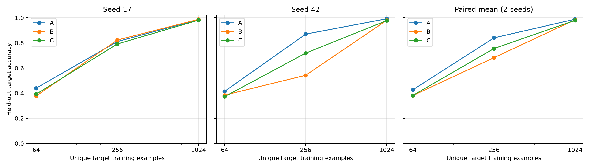

# DMLR minimal exploratory pilot (2026-10-18)

Two paired seeds (17, 42), 4 source pretraining runs, 18 target adaptations, and final testing were completed on branch `pilot/permworld-composition`. **This pilot found no stable sample-efficiency benefit and observed negative transfer at small sample sizes. Incomplete source-task learning and difficulty mismatches prevent these results from confirming or rejecting the claim that mathematical relations promote transfer.** Improving the learning conditions of this small pilot is more worthwhile than immediately expanding the task library.

## What was done

The pilot reuses PermWorld tasks, one-line encoding, the 188-token vocabulary, and a 3,240,448-parameter Transformer (width 256, 4 layers, 8 heads) from GitHub 2026TMLR and its pinned neurips upstream. The DMLR repository was initially empty with no commits; reference clones were placed in `reference/`. The original alignment project and results were not modified.

Only n=10 is used. The sole target candidate, `fixed_points(p)=#{i:p(i)=i}`, was determined before transfer: the original project's single-task development results were reliable, and this round's independent single-task development experiment reached 1024/1024. The formal protocol was frozen only after passing the predefined 90% threshold. This development pool is independent of the formal data; neither transfer performance nor the final test set was used for target selection.

A adapts from random initialization. B pretrains on `anti_fixed_points / descents / peaks / left_to_right_maxima`. C replaces only the first task with `successions`. The known relation is `fixed_points(p)=anti_fixed_points(c(p))`, where `c(p)(i)=n+1-p(i)`. Successions counts adjacent values increasing by exactly one; it is outside the registered direct relation pair and is not described as mathematically unrelated.

Each seed uses 8192 distinct pretraining permutations. The first 64/256/1024 target training permutations form strictly nested subsets; target development and test sets contain 1024 and 2048 examples. The three conditions share target data and adaptation budgets within each seed. Complete inverse/reverse/complement orbits are excluded across all pools and both seeds. The audit found 0 duplicate inputs and 0 cross-pool orbit intersections. Final testing occurred only after all training ended and did not select tasks, hyperparameters, or checkpoints. This does not claim exhaustive exclusion of every historical input from the original alignment project; no old training data or weights were loaded.

B/C each use 2400 updates, batch size 64, and exactly 1/4 sampling per task. Each adaptation uses 800 updates × 64 exposures, resets the optimizer, restores the same initial target-task-token row, and starts independently from the corresponding endpoint. AdamW uses lr3e-4, 100 warmup steps, and cosine decay, retaining dropout 0.1 and BF16. Full definitions, configuration, the frozen protocol, and reproduction commands are in the [experiment documentation](experiments/permworld_pilot/README.md).

## Observations

The following are simple averages of test accuracy over two seeds, not significance claims:

| Distinct target training examples | A: random initialization | B: includes known related task | C: replacement task |
|---:|---:|---:|---:|
| 64 | 42.72% | 38.11% | 38.23% |
| 256 | 84.01% | 68.26% | 75.51% |
| 1024 | 98.85% | 98.36% | 97.92% |

At 64 examples, B−A is −4.61 percentage points and C−A is −4.49. All three conditions have 100% training accuracy but only about 37%–44% test accuracy, showing substantial overfitting. Test baselines using the majority label of each training subset range from 35.35% to 38.38%.

At 256 examples, seed differences are large: seed17 A/B/C are 81.05%/82.28%/79.15%, and seed42 gives 86.96%/54.25%/71.88%. B−C is +3.13 and −17.63 percentage points, with inconsistent directions. Both initialization and data sampling change between seeds, so the differences cannot be attributed to initialization alone. At 1024 examples, all three conditions approach saturation with no stable advantage.

Source tasks were not fully learned, especially the replacement task:

| Seed | B anti_fixed_points train/dev | C successions train/dev | successions dev majority baseline |
|---:|---:|---:|---:|
| 17 | 79.42% / 79.20% | 45.47% / 42.48% | 41.41% |
| 42 | 79.28% / 76.76% | 47.57% / 47.75% | 41.31% |

Development accuracy on common sources ranges from 44.63%–49.80% for descents, 58.98%–65.82% for peaks, and 95.80%–97.36% for left_to_right_maxima. Thus this is not a transfer experiment conducted after all four sources were learned.

The replaced tasks have similar but imperfectly matched answer distributions: empirical total variation distances are 0.0443/0.0520 across seeds; anti_fixed_points has means 0.998/1.016 and entropies 1.876/1.903 bits, while successions has means 0.891/0.883 and entropies 1.783/1.778 bits. **The difficulty gap is much larger than the distribution gap and is a major confound.** Raw train/dev results and full histograms are retained.

## Budget, validation, and artifacts

Each B/C pretraining run processed 4,300,800 full input tokens, including answers and EOS, with 307,200 supervised tokens. Each adaptation processed 1,433,600 input tokens and 102,400 supervised tokens. Paired-budget checks passed. The 22 formal runs total 43,008,000 input tokens and 3,072,000 supervised tokens. Training loops took 499.9 seconds in total; formal-stage wall time was 523.1 seconds (about 8.7 minutes) on an RTX 5070. Independent development took another 59.7 seconds, smoke testing 25.5 seconds, and final evaluation/plotting 19.9 seconds. Environment installation and initial troubleshooting are excluded from these training times.

The smoke test exhaustively checked 5912 permutations of n=2..7 against independent definitions of six labels and their relation; causal-suffix error was 0 and save/load error was 0. The initial run failed because the upstream tokenizer did not accept NumPy integers. Converting them to Python int fixed the rerun; the failure record is retained. All formal runs completed, with no unrun units. Additional checks found a maximum FP32 difference of 1.72e-5 between SDPA and the original attention and a 7.45e-9 difference between the two-token loss and original shifted CE. The final artifact audit passed. The CKA interface extracted four-layer and final_norm features for 16 development inputs; no geometry-metric sweep was conducted.

- [seed17 raw CSV](experiments/permworld_pilot/runs/pilot_v1/results_seed17.csv), [seed42 raw CSV](experiments/permworld_pilot/runs/pilot_v1/results_seed42.csv), [means and paired differences](experiments/permworld_pilot/runs/pilot_v1/summary.csv).
- [Source learning](experiments/permworld_pilot/runs/pilot_v1/source_learning.csv), [actual budgets and timing](experiments/permworld_pilot/runs/pilot_v1/actual_budgets.csv), [final audit](experiments/permworld_pilot/runs/pilot_v1/final_audit.json).
- Data, frozen protocol, configuration, source hashes, loss/dev curves, initial/pretraining/adaptation checkpoints, and the artifact manifest are in `experiments/permworld_pilot/runs/pilot_v1/`. Checkpoints remain local and are excluded from Git; the other data and reports are tracked. Reproduction does not depend on the reference clones.

## Interpretation limits and next step

This explores one length, one target, one task replacement, and two random units. B/C control task count, token budget, and sampling, but not learning difficulty or final source capability. The identity requires complementing the input and does not guarantee automatic reuse by the network. Under the fixed adaptation budget, 64/256/1024 examples are repeated for roughly 800/200/50 epochs, with clear optimization overfitting at low sample sizes. Negative transfer must not be generalized into a rejection of the data-centric direction, and B/C differences must not be attributed to the mathematical relation alone.

**The first priority is to check whether the phenomenon persists after the source tasks are learned.** Keep this target and four sources fixed, and use independent source-development data to set a more adequate, equal B/C pretraining budget. If successions remains substantially harder, select a more comparable replacement through single-task development checks with target transfer results hidden. Meanwhile, examine learning-rate/budget sensitivity for 64-example adaptation only on an independent development pool. Seal this test set; subsequent protocols must use a newly isolated test pool. Do not yet expand the task library or run multi-metric sweeps.
