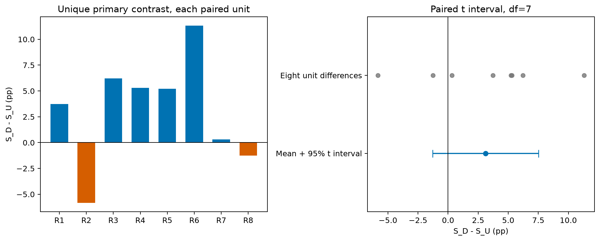
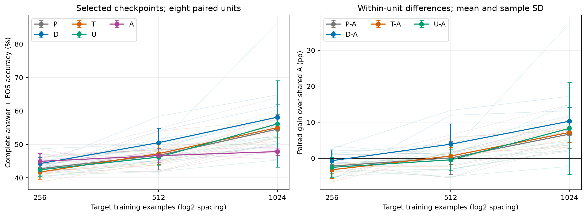
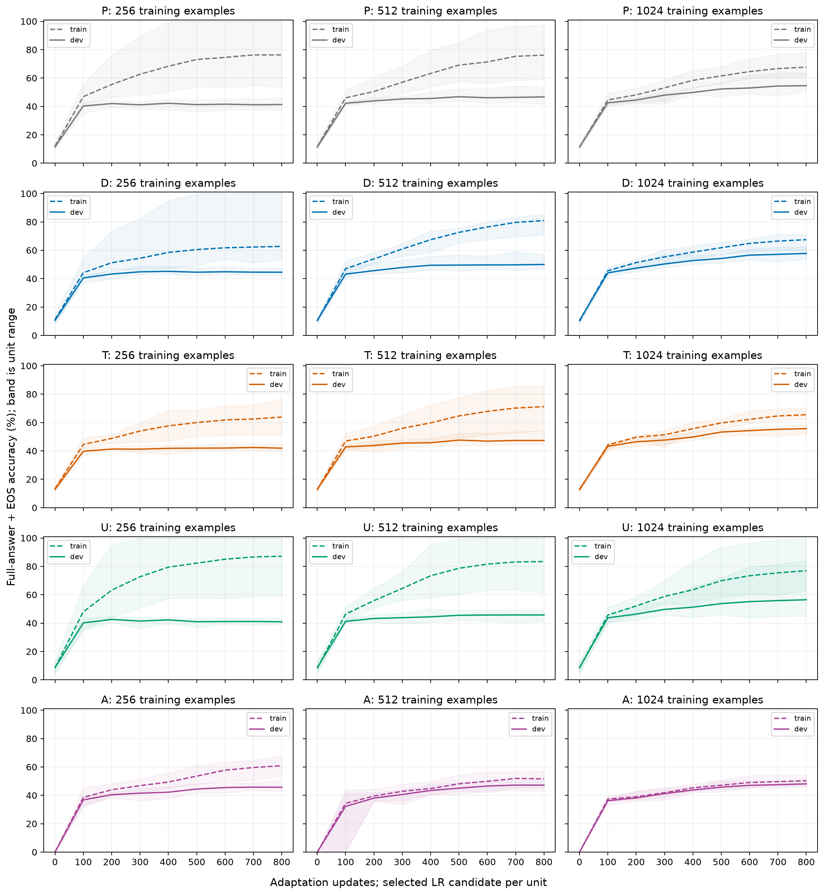
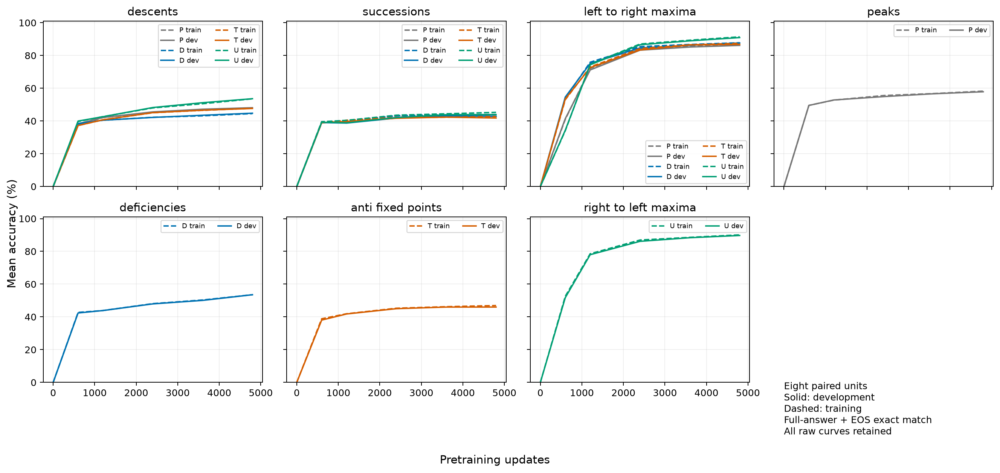
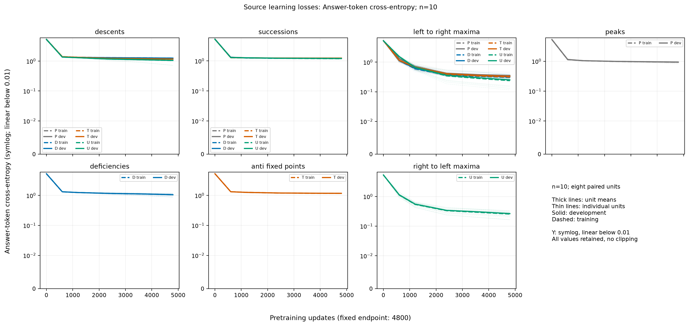
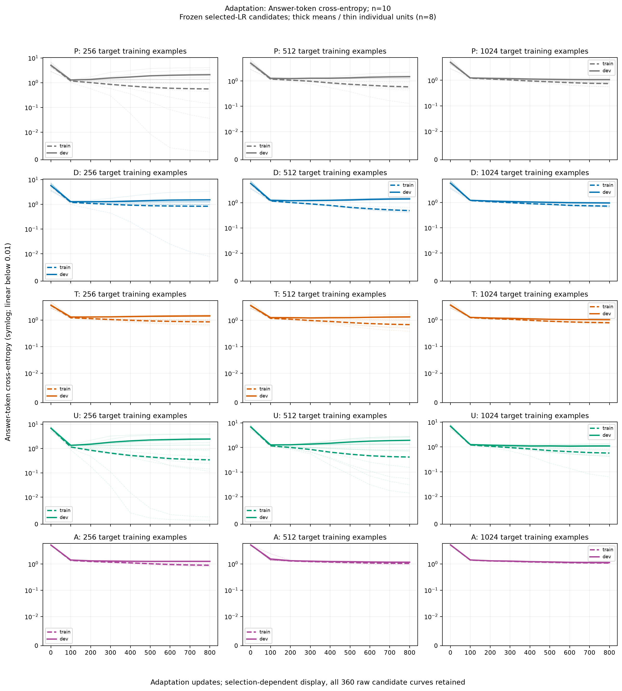

# Fixed-points source-replacement model replication: completed results

The fixed scope is complete: 32 source models, 360 adaptation learning-rate candidates,
120 development-selected results, 240 selected/endpoint evaluations and 491,520
stored prediction records. The records reuse eight test pools containing 16,384
distinct inputs; shared checkpoints and conditions do not create more independent units.
All training and prediction/statistics audits passed.

This study uses **4-layer width-256 GRU**, eight fresh paired units and n=10. It
replicates the original source-replacement design under the prespecified model
selection rule. Its results are reported separately and **never pooled with the
original eight-unit confirmation**. Earlier v5 failed confirmation and task-count
negative outcomes are unchanged.

## Sole primary comparison

S = .25*A256 + .5*A512 + .25*A1024 is the normalized trapezoid area over log2
target training size, using complete generated answer-plus-EOS exact match.
The sole primary paired contrast is **S_D-S_U = +3.1235 pp**, sample SD
5.2604, range [-5.8472, +11.3159], paired 95% t
interval **[-1.2743, +7.5213] pp**, df=7. There are
6 positive, 0 zero and
2 negative unit differences.

The primary interval includes zero. Evidence for additional transfer value of deficiencies over U remains uncertain; this does not prove absence of benefit.

| Unit | S_P (%) | S_D (%) | S_T (%) | S_U (%) | S_A (%) | Primary D-U (pp) |
| --- | --- | --- | --- | --- | --- | --- |
| R1 | 54.8096 | 50.0244 | 51.4160 | 46.3013 | 48.1812 | +3.7231 |
| R2 | 48.6816 | 51.8066 | 49.2432 | 57.6538 | 48.0347 | -5.8472 |
| R3 | 48.7549 | 53.0762 | 46.6431 | 46.8628 | 45.3003 | +6.2134 |
| R4 | 48.3643 | 50.3174 | 47.9614 | 45.0195 | 46.8018 | +5.2979 |
| R5 | 44.5435 | 47.6685 | 45.7275 | 42.4438 | 46.3989 | +5.2246 |
| R6 | 47.5708 | 56.3965 | 46.8140 | 45.0806 | 44.7876 | +11.3159 |
| R7 | 44.3848 | 51.0620 | 47.3877 | 50.7446 | 45.7520 | +0.3174 |
| R8 | 44.2993 | 46.4722 | 47.2412 | 47.7295 | 46.8262 | -1.2573 |



The interval uses eight within-unit differences. Approximate normality and
independence are assumptions with limited diagnostics, not guarantees. Global
orbit rejection conditions later pools on earlier pools in a finite permutation
space. Learning rates, training sizes, test examples and shared A baselines do
not increase the repeat count. An interval containing zero is uncertainty, not
proof of no effect.

## Scratch-relative context and secondary results

The D-U contrast compares two source replacements, not a gain over scratch.
The scratch-relative results are **P-A +1.1658 pp (SD 3.1007); D-A +4.3427 pp (SD 3.8597); T-A +1.2939 pp (SD 1.1391); U-A +1.2192 pp (SD 4.3303)**. The identity
D-U=(D-A)-(U-A) is a descriptive decomposition; it does not establish a mechanism.
All prescribed contrasts remain visible regardless of direction.

| Area contrast | Role | Mean (pp) | Sample SD | Unit range (pp) | Positive / zero / negative |
| --- | --- | --- | --- | --- | --- |
| D_minus_U | primary | +3.1235 | 5.2604 | [-5.8472, +11.3159] | 6 / 0 / 2 |
| D_minus_P | secondary_or_diagnostic | +3.1769 | 3.9888 | [-4.7852, +8.8257] | 7 / 0 / 1 |
| U_minus_P | secondary_or_diagnostic | +0.0534 | 5.7378 | [-8.5083, +8.9722] | 3 / 0 / 5 |
| D_minus_T | secondary_or_diagnostic | +3.0487 | 3.6010 | [-1.3916, +9.5825] | 6 / 0 / 2 |
| P_minus_A | secondary_or_diagnostic | +1.1658 | 3.1007 | [-2.5269, +6.6284] | 5 / 0 / 3 |
| D_minus_A | secondary_or_diagnostic | +4.3427 | 3.8597 | [-0.3540, +11.6089] | 7 / 0 / 1 |
| T_minus_A | secondary_or_diagnostic | +1.2939 | 1.1391 | [-0.6714, +3.2349] | 7 / 0 / 1 |
| U_minus_A | secondary_or_diagnostic | +1.2192 | 4.3303 | [-3.9551, +9.6191] | 5 / 0 / 3 |

Secondary comparisons cannot replace the primary contrast. All ten pairwise
contrasts at each target size, both checkpoint kinds and the separate legacy
answer-token bridge remain in `artifacts/analysis/paired_differences.csv` and
`paired_summary.csv`.

| Route | Train examples | Selected accuracy (%) | Sample SD | Endpoint accuracy (%) | Selected answer CE | Train-derived majority (%) |
| --- | --- | --- | --- | --- | --- | --- |
| P | 256 | 42.74 | 1.60 | 41.21 | 1.4384 | 36.66 |
| P | 512 | 46.71 | 4.31 | 46.72 | 1.3125 | 36.85 |
| P | 1024 | 54.54 | 4.41 | 54.50 | 1.0462 | 37.08 |
| D | 256 | 44.25 | 1.95 | 44.28 | 1.3427 | 36.66 |
| D | 512 | 50.52 | 4.25 | 50.68 | 1.3079 | 36.85 |
| D | 1024 | 58.12 | 3.76 | 58.17 | 0.9560 | 37.08 |
| T | 256 | 41.72 | 2.12 | 41.29 | 1.3438 | 36.66 |
| T | 512 | 47.24 | 3.23 | 47.11 | 1.2458 | 36.85 |
| T | 1024 | 55.01 | 2.82 | 55.10 | 1.0206 | 37.08 |
| U | 256 | 42.41 | 2.01 | 41.69 | 1.6778 | 36.66 |
| U | 512 | 46.19 | 2.56 | 45.74 | 1.7247 | 36.85 |
| U | 1024 | 56.14 | 12.90 | 55.92 | 1.0637 | 37.08 |
| A | 256 | 44.93 | 2.40 | 45.56 | 1.2563 | 36.66 |
| A | 512 | 46.63 | 2.09 | 46.72 | 1.1650 | 36.85 |
| A | 1024 | 47.85 | 1.10 | 47.99 | 1.1353 | 37.08 |

The endpoint is update 800 of the development-selected learning-rate candidate,
not a test-selected alternative. Answer CE is teacher-forced answer-token loss;
EOS and mean two-token losses are separately retained. Majority labels are
determined from each corresponding training subset. All target sizes also use
1024 labeled development examples per unit; the smallest condition therefore
does not use only 256 target labels overall.




## Architecture gate, protocol and isolation

Both prespecified GRU gate tasks passed the endpoint development threshold; the formal model is the four-layer GRU. The gate uses a separate, historically isolated n=10
training/development pool, discarded weights and no test set. Its criterion,
endpoint results and selected model are recorded in `artifacts/GATE_RESULT.json`.
There is no architecture tuning or outcome-dependent addition of units.

| Gate task | Endpoint train accuracy (%) | Endpoint dev accuracy (%) | Threshold passed | Elapsed seconds |
| --- | --- | --- | --- | --- |
| fixed_points | 99.90 | 100.00 | True | 55.13 |
| deficiencies | 99.94 | 100.00 | True | 54.66 |

Common source slots are descents, successions and left_to_right_maxima; the
fourth is P=peaks, D=deficiencies, T=anti_fixed_points or U=right_to_left_maxima.
A is the shared random-initialization baseline. Task sets and slot order match
the original eight-unit study. The model change and fresh paired units do not
change one-line encoding, vocabulary 188, loss, optimizer or schedules.

Each source model receives 4800 updates at batch 64, exactly 16 examples per
source per update. The inherited source learning rate decays through update
2400 and remains at its minimum through update 4800. Only the fixed source
endpoint supplies adaptation weights. Each route/size/LR starts independently,
loads all source parameters, restores the fixed_points tied token row to the
same unit's step-0 value, and uses a fresh optimizer. Full-parameter adaptation
uses 800 updates and the same three predetermined learning rates. Development
selection is highest full-answer accuracy, lowest answer CE, earliest positive
step, then declared learning-rate order.

Each unit has 8192 source-training, 1024 source-development, 1024 maximum
target-training, 1024 target-development and 2048 test inputs. Target subsets
256/512/1024 are nested. Complete inverse/reverse/complement orbits separate
roles, units, gate data and historical inputs. All 120 development choices
precede new-test generation. No result changes the task list, seeds, budgets,
learning-rate candidates or model selection rule.

## Source learning and comparator limitations

The following are fixed source endpoints at update 4800 across the eight new
units. Candidate accuracies concern different labels and distributions and do
not constitute matched-difficulty controls.

| Condition | Candidate | Train accuracy (%) | Dev accuracy (%) | Dev sample SD | Dev answer CE | Dev majority (%) |
| --- | --- | --- | --- | --- | --- | --- |
| P | peaks | 58.24 | 57.85 | 3.51 | 0.9309 | 50.65 |
| D | deficiencies | 53.55 | 53.53 | 6.19 | 1.0548 | 36.25 |
| T | anti_fixed_points | 46.92 | 46.01 | 2.40 | 1.1720 | 36.01 |
| U | right_to_left_maxima | 90.09 | 89.71 | 2.66 | 0.2635 | 32.64 |

| Common task | Condition | Train accuracy (%) | Dev accuracy (%) | Dev majority (%) | Dev answer CE |
| --- | --- | --- | --- | --- | --- |
| descents | P | 47.79 | 48.11 | 36.73 | 1.1659 |
| descents | D | 44.52 | 44.76 | 36.73 | 1.2559 |
| descents | T | 47.78 | 47.66 | 36.73 | 1.1739 |
| descents | U | 53.55 | 53.61 | 36.73 | 1.0520 |
| successions | P | 43.97 | 42.91 | 40.27 | 1.2219 |
| successions | D | 43.86 | 42.87 | 40.27 | 1.2237 |
| successions | T | 42.68 | 41.83 | 40.27 | 1.2378 |
| successions | U | 45.27 | 43.92 | 40.27 | 1.2044 |
| left_to_right_maxima | P | 87.04 | 86.17 | 32.24 | 0.3548 |
| left_to_right_maxima | D | 87.79 | 87.66 | 32.24 | 0.3156 |
| left_to_right_maxima | T | 87.39 | 86.80 | 32.24 | 0.3327 |
| left_to_right_maxima | U | 91.38 | 90.93 | 32.24 | 0.2513 |

Full source training/development accuracy, losses and majority baselines remain
in `artifacts/source_curves.csv`. Weak fitting and negative transfer are retained;
source performance never filters a unit. Differences in common-source learning
are descriptive associations, not causal mediation evidence.





FP+E+D=n and E(p)=D(inverse(p)) are proved identities, but D(p) alone is
insufficient to reconstruct FP. Deficiencies require two registered queries;
anti-fixed points connect through complement/reversal and can also use positional
comparison. U has a reversal relation to the common prefix-maxima source; it is
not an unrelated control. Original definition/relationship certificates are
reused by hash. No explicit paired-transform queries, formula supervision or
local labels are added to training. A positive transfer result cannot establish
internal formula use or a transferable lemma module. D/U remain unmatched in
task difficulty, answer distribution and redundancy. Replacing peaks does not
separate the absolute effects of adding a task and removing another.

## Actual budgets, elapsed time and engineering work

| Stage | Runs | Updates | Sample exposures | Prompt tokens | Sequence tokens | Supervised tokens | Sum of run elapsed seconds |
| --- | --- | --- | --- | --- | --- | --- | --- |
| pretrain | 32 | 153600 | 9830400 | 255590400 | 275251200 | 19660800 | 3762.92 |
| adapt | 360 | 288000 | 18432000 | 479232000 | 516096000 | 36864000 | 6170.06 |

| Stage | Worker units | Start UTC | Finish UTC | Recorded seconds |
| --- | --- | --- | --- | --- |
| SOURCE | R1, R3, R5, R7 | 2026-11-16T21:31:45.446856+00:00 | 2026-11-16T22:04:06.205763+00:00 | 1940.76 |
| SOURCE | R2, R4, R6, R8 | 2026-11-16T21:31:45.446917+00:00 | 2026-11-16T22:04:06.205802+00:00 | 1940.76 |
| ADAPT | R1, R3, R5, R7 | 2026-11-16T22:04:34.257484+00:00 | 2026-11-16T23:10:14.280180+00:00 | 3940.02 |
| ADAPT | R2, R4, R6, R8 | 2026-11-16T22:04:34.257437+00:00 | 2026-11-16T23:10:01.944756+00:00 | 3927.69 |

Run elapsed sums include internal evaluation and writes. Concurrent intervals
overlap; these sums are neither wall time nor dedicated GPU-hours. Worker start
and finish records provide the execution envelopes. Final test timings are in
`artifacts/results_test.csv`. Per-source exposure records include actual unique
input counts; repeated exposure and shared pools do not create new independent
data. Gate and smoke compute are separate engineering/development costs, not
new confirmation repeats; their exact records remain in the gate artifacts and
`artifacts/SMOKE.json`.

## Acceptance and reproduction

`FINAL_TRAINING_AUDIT.json` independently replays sampling, exposures, loading,
target-row restoration and development choices. `analysis/INDEPENDENT_RECOMPUTE.json`
recounts all prediction records, labels, paired scores and the primary interval
without model execution. No original experiment or publication record is changed.

The runner commands are documented in `EXECUTION_LOG.md`; after formal workers finish:

```powershell
.venv/Scripts/python.exe -B experiments/fixed_points_deficiencies_arch_v1/post_training.py
```

This completion report uses audited stored records only. The experiment stops
at the prescribed scope, with no additional target, background, architecture,
budget or repeat triggered by its results. Checkpoints remain local.
