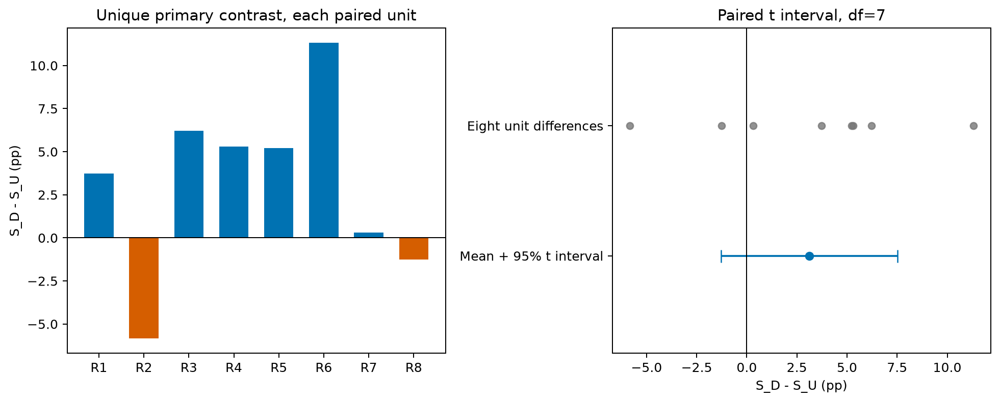
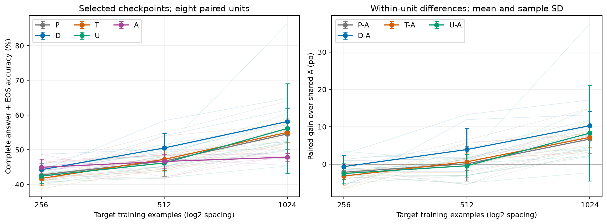

# Fixed-points source-replacement model replication

Status: all 32 pretraining models, 360 learning-rate candidates and 120 selected
adaptations are represented by complete test records. Selected and fixed-endpoint
results remain separate. This is the prespecified model-change replication of
the original fixed-points source-replacement confirmation, using 4-layer width-256 GRU.
These eight new units are reported separately and never pooled with the original
eight units. Historical failed confirmation and negative transfer are retained.

## Primary result

The prespecified score is S = 0.25 A256 + 0.5 A512 + 0.25 A1024, using complete
generated answer plus EOS exact match. The sole primary comparison S_D-S_U is
**+3.1235 percentage points**, sample SD 5.2604,
range [-5.8472, +11.3159], with a paired 95% t interval
**[-1.2743, +7.5213]**, df=7. 6 of eight differences
are positive, 2 negative and 0 zero.

The primary interval includes zero. Evidence for additional transfer value of deficiencies over U remains uncertain; this is not proof of no benefit.



## All prespecified area contrasts

All differences are computed within unit before aggregation. Secondary contrasts
are descriptive and cannot replace the primary contrast.

| Contrast | Mean (pp) | Sample SD | Unit range (pp) | Positive units |
| --- | ---: | ---: | --- | ---: |
| D_minus_U | +3.1235 | 5.2604 | [-5.8472, +11.3159] | 6/8 |
| D_minus_P | +3.1769 | 3.9888 | [-4.7852, +8.8257] | 7/8 |
| U_minus_P | +0.0534 | 5.7378 | [-8.5083, +8.9722] | 3/8 |
| D_minus_T | +3.0487 | 3.6010 | [-1.3916, +9.5825] | 6/8 |
| P_minus_A | +1.1658 | 3.1007 | [-2.5269, +6.6284] | 5/8 |
| D_minus_A | +4.3427 | 3.8597 | [-0.3540, +11.6089] | 7/8 |
| T_minus_A | +1.2939 | 1.1391 | [-0.6714, +3.2349] | 7/8 |
| U_minus_A | +1.2192 | 4.3303 | [-3.9551, +9.6191] | 5/8 |

The per-size table contains all ten pairwise differences at each of the three
sample sizes. It retains every unit and both selected/endpoint diagnostics;
`metric=legacy_answer_token` is an explicitly separate evaluation bridge.
It is not pooled with the complete-answer metric.



## Protocol and supervision

Common sources are descents, successions and left_to_right_maxima; the fourth
slot is P=peaks, D=deficiencies, T=anti_fixed_points or U=right_to_left_maxima.
A is one shared scratch adaptation per unit/sample-size/LR candidate. The task
sets and common-first slot order match the original eight-unit experiment.
Historically P/D correspond to the old v5 C task sets, and T was a new
composition rather than a direct replay of an old B group.

The tokenizer/input/loss/optimizer and schedules inherit the original confirmation:
one-line n=10, vocabulary 188, 4-layer width-256 GRU,
4800 pretraining updates, batch 64 with 16 samples per task. Each adaptation
starts independently from the source endpoint or paired step-0 state, resets
the fixed_points tied token row to its step-0 value, and uses a fresh optimizer.
All parameters adapt for 800 updates at each of three fixed learning rates.
Development selection uses full-answer accuracy, answer CE, earliest positive
step, then fixed LR order. This full-answer selection/evaluation differs from
the legacy v5 answer-token metric and is disclosed rather than merged.

Training subsets are nested 256/512/1024. **Each unit additionally uses 1024
labeled target development examples** for selection. A 256-example adaptation
is therefore not a procedure with only 256 target labels in total. All 120
selections freeze before independent new tests are generated. No test-driven
task, checkpoint, LR, sample-size or budget choice occurs.

| Target training examples | Training-derived majority test accuracy (%) | SD across units |
| --- | ---: | ---: |
| 256 | 36.6638 | 1.3777 |
| 512 | 36.8469 | 1.5970 |
| 1024 | 37.0850 | 1.5773 |

## Source learning and accounting

All source training/development curves, full-answer accuracy, loss and
training-derived majority baselines are retained. `source_endpoint_summary.csv`
separates common-source performance by composition and split; the original
per-unit records remain in `../source_curves.csv`. Training/exposure records
report actual tokens, supervised tokens, samples, unique inputs, updates and
runtime in `../exposures.csv` and `../accounting.csv`. Equal update counts alone
are not asserted to match all resources. Engineering checks/retries are
separate from the eight scientific units.

| Stage | Runs | Updates | Samples | Sequence tokens | Supervised tokens | Runtime (hours) |
| --- | ---: | ---: | ---: | ---: | ---: | ---: |
| pretrain | 32 | 153600 | 9830400 | 275251200 | 19660800 | 1.0453 |
| adapt | 360 | 288000 | 18432000 | 516096000 | 36864000 | 1.7139 |

Runtime is the sum of recorded scientific training-run elapsed intervals, not
total elapsed wall time or dedicated GPU-hours. Each run includes its internal
train/development evaluations and writes; concurrent runs overlap. Final tests,
data checks and engineering checks have separate records. Unique inputs are per run; summing reused
inputs across conditions would not measure independent data.

## Interpretation limits

The paired t interval assumes approximately independent normal unit differences;
eight units provide limited diagnostics. Global inverse/reverse/complement orbit
rejection draws from a finite universe and introduces dependence, despite new
RNG streams. The interval has assumption-sensitive coverage, and eight units
are a fixed compute budget rather than a power guarantee. Conditions, samples,
models reused across sample sizes and shared baselines do not enlarge n.

FP+E+D=n and E(p)=D(inverse(p)) are mathematical identities. D(p) alone is not
enough for that reconstruction. Anti-fixed points are connected through
complement/reversal and can also use positional comparison. U is related to
the common left-to-right-record task by reversal; it is not mathematically
unrelated, nor matched to D in difficulty, distribution or redundancy.
Training supplies no paired-transform queries, formula supervision or local
position labels. Positive transfer cannot prove formula use or an independently
transplantable lemma module. Source-learning correlations are descriptive,
not mediator-causal evidence.

If D and U both improve over P without D exceeding U, improvement over the old
background is not specific evidence for deficiencies. D-versus-T concerns
these two sources only, not a general hierarchy of shared computation and
transformation relations. U does not fully separate adding a task from removing
peaks. No outcomes trigger another target, architecture, budget or background.

## Artifacts and reproduction

See `scores_per_repeat.csv`, `paired_differences.csv`, `paired_summary.csv`,
`condition_summary.csv`, `primary_summary.json`, `../results_test.csv`, and
`../predictions/`. Independent raw-prediction recounting is implemented in
`../../independent_recompute.py`, separately from the analysis calculations.

```powershell
.venv/Scripts/python.exe experiments/fixed_points_deficiencies_arch_v1/analysis.py --artifacts experiments/fixed_points_deficiencies_arch_v1/artifacts
.venv/Scripts/python.exe experiments/fixed_points_deficiencies_arch_v1/independent_recompute.py --artifacts experiments/fixed_points_deficiencies_arch_v1/artifacts
```

No upload, publication or additional experiment is performed by analysis.
