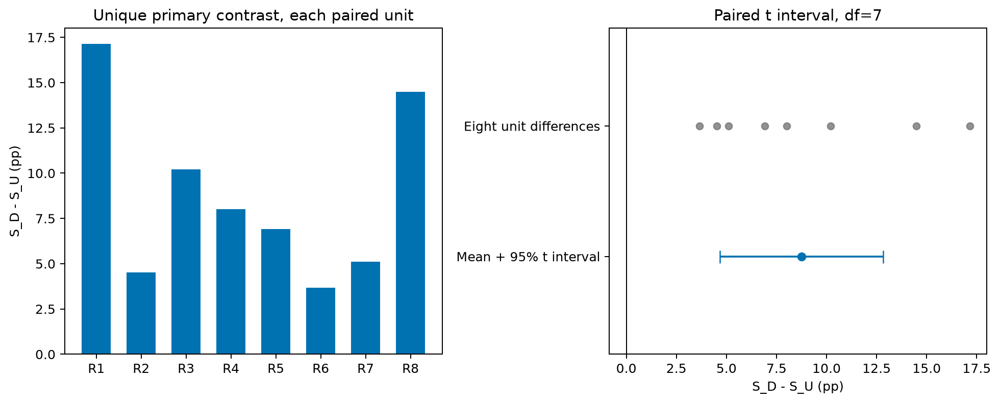
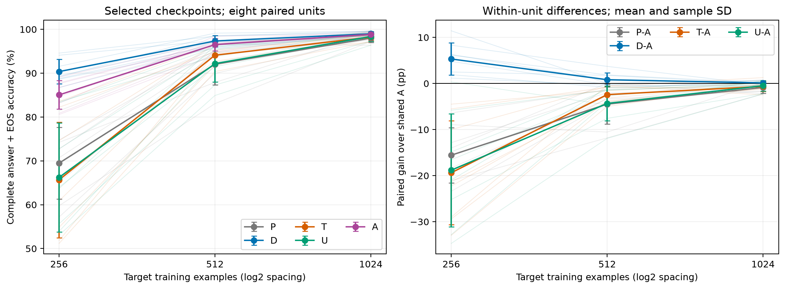
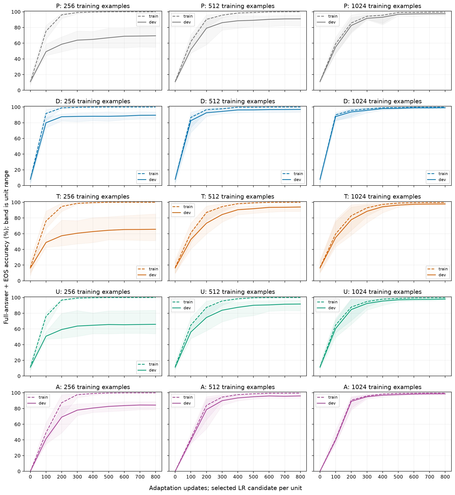
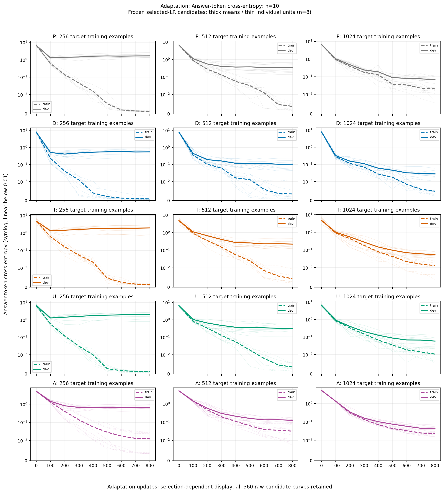
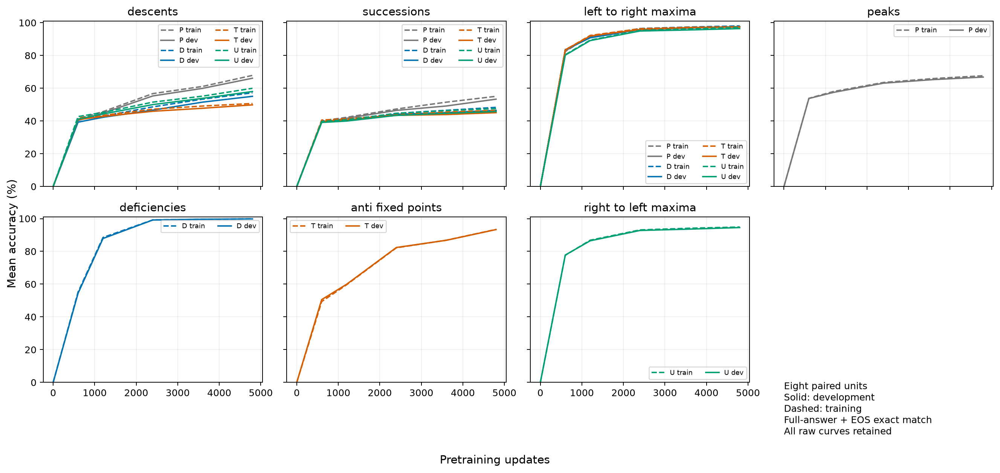
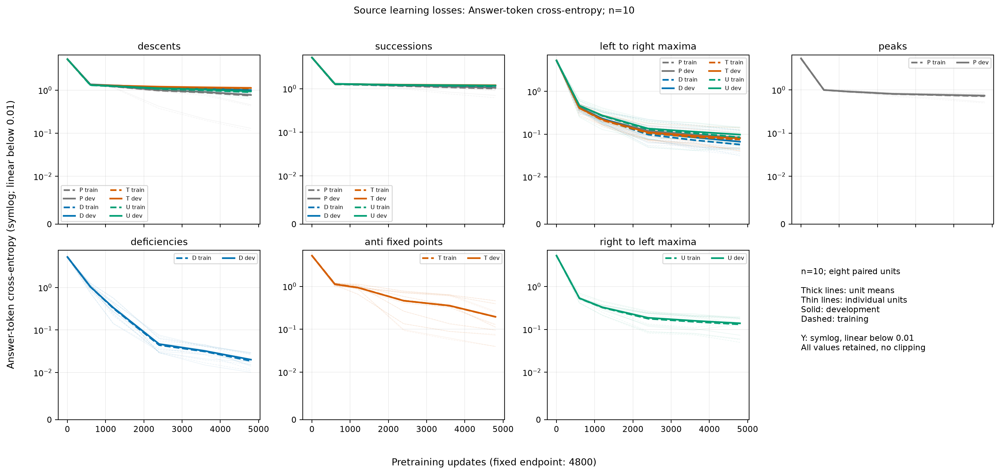

# Fixed-points deficiencies confirmation: completed results

All eight new paired units completed the fixed scope: **32 source models,
360 adaptation learning-rate candidates, 120 development-selected results,
240 selected/endpoint evaluations and 491,520 stored per-example predictions**.
The last count reuses eight test pools across conditions and checkpoints; there
are 16,384 distinct test inputs, not 491,520 independent test examples. The final
training audit and independent prediction/statistics reconstruction passed.
This is an independent case within the DMLR relationship-annotated platform and
composition/budget program; no historical conclusion is replaced.

## Sole primary comparison

The score is `S = .25*A256 + .5*A512 + .25*A1024`, the normalized trapezoid area
over log2 target training size, using complete generated answer plus EOS exact
match. Within each unit, D is compared with U before summarization.

**S_D-S_U = +8.7601 pp**, sample SD 4.8776 pp,
range [+3.6621, +17.1509] pp. The paired 95% t
interval is **[+4.6823, +12.8378] pp**, df=7. There are
8 positive, 0 negative and
0 zero unit differences. The primary interval is entirely positive. This supports additional transfer value of deficiencies over the specified U task in this background, budget and adaptation procedure.

| Unit | S_P (%) | S_D (%) | S_T (%) | S_U (%) | S_A (%) | Primary D-U (pp) |
| --- | --- | --- | --- | --- | --- | --- |
| R1 | 92.9688 | 96.9727 | 84.2407 | 79.8218 | 95.0317 | +17.1509 |
| R2 | 90.4297 | 95.0562 | 87.4390 | 90.5396 | 95.0562 | +4.5166 |
| R3 | 90.5396 | 94.6777 | 92.6758 | 84.4727 | 94.5679 | +10.2051 |
| R4 | 83.7402 | 94.3237 | 82.2876 | 86.3037 | 91.8213 | +8.0200 |
| R5 | 88.2080 | 95.4956 | 91.7725 | 88.5742 | 94.2749 | +6.9214 |
| R6 | 89.1602 | 97.3389 | 93.7866 | 93.6768 | 95.8618 | +3.6621 |
| R7 | 87.2681 | 97.7539 | 87.5244 | 92.6392 | 94.7266 | +5.1147 |
| R8 | 80.7861 | 96.3867 | 84.4604 | 81.8970 | 92.5293 | +14.4897 |

The interval uses eight differences and the sample SD with denominator seven.
Its approximate-normal, approximately independent unit assumptions are strong
with eight units. Global orbit rejection conditions later pools on earlier pools
in a finite permutation space, so fresh RNG seeds do not establish exact IID
units or guaranteed interval coverage. Eight units are a fixed compute budget,
not a power guarantee. Learning rates, sample sizes, test samples, shared source
models and the shared A baselines do not increase the number of repeats.

## Secondary results and endpoint diagnostics

| Area contrast | Role | Mean (pp) | Sample SD | Unit range (pp) | Positive units |
| --- | --- | --- | --- | --- | --- |
| D_minus_U | primary | +8.7601 | 4.8776 | [+3.6621, +17.1509] | 8/8 |
| D_minus_P | secondary | +8.1131 | 4.0236 | [+4.0039, +15.6006] | 8/8 |
| U_minus_P | secondary | -0.6470 | 6.1354 | [-13.1470, +5.3711] | 6/8 |
| D_minus_T | secondary | +7.9773 | 4.3632 | [+2.0020, +12.7319] | 8/8 |
| P_minus_A | secondary | -6.3461 | 2.9339 | [-11.7432, -2.0630] | 0/8 |
| D_minus_A | secondary | +1.7670 | 1.3512 | [+0.0000, +3.8574] | 7/8 |
| T_minus_A | secondary | -6.2103 | 3.5444 | [-10.7910, -1.8921] | 0/8 |
| U_minus_A | secondary | -6.9931 | 4.5911 | [-15.2100, -2.0874] | 0/8 |

The primary **+8.7601 pp is a comparison with U**, not a gain
of that size over random initialization. D's mean gain over shared A is
**+1.7670 pp**, sample SD 1.3512, with
7/8 positive units and 1 tie.
The negative area-gain counts relative to A are P: 8/8, T: 8/8, U: 8/8.
The arithmetic identity `D-U = (D-A) - (U-A)` gives
`+8.7601 = +1.7670 - (-6.9931)` pp for the means.
Thus the primary separation includes U's negative transfer relative to A as
well as D's smaller gain over A. This is a descriptive decomposition, not a
mechanistic or causal mediation result.

The prespecified pointwise D-U means are **+24.1333 / +5.1514 / +0.6042 pp** at
256 / 512 / 1024 examples, respectively. The observed advantage narrows as
target training size increases in this fixed range; no sample size is selected
after testing, and the weighted-area contrast remains the sole primary result.

These secondary contrasts cannot replace the primary comparison. In particular,
an improvement of both D and U over P without D outperforming U does not isolate
a benefit specific to deficiencies. D-T compares two specified sources, not
general classes of shared-subcomputation versus transformed-input relationships.
All ten condition-pair differences at each size are retained in
[paired_differences.csv](artifacts/analysis/paired_differences.csv) and
[paired_summary.csv](artifacts/analysis/paired_summary.csv), including negative
and uncertain results. No favorable subset is selected for the conclusion.

| Route | Train examples | Selected accuracy (%) | Sample SD | Endpoint accuracy (%) | Selected answer CE | Train-derived majority (%) |
| --- | --- | --- | --- | --- | --- | --- |
| P | 256 | 69.48 | 8.18 | 69.73 | 1.6143 | 36.93 |
| P | 512 | 92.03 | 4.66 | 91.99 | 0.2987 | 36.69 |
| P | 1024 | 98.00 | 0.99 | 97.88 | 0.0600 | 36.99 |
| D | 256 | 90.36 | 2.79 | 90.19 | 0.4816 | 36.93 |
| D | 512 | 97.33 | 1.29 | 97.17 | 0.0956 | 36.69 |
| D | 1024 | 98.97 | 0.42 | 98.91 | 0.0301 | 36.99 |
| T | 256 | 65.67 | 13.18 | 65.62 | 1.7799 | 36.93 |
| T | 512 | 94.10 | 2.25 | 94.11 | 0.2122 | 36.69 |
| T | 1024 | 98.22 | 0.76 | 98.29 | 0.0512 | 36.99 |
| U | 256 | 66.23 | 12.41 | 66.47 | 1.8850 | 36.93 |
| U | 512 | 92.18 | 4.14 | 92.06 | 0.2911 | 36.69 |
| U | 1024 | 98.37 | 1.12 | 98.32 | 0.0493 | 36.99 |
| A | 256 | 85.05 | 3.26 | 85.03 | 0.6191 | 36.93 |
| A | 512 | 96.51 | 1.39 | 96.25 | 0.1172 | 36.69 |
| A | 1024 | 98.86 | 0.57 | 98.83 | 0.0420 | 36.99 |

The endpoint is update 800 of the learning-rate candidate selected on
development data, not a second test-selected learning rate. Answer CE is the
teacher-forced answer-token loss; EOS and mean two-token losses remain in the
raw table. The legacy first-answer-token accuracy is separately marked
`legacy_answer_token` in derived tables and is never pooled with the primary
full-answer/EOS metric. Target majority labels come from the corresponding
training subset, with the smallest-answer tie rule, and are applied unchanged
to development and test inputs. All data have n=10.

The separate [loss-curve figures](artifacts/loss_figures/README.md) show saved
answer-token CE and mean answer-plus-EOS CE, with thin per-unit trajectories and
thick eight-unit means. The target plots display the full trajectory of the
development-selected LR candidate for each route/size/unit, not just its selected
checkpoint. This is a selection-dependent display; all 360 raw LR candidate
curves remain available, and the plots perform no new selection or evaluation.

## Frozen design and isolation

The common source slots are `descents`, `successions`, `left_to_right_maxima`;
the fourth is P=`peaks`, D=`deficiencies`, T=`anti_fixed_points`, or
U=`right_to_left_maxima`. A starts from the same unit's random initialization.
P/D are the old V5 C **task sets**, with new slot order `[1,0,3,2]` relative to
that history. T is a new composition, not an old B replication.
[HYPOTHESIS_ORIGIN.md](HYPOTHESIS_ORIGIN.md) preserves V5's failed fixed-points
confirmation and uncertain longest-decreasing-run result, along with task-count
V1/V2 negative outcomes and protocol differences. Historical observations are
not pooled with these eight units.

The model and training primitives inherit V5: legacy one-line n=10 input,
188-token vocabulary, four Transformer layers, width 256, eight heads,
4800 source updates with batch 64 and 16 samples per task. Every route and
target size independently starts from its own source endpoint or paired step-0
state. Adaptation loads all source parameters, restores only the fixed_points
tied embedding/output row to its unit's step-0 value, and creates a fresh
optimizer. All parameters adapt for 800 updates at each of three predetermined
learning rates. No frozen prefixes, layer probes or state exchanges are used.
The selected development ordering is highest complete-answer accuracy, lowest
answer CE, earliest positive update, then fixed LR order.

Each unit has 8192 source-training, 1024 source-development, 1024 maximum
target-training, 1024 target-development and 2048 test inputs. Target-training
sizes 256/512/1024 are nested prefixes of one prespecified shuffled pool.
**The additional 1024 labeled target-development examples per unit are target
supervision.** The 256-example condition does not use only 256 target labels in
total. All conditions share paired pools and adaptation streams; all 120
development selections freeze before new test generation. Complete inverse,
reverse and complement orbits isolate roles, units and historical DMLR inputs.
Finite-space rejection and capacity limits remain documented in the data audit.

## Source learning and remaining comparator differences

The candidate table uses all eight unit endpoints at update 4800. Candidate
accuracy differences compare different tasks and distributions, so they do not
constitute a matched difficulty control.

| Condition | Candidate | Train accuracy (%) | Dev accuracy (%) | Dev sample SD | Dev answer CE | Dev majority (%) |
| --- | --- | --- | --- | --- | --- | --- |
| P | peaks | 67.65 | 66.82 | 5.30 | 0.7356 | 50.68 |
| D | deficiencies | 99.87 | 99.82 | 0.20 | 0.0201 | 35.61 |
| T | anti_fixed_points | 93.42 | 93.31 | 6.56 | 0.1950 | 37.12 |
| U | right_to_left_maxima | 94.86 | 94.54 | 2.20 | 0.1389 | 32.63 |

| Common task | Condition | Train accuracy (%) | Dev accuracy (%) | Dev majority (%) | Dev answer CE |
| --- | --- | --- | --- | --- | --- |
| descents | P | 67.85 | 66.11 | 36.07 | 0.7722 |
| descents | D | 57.22 | 55.07 | 36.07 | 1.0014 |
| descents | T | 50.69 | 49.85 | 36.07 | 1.1204 |
| descents | U | 59.98 | 58.00 | 36.07 | 0.9383 |
| successions | P | 55.07 | 53.33 | 39.45 | 1.0525 |
| successions | D | 48.33 | 46.47 | 39.45 | 1.1660 |
| successions | T | 46.46 | 45.09 | 39.45 | 1.1982 |
| successions | U | 47.55 | 45.78 | 39.45 | 1.1787 |
| left_to_right_maxima | P | 97.59 | 97.36 | 32.54 | 0.0824 |
| left_to_right_maxima | D | 98.05 | 97.63 | 32.54 | 0.0665 |
| left_to_right_maxima | T | 97.53 | 97.42 | 32.54 | 0.0793 |
| left_to_right_maxima | U | 97.13 | 96.41 | 32.54 | 0.0974 |

The common descents and successions tasks have substantially incomplete training
fit as well as imperfect development performance under this budget. A small
train/development gap therefore does not establish that these tasks were fully
learned. Prefix maxima are much more accurate. No task or unit is removed and
no budget is extended based on source learning.

| Common task | Paired dev contrast | Mean (pp) | Sample SD | Unit range (pp) |
| --- | --- | --- | --- | --- |
| descents | D-U | -2.93 | 5.82 | [-11.23, +4.30] |
| descents | D-P | -11.05 | 17.37 | [-39.55, +7.23] |
| descents | U-P | -8.12 | 18.00 | [-39.94, +16.11] |
| descents | D-T | +5.21 | 4.05 | [-0.68, +10.25] |
| successions | D-U | +0.70 | 1.99 | [-2.05, +3.22] |
| successions | D-P | -6.86 | 10.78 | [-28.32, +4.20] |
| successions | U-P | -7.56 | 10.07 | [-26.37, +2.34] |
| successions | D-T | +1.38 | 2.13 | [-2.44, +4.79] |
| left_to_right_maxima | D-U | +1.22 | 1.36 | [-0.39, +3.12] |
| left_to_right_maxima | D-P | +0.27 | 1.56 | [-2.64, +2.54] |
| left_to_right_maxima | U-P | -0.95 | 2.25 | [-4.00, +2.64] |
| left_to_right_maxima | D-T | +0.21 | 1.03 | [-1.07, +1.56] |

These source contrasts are paired within unit before averaging. They describe
composition-associated changes; they are not mediator interventions and do not
show that a particular source-learning change caused a target gain or loss.
The [pre-test source-learning note](artifacts/SOURCE_LEARNING_NOTE.md) retains
the interpretation written without target/test outcomes, with complete
[source curves](artifacts/source_curves.csv) and [endpoint summaries](artifacts/analysis/source_endpoint_summary.csv).

| Pool | D/U answer-distribution TV mean [range] | D mean answer | U mean answer | D entropy (bits) | U entropy (bits) | Same-input label agreement (%) |
| --- | --- | --- | --- | --- | --- | --- |
| source_train | 0.5677 [0.5564, 0.5791] | 4.4983 | 2.9269 | 1.9837 | 2.2448 | 14.75 |
| source_dev | 0.5629 [0.5293, 0.5967] | 4.4882 | 2.9288 | 1.9780 | 2.2302 | 15.10 |

Total variation is half the summed absolute difference of empirical answer
probabilities on the shared numeric support. D/U are not matched in answer
distribution, difficulty or redundancy. U has a reversal relation to the
common prefix-maxima task; it is not an unrelated control. The
[matching table](artifacts/DATA_TASK_MATCHING.csv) retains every unit and other
candidate comparisons. Adaptation retains learned numeric answer embedding/
output rows and all other non-target-task parameters. Such output-parameter
history, label distributions, shared computations, optimization and broader
representations are possible contributors; this experiment does not separate
their roles or establish any as a mechanism.

The [mean answer-plus-EOS source losses](artifacts/loss_figures/source_two_token_ce.png)
and [target losses](artifacts/loss_figures/adaptation_two_token_ce.png) remain
separate from exact-match accuracy. All loss panels explicitly use n=10.

## Mathematics is distinct from learned computation

`FP(p)+E(p)+D(p)=n` and `E(p)=D(inverse(p))` are proved answer identities.
D(p) alone does not provide E(p); the registered deficiencies recovery formula
needs answers on both p and inverse(p). Anti-fixed points has complement and
reversal relationships to FP and can also use positional comparison. All four
source answer vectors on the same input have recorded n=10 insufficiency
witnesses; allowing all registered I/R/C queries makes D and T sufficient in
the specified scalar-answer query model. P/U remain insufficient in that query
model, not mathematically independent of FP. Missing relation annotations do
not prove absence of other relationships.

The training provides no explicit paired transformed queries, formula
supervision or local position labels. Mathematical derivability, source-task
competence and actual transfer benefit are separate claims. Neither a positive
primary result nor D outperforming T would prove use of `FP=n-E-D` or an
independently transplantable lemma module. U helps compare specified source
replacements but does not fully separate adding a task from removing peaks.
See [RELATION_TABLE.csv](RELATION_TABLE.csv) and
[the full-composition audit](preflight_audit/JOINT_DERIVABILITY.csv).

## Actual budgets, time and engineering work

| Stage | Runs | Updates | Sample exposures | Prompt tokens | Sequence tokens | Supervised tokens | Sum of run elapsed seconds |
| --- | --- | --- | --- | --- | --- | --- | --- |
| pretrain | 32 | 153600 | 9830400 | 255590400 | 275251200 | 19660800 | 2192.65 |
| adapt | 360 | 288000 | 18432000 | 479232000 | 516096000 | 36864000 | 9471.27 |

Every source task has 76,800 sample exposures, 1,996,800 prompt tokens,
2,150,400 complete training-sequence tokens and 153,600 supervised tokens.
There are 26 prompt tokens plus answer and EOS in every 28-token sample, so the
paired source counts here also match source sequence and supervised tokens.
[Per-task exposures](artifacts/exposures.csv) preserve actual unique input counts;
repeated exposures and shared pools are not multiplied into independent data.

| Worker units | Start UTC | Finish UTC | Recorded seconds |
| --- | --- | --- | --- |
| R1, R3, R5, R7 | 2026-11-10T20:13:18.997013+00:00 | 2026-11-10T21:33:27.680474+00:00 | 4808.68 |
| R2, R4, R6, R8 | 2026-11-10T20:13:18.997023+00:00 | 2026-11-10T21:33:26.675205+00:00 | 4807.68 |

The actual adaptation worker envelope is **4808.68 seconds
(80.14 minutes)** from the earliest worker start to the latest
worker finish. Per-run elapsed intervals include in-run evaluations and
checkpoint/table work. The parallel adaptation intervals overlap and contain
resource contention: their sum is accumulated run elapsed time, **not dedicated
GPU-hours or wall-clock duration**. The serial source-run sum is
2192.65 seconds; source setup/process overhead is not
claimed to be included. Summed final-test record elapsed time is
**143.49 seconds**, reported separately. Stage envelopes, per-run
sums and test timers must not be added as if they were disjoint measurements.

Engineering smoke, wiring and scheduling checks used **248 additional optimizer
updates, 444,416 nonpadding sequence tokens and 31,744 supervised tokens**.
These are excluded from scientific budgets and are not new repeats. Engineering
timing is only partially recorded; no complete engineering wall-time or GPU-hour
total is claimed. [ENGINEERING_LOG.md](ENGINEERING_LOG.md) and
[EXECUTION_LOG.md](EXECUTION_LOG.md) retain those checks, environment and commands.

## Acceptance, reproducibility and stopping point

[FINAL_TRAINING_AUDIT.json](artifacts/FINAL_TRAINING_AUDIT.json) replays source
and adaptation streams, validates exposures and initialization/loading/reset
bindings, and independently reconstructs development choices. The raw-prediction
[independent recomputation](artifacts/analysis/INDEPENDENT_RECOMPUTE.json) checks
all 491,520 records against direct fixed-point labels, test input order,
training-derived majority labels and frozen checkpoint metadata. It reconstructs
integer accuracy counts, all weighted scores and paired moments, and the primary
t interval through independent numerical quadrature. These audits add no model
test forwards or training. All 240 evaluation rows are in
[results_test.csv](artifacts/results_test.csv), with [predictions](artifacts/predictions)
and [checkpoint choices](artifacts/SELECTIONS_FROZEN.json).

This canonical report is a documentation supplement produced after the frozen
analysis. It clarifies runtime language and adds source/context summaries
without editing `analysis.py`, its original outputs or any scientific record.
[REPORT_AMENDMENT.json](REPORT_AMENDMENT.json) binds this generator, inputs,
previous document bytes and final document hashes.
The [canonical DMLR paragraph](PAPER_RESULT_DRAFT.md) adds explicit metric and
scratch-baseline context while preserving the
[original frozen-analysis draft](artifacts/analysis/PAPER_RESULT_DRAFT.md).

Only one target, background, architecture, length and budget were tested. This
is a finite three-size comparison, not a scaling law or a general task-family
ranking. Negative transfer, incomplete learning and uncertainty remain in the
complete outputs. The scope is complete and stops here: no additional target,
composition, source substitution, architecture, budget or mechanistic experiment
is authorized by these results. Files and checkpoints remain local; no upload
or publication was performed by this experiment.
