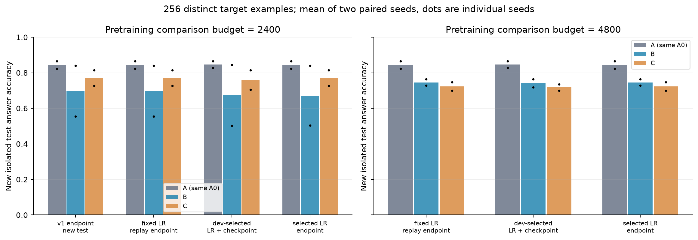

# PermWorld 第二轮诊断报告（2026-10-18）

已实际完成两个配对种子[17, 42]、30次学习率候选适配（每次800更新）、4次预训练延长（每次新增2400更新），以及冻结选择后生成的新隔离测试集评估。目标固定为256个不同训练样本的 fixed_points，任务组合、one-line编码和模型结构均沿用pilot_v1。没有增加任务或目标。

**2400步预训练、开发集选择后，B−A=-17.26、C−A=-8.74、B−C=-8.52个百分点。 4800步预训练、开发集选择后，B−A=-10.55、C−A=-12.87、B−C=+2.32个百分点。**

开发集选择后仍有低于A的均值，负迁移保留在结果中；两倍预算后仍有11/16个源任务×种子×条件组合的开发准确率低于90%。90%仅用于描述未充分掌握的诊断门槛，不是跨任务统一难度标准。不能从这些结果把迁移机制归因于已知数学关系。

## 任务、数据与公平比较

目标 fixed_points(p)=#{i:p(i)=i}，固定n=10。B预训练 anti_fixed_points、descents、peaks、left_to_right_maxima；C仅把anti_fixed_points替换成successions。关系为fixed_points(p)=anti_fixed_points(c(p))，c(p)(i)=11−p(i)。这是输入complement下的恒等式。successions没有被登记为该直接关系任务，未断言数学上无关。

两种子各沿用v1目标训练前256条及1024条开发输入；B/C共用8192条预训练输入、1024条源开发输入，四任务每批各16/64。适配所有候选共享同种子数据、采样序列与最大800更新。没有新增参数；目标专有初始化处理仅将既有目标task token的tied embedding/output行恢复到同种子共享step0值，数字输出参数继续迁移。每次适配新建AdamW并检查状态为空。

新测试在10个开发集选择全部冻结之后生成，每种子2048条；按identity/inverse/reverse/complement完整轨道排除v1所有数据（包含历史测试）及跨种子新测试输入。显式轨道交集为0。两个种子均在同种子各条件、候选和协议之间共享同一新测试集。下列表全部是这批新测试结果，v1旧测试分数没有混入均值。v1原endpoint重新在新测试上评估。旧开发集被复用，且本轮问题来源于历史探索，所以这仍是诊断性探索。

## 历史记录与补充诊断

历史记录保存了预训练稀疏的最后一批双token损失、源endpoint准确率、目标每400更新（仅400和800步）的开发准确率/答案CE和最后一批训练损失。缺少逐源任务历史训练/开发损失轨迹、目标完整训练集轨迹及中间模型checkpoint。此次对原checkpoint补测完整源训练/开发集准确率、答案CE、双token CE、EOS准确率和按长度多数基线。历史中间模型无法从endpoint恢复，新重跑曲线明确记为replay，不伪装成历史测量。

按长度基线在本轮只有n=10一层；多数标签由对应训练池确定，再测量该标签在训练/开发/测试池的命中率。源任务表中的答案CE使用全188词表；训练损失是答案与EOS的双token平均CE，两者不可混用。

权重严格加载hash检查通过=True；同种子目标专有行一致=True；目标数据哈希一致=True；适配采样序列哈希一致=True；保存/继续训练4+4更新逐位一致=True。原预训练优化器步数为2400，原适配保存步数为800；新的适配优化器状态从0开始。

历史v1没有保存适配起点参数指纹，历史加载/重置判断依据代码、保存的优化器步数及本次重建检查，不能声称掌握历史起点的直接哈希证据。v2每个候选实际运行前保存initialization.json，具有加载前后hash、目标行hash及空优化器状态记录。

历史6组256样本适配从400到800步，有6组开发答案CE上升、1组开发准确率下降。CE恶化可能反映置信度/校准恶化，不能全部写成准确率过拟合；历史最后一批混合双token loss也不能代替完整训练集损失。

高学习率原协议重跑与v1原endpoint在6/6个单元逐位相同。最大参数绝对差见[replay表](artifacts/replay_v1_weight_differences.csv)。重跑补出的完整训练曲线可与相同权重终点关联，历史稀疏记录仍单独保留。

| 种子 | 条件 | 预训练更新 | 逐位相同 | 最大参数差 |
| --- | --- | --- | --- | --- |
| 17 | A | 0 | True | 0 |
| 17 | B | 2400 | True | 0 |
| 17 | C | 2400 | True | 0 |
| 42 | A | 0 | True | 0 |
| 42 | B | 2400 | True | 0 |
| 42 | C | 2400 | True | 0 |

## 源任务学习与替换难度

下表为每种子的原预算和两倍预算endpoint。准确率与CE全部为完整池测量；更完整的双token/EOS指标和训练多数基线保存在[源学习表](artifacts/source_learning_table.csv)，延长阶段每600更新的结果见[全部源曲线CSV](artifacts/source_learning_all.csv)。

| seed | 条件/更新 | 任务 | 训练acc | 开发acc | 训练CE | 开发CE | 开发多数 |
| --- | --- | --- | --- | --- | --- | --- | --- |
| 17 | B/2400 | anti_fixed_points | 79.42% | 79.20% | 0.4954 | 0.4998 | 36.82% |
| 17 | B/2400 | descents | 46.63% | 44.63% | 1.1989 | 1.2233 | 36.82% |
| 17 | B/2400 | left_to_right_maxima | 94.92% | 95.80% | 0.1475 | 0.1345 | 31.15% |
| 17 | B/2400 | peaks | 59.24% | 58.98% | 0.9093 | 0.8860 | 50.00% |
| 17 | B/4800 | anti_fixed_points | 88.48% | 88.57% | 0.2780 | 0.2763 | 36.82% |
| 17 | B/4800 | descents | 47.84% | 47.56% | 1.1646 | 1.1920 | 36.82% |
| 17 | B/4800 | left_to_right_maxima | 95.80% | 96.09% | 0.1227 | 0.1200 | 31.15% |
| 17 | B/4800 | peaks | 61.07% | 60.94% | 0.8556 | 0.8500 | 50.00% |
| 17 | C/2400 | descents | 52.86% | 49.80% | 1.0512 | 1.1173 | 36.82% |
| 17 | C/2400 | left_to_right_maxima | 96.00% | 96.58% | 0.1098 | 0.1135 | 31.15% |
| 17 | C/2400 | peaks | 63.81% | 63.77% | 0.7987 | 0.7919 | 50.00% |
| 17 | C/2400 | successions | 45.47% | 42.48% | 1.1768 | 1.2053 | 41.41% |
| 17 | C/4800 | descents | 58.30% | 55.08% | 0.9373 | 0.9996 | 36.82% |
| 17 | C/4800 | left_to_right_maxima | 97.91% | 98.54% | 0.0682 | 0.0633 | 31.15% |
| 17 | C/4800 | peaks | 68.58% | 66.41% | 0.7144 | 0.7286 | 50.00% |
| 17 | C/4800 | successions | 48.93% | 48.34% | 1.1254 | 1.1550 | 41.41% |
| 42 | B/2400 | anti_fixed_points | 79.28% | 76.76% | 0.5672 | 0.6235 | 36.91% |
| 42 | B/2400 | descents | 52.42% | 49.51% | 1.0613 | 1.1281 | 37.70% |
| 42 | B/2400 | left_to_right_maxima | 97.72% | 96.68% | 0.0813 | 0.0985 | 34.57% |
| 42 | B/2400 | peaks | 63.50% | 62.70% | 0.8000 | 0.8054 | 52.64% |
| 42 | B/4800 | anti_fixed_points | 92.03% | 90.04% | 0.2479 | 0.2838 | 36.91% |
| 42 | B/4800 | descents | 55.38% | 53.22% | 0.9793 | 1.0308 | 37.70% |
| 42 | B/4800 | left_to_right_maxima | 97.94% | 97.07% | 0.0637 | 0.0772 | 34.57% |
| 42 | B/4800 | peaks | 66.22% | 65.23% | 0.7494 | 0.7645 | 52.64% |
| 42 | C/2400 | descents | 53.64% | 49.51% | 1.0430 | 1.0859 | 37.70% |
| 42 | C/2400 | left_to_right_maxima | 98.00% | 97.36% | 0.0763 | 0.0870 | 34.57% |
| 42 | C/2400 | peaks | 66.08% | 65.82% | 0.7621 | 0.7639 | 52.64% |
| 42 | C/2400 | successions | 47.57% | 47.75% | 1.1557 | 1.1336 | 41.31% |
| 42 | C/4800 | descents | 66.99% | 65.23% | 0.7698 | 0.8065 | 37.70% |
| 42 | C/4800 | left_to_right_maxima | 98.46% | 97.75% | 0.0538 | 0.0752 | 34.57% |
| 42 | C/4800 | peaks | 70.32% | 71.19% | 0.6617 | 0.6622 | 52.64% |
| 42 | C/4800 | successions | 56.41% | 55.37% | 0.9968 | 0.9891 | 41.31% |

答案分布使用相同8192条源训练输入，延长训练不改变输入分布：

| seed | 任务 | 标签均值 | 熵(bit) | B/C总变差 |
| --- | --- | --- | --- | --- |
| 17 | anti_fixed_points | 0.9982 | 1.8757 | 0.0443 |
| 17 | successions | 0.8905 | 1.7832 | 0.0443 |
| 42 | anti_fixed_points | 1.0160 | 1.9031 | 0.0520 |
| 42 | successions | 0.8829 | 1.7777 | 0.0520 |

2400更新时，被替换任务开发准确率均值：anti_fixed_points=77.98%，successions=45.12%；开发答案CE均值分别为0.5617/1.1695。这是当前多任务优化条件下的学习差异，尚不能当作任务内在难度的独立估计。

4800更新时，被替换任务开发准确率均值：anti_fixed_points=89.31%，successions=51.86%；开发答案CE均值分别为0.2801/1.0721。这是当前多任务优化条件下的学习差异，尚不能当作任务内在难度的独立估计。

原预算→两倍预算的16个配对源任务单元中，16/16个开发准确率提高、16/16个开发答案CE下降；逐项训练/开发指标变化见[source_budget_changes.csv](artifacts/source_budget_changes.csv)。这说明继续训练对源学习的实际影响，同时保留仍未充分掌握的单元，不能以“有提升”代替“已经学会”。

B/C共有的三个源任务在两种组成下也呈现不同学习水平。下表是两种子平均开发结果，B/C使用相同公共任务输入、标签、采样比例和总预算：

| 预训练更新 | 公共任务 | B开发acc | C开发acc | B−C百分点 | B开发CE | C开发CE |
| --- | --- | --- | --- | --- | --- | --- |
| 2400 | descents | 47.07% | 49.66% | -2.59 | 1.1757 | 1.1016 |
| 2400 | left_to_right_maxima | 96.24% | 96.97% | -0.73 | 0.1165 | 0.1002 |
| 2400 | peaks | 60.84% | 64.79% | -3.96 | 0.8457 | 0.7779 |
| 4800 | descents | 50.39% | 60.16% | -9.77 | 1.1114 | 0.9031 |
| 4800 | left_to_right_maxima | 96.58% | 98.14% | -1.56 | 0.0986 | 0.0693 |
| 4800 | peaks | 63.09% | 68.80% | -5.71 | 0.8073 | 0.6954 |

任务替换伴随整个多任务模型的源能力差异，包括公共任务；因此后续替换匹配需要同时核对替换任务和公共任务的学习曲线与最终能力。该观察没有识别梯度冲突、数学关系或其他具体机制，也不能证明任何单任务的内在难度。完整训练/开发均值见[common_source_tasks_comparison.csv](artifacts/common_source_tasks_comparison.csv)。

## 适配协议与新测试对照

各条件/种子/预训练预算拥有同样三个学习率3e−4、1e−4、3e−5，各800更新；100步warmup后余弦衰减到0.1倍。每100更新测量完整训练集与开发集，step0仅诊断，不参与选择。按开发答案准确率最大、答案CE最小、更新步最早、声明学习率顺序依次打破平局。先在各候选中选checkpoint，再以同一规则选择学习率；测试分数从不参与选择。

两倍预算从原2400更新checkpoint继续，保留原优化器与随机数状态，用原末端学习率3e−5继续2400更新。它检验固定末端学习率的继续训练，并非从头训练4800步的新余弦计划。两预算使用同一适配选择规则。A的预训练预算恒为0，在两预算面板中复用同一运行，未额外训练或当成新增种子。

| 比较预训练预算 | 协议 | A | B | C |
| --- | --- | --- | --- | --- |
| 2400 | original_v1_endpoint_new_test | 84.35% | 69.68% | 77.05% |
| 2400 | replay_fixed_lr_endpoint | 84.35% | 69.68% | 77.05% |
| 2400 | dev_selected | 84.64% | 67.38% | 75.90% |
| 2400 | selected_lr_endpoint | 84.35% | 67.16% | 77.05% |
| 4800 | replay_fixed_lr_endpoint | 84.35% | 74.56% | 72.39% |
| 4800 | dev_selected | 84.64% | 74.10% | 71.78% |
| 4800 | selected_lr_endpoint | 84.35% | 74.56% | 72.39% |

`original_v1_endpoint_new_test`为原学习率、800步原权重在新测试上的结果；`replay_fixed_lr_endpoint`为同原学习率重新训练的终点；`dev_selected`为开发选择的学习率及checkpoint；`selected_lr_endpoint`为同一选中学习率在800步的终点。表为两个种子算术均值；每种子结果及描述性标准差见[协议均值CSV](artifacts/protocol_comparison_mean.csv)和[配对对照CSV](artifacts/protocol_comparison_paired.csv)，不作显著性推断。

| seed | 条件/预训练 | 选中LR | 选中步 | 选中开发acc | 终点开发acc | 选中测试acc | 终点测试acc |
| --- | --- | --- | --- | --- | --- | --- | --- |
| 17 | A/0 | 0.0003 | 700 | 81.54% | 81.05% | 82.81% | 82.23% |
| 17 | B/2400 | 0.0003 | 700 | 83.79% | 82.71% | 84.47% | 83.89% |
| 17 | C/2400 | 0.0003 | 800 | 81.54% | 81.54% | 81.40% | 81.40% |
| 17 | B/4800 | 0.0003 | 800 | 76.56% | 76.56% | 76.32% | 76.32% |
| 17 | C/4800 | 0.0003 | 500 | 74.71% | 74.41% | 73.58% | 74.76% |
| 42 | A/0 | 0.0003 | 800 | 85.74% | 85.74% | 86.47% | 86.47% |
| 42 | B/2400 | 0.0001 | 500 | 55.76% | 53.91% | 50.29% | 50.44% |
| 42 | C/2400 | 0.0003 | 500 | 72.75% | 72.66% | 70.41% | 72.71% |
| 42 | B/4800 | 0.0003 | 500 | 74.22% | 73.24% | 71.88% | 72.80% |
| 42 | C/4800 | 0.0003 | 700 | 70.70% | 70.51% | 69.97% | 70.02% |

开发集选择的学习率计数：0.0003选中9/10组、0.0001选中1/10组、3e-05选中0/10组；seed42 B/2400选择0.0001、500步。每种子的A0只计一次，10组不是10个独立随机种子。当前同为800步的候选预算下，结果不支持把简单统一降低学习率视为普遍修复；这不排除低学习率需要更多更新、不同warmup/衰减日程，或候选集合以外的适配策略更合适。计数见[selected_learning_rate_counts.csv](artifacts/selected_learning_rate_counts.csv)。

固定2400预训练预算下，开发选择相对原v1 endpoint的新测试准确率变化：A +0.29、B -2.29、C -1.15个百分点。这同时改变学习率和停止位置，只能评价这一联合适配协议；不能把差值全部归因于其中一个因素。

10个选择中7个早于800更新；其中6个从最佳开发checkpoint到终点出现开发准确率下降且开发CE上升。该计数受开发集选择规则影响：被选checkpoint的开发准确率不低于终点几乎是规则本身的结果，不能单凭它证明过拟合。完整曲线见[曲线CSV](artifacts/target_curves.csv)，最佳与终点差值见[best_vs_endpoint](artifacts/best_vs_endpoint.csv)；对应新测试差值只作为冻结后的验证，不用于重新选择。

在这7个提前选择中，只有2个选中checkpoint的新测试准确率高于同学习率800步终点，5个更低。开发选择没有保证在新测试上获益；这些失败选择按冻结方案完整保留，不根据新测试反向挑选终点、学习率或重新训练。

另对全部30候选统一比较固定400→800步，不依赖选中学习率或checkpoint：23/30出现训练答案CE下降且开发答案CE上升，其中1/30同时开发准确率下降。前者支持训练拟合继续改善但开发损失退化的现象，只有后者同时表明准确率也退化；均不证明其是负迁移的唯一原因。每100步的稀疏评估不能把这些现象等同于数值优化不稳定，也不能完全排除未采样时间点的瞬时不稳定。这是探索性固定窗口诊断，30个共享数据/初始化的候选不是30个独立种子。原始指标和标记见[late_training_diagnostics.csv](artifacts/late_training_diagnostics.csv)。

| 条件/预训练 | 候选数 | 训练CE下降 | 开发CE上升 | 开发acc下降 | 训练CE↓且开发CE↑ | 前项且开发acc↓ |
| --- | --- | --- | --- | --- | --- | --- |
| A/0 | 6 | 6 | 2 | 0 | 2 | 0 |
| B/2400 | 6 | 6 | 6 | 1 | 6 | 1 |
| C/2400 | 6 | 6 | 5 | 0 | 5 | 0 |
| B/4800 | 6 | 6 | 5 | 0 | 5 | 0 |
| C/4800 | 6 | 6 | 5 | 0 | 5 | 0 |

开发选择后两倍预训练相对原预算的新测试差值：B +6.71个百分点；C -4.13个百分点。增加预训练预算与固定预算结果分开呈现，不能把两倍计算带来的差值当作原固定预算条件下的任务组成效应。

预算变化的逐种子效应如下（开发选择后的4800−2400测试准确率，百分点）；均值不能代表每个种子都受益：

| seed | B预算变化 | C预算变化 |
| --- | --- | --- |
| 17 | -8.15 | -7.81 |
| 42 | +21.58 | -0.44 |

B的预算效应在两个种子之间异号，说明当前预算效应有明显异质性，不能将其均值解释为稳定收益。各协议的逐种子预算差值见[target_budget_deltas.csv](artifacts/target_budget_deltas.csv)。

逐配对种子差值如下（百分点）：

| seed | 预算 | 协议 | B−A | C−A | B−C |
| --- | --- | --- | --- | --- | --- |
| 17 | 2400 | dev_selected | +1.66 | -1.42 | +3.08 |
| 17 | 2400 | selected_lr_endpoint | +1.66 | -0.83 | +2.49 |
| 17 | 4800 | dev_selected | -6.49 | -9.23 | +2.73 |
| 17 | 4800 | selected_lr_endpoint | -5.91 | -7.47 | +1.56 |
| 42 | 2400 | dev_selected | -36.18 | -16.06 | -20.12 |
| 42 | 2400 | selected_lr_endpoint | -36.04 | -13.77 | -22.27 |
| 42 | 4800 | dev_selected | -14.60 | -16.50 | +1.90 |
| 42 | 4800 | selected_lr_endpoint | -13.67 | -16.46 | +2.78 |

## 计算预算与运行时间

原B/C预训练每次2400更新×64=153600次样本曝光、4300800输入tokens（含答案与EOS）、307200监督tokens；两倍预算总计307200次曝光、8601600输入tokens、614400监督tokens。四任务严格各25%；预训练池8192条，实际每任务看过的不同输入数与采样hash见[source_budgets.csv](artifacts/source_budgets.csv)。延长继续使用相同池，增加的是曝光次数，不是不同训练样本数。

每次适配800×64=51200次曝光、1433600输入tokens、102400监督tokens；256条目标训练样本平均曝光200遍。每组3个候选共2400更新。A复用使本轮实际候选数为30，而非36。

| 阶段 | 运行数 | 新增计算 | 更新合计 | 输入tokens | 监督tokens | 记录循环秒数 |
| --- | --- | --- | --- | --- | --- | --- |
| v1_pretraining_reused | 4 | False | 9,600 | 17,203,200 | 1,228,800 | 169.6 |
| v2_adapt_candidate | 30 | True | 24,000 | 43,008,000 | 3,072,000 | 866.9 |
| v2_pretrain_extension | 4 | True | 9,600 | 17,203,200 | 1,228,800 | 348.5 |

本轮记录的训练及关联评估/保存计时合计1215.3秒；其中新增预训练348.5秒、额外17,203,200输入tokens。仅已记录阶段的墙钟合计1275.7秒（21.3分钟），实际覆盖freeze, select, smoke, test, train；与上述训练计时重叠，不应相加。inventory经独立CLI执行且没有timing_inventory记录，因此其耗时不在上述墙钟合计内。这不是包含全部诊断工作的端到端总时长。适配计时包含step0和后续完整训练/开发评估、候选内best checkpoint保存、适用时的重放权重差异检查；不含初始化和最终endpoint保存。源延长计时包含训练、源训练/开发测量和CPU NumPy采样器重放核验，不含最后保存。均不是纯GPU训练时间，未记录诊断forward的精确tokens。模型训练tokens与评估成本严格区分。smoke小步更新另计在smoke阶段墙钟，不计入正式训练tokens。

| 阶段 | 墙钟秒数 |
| --- | --- |
| freeze | 0.01 |
| select | 0.02 |
| smoke | 2.41 |
| test | 40.88 |
| train | 1232.41 |

## 得到支持的解释与仍无法区分的因素

1. **源任务未充分掌握、当前多任务条件下学习水平不匹配有直接证据。** 完整源训练/开发结果及继续训练曲线说明被替换任务和公共任务均存在B/C能力差异；仅答案分布近似并不等于学习条件或最终能力匹配。训练与开发同时较低的任务不能仅用源过拟合解释，公共任务差异也没有单独识别梯度冲突或数学关系机制。
2. **固定窗口显示部分训练后期泛化退化，适配协议敏感性由同数据同预算候选直接检验。** 统一400→800步中，23/30候选训练答案CE下降而开发答案CE上升，1/30还伴随开发准确率下降。该证据不依赖挑选最佳checkpoint；最佳开发点与终点的开发差距受选择规则约束，不能独立证明过拟合。开发选择与原协议的新测试差异是冻结后的验证；LR和checkpoint联合选择的影响不能单独识别负迁移的原因，失败的选择也完整保留。
3. **检查未发现加载、目标专有行、优化器重置或条件间数据/评估不一致。** 哈希与状态审计、继续训练smoke、原高LR重跑差异表给出了可检查证据；这些工程错误作为本轮差异的解释不受现有证据支持。
4. **机制仍无法识别。** 没有控制替换任务最终能力、梯度冲突、表示变化或输入complement归纳偏置。更长预训练同时改变源能力与参数位置，不是隔离机制的干预。本轮没有开展CKA扫描；兼容state_dict及配置保留供后续接入。
5. **统计与选择范围有限。** 两个随机单元同时改变初始化和数据，不能分开估计两者；单一长度、目标和任务替换不能外推到任务库。开发集长期复用可能有选择偏差；全部候选的新测试数值只作冻结后披露，不据此追选学习率、重训或改配置。旧v1测试保持其探索性质。

## 下一步建议与停止边界

**优先检查替换任务匹配，其次才增加目标任务，最后再考虑扩大源任务数量。** 当前任务组合中的源开发能力差异尚未消除，先在不看目标迁移测试的条件下，以单任务/源开发学习曲线、标签分布及收敛能力匹配替换任务，能直接减少B/C机制解释的混杂。匹配检查同时覆盖被替换任务及三个公共源任务的训练/开发曲线和最终能力，因为本轮任务替换也伴随公共任务能力变化。当前v2不更换任务；若后续保留现有替换任务，则先建立更充分且等计算预算的源学习条件。匹配检查之后，再增加少量预先指定且具已知关系的目标，检验单目标结论是否可复现；扩大任务数量现在会同时增加混杂与计算量。

本轮到此停止扩展，等待后续指导。所有已运行结果（包括负迁移和源任务未充分学会）均保留。

## 产物与复现

- 每种子全部候选测试：[seed17](artifacts/results_seed17.csv)、[seed42](artifacts/results_seed42.csv)；[原始协议对照](artifacts/protocol_comparison.csv)。
- [完整配置与冻结代码hash](artifacts/FROZEN_PROTOCOL.json)、[选择冻结记录](artifacts/SELECTIONS_FROZEN.json)、[新测试隔离审计](artifacts/test_data_audit.json)。
- [源学习表](artifacts/source_learning_table.csv)、[实际预算](artifacts/source_budgets.csv)、[候选开发结果](artifacts/candidate_development_results.csv)、[完整目标曲线](artifacts/target_curves.csv)、[实际成本](artifacts/compute_costs.csv)。
- 目标每seed/condition/budget的选中LR训练/开发曲线为`artifacts/figures/target_selected_*.png`，三LR比较为`target_lr_comparison_*.png`，源学习曲线为`source_seed*.png`。图使用答案准确率和答案CE，不把双token训练loss伪装成答案CE。
- [复现说明](README.md)。本报告与图由`.venv/Scripts/python.exe experiments/pilot_v2_diagnostics/summarize.py`从已保存产物生成；该脚本没有任何模型forward，不选择或重跑训练。

最终产物审计状态：passed，见[FINAL_AUDIT.json](artifacts/FINAL_AUDIT.json)。审计另核验选择冻结先于新测试生成、测试/选择hash、源码冻结hash和v1文件逐字节保留。
