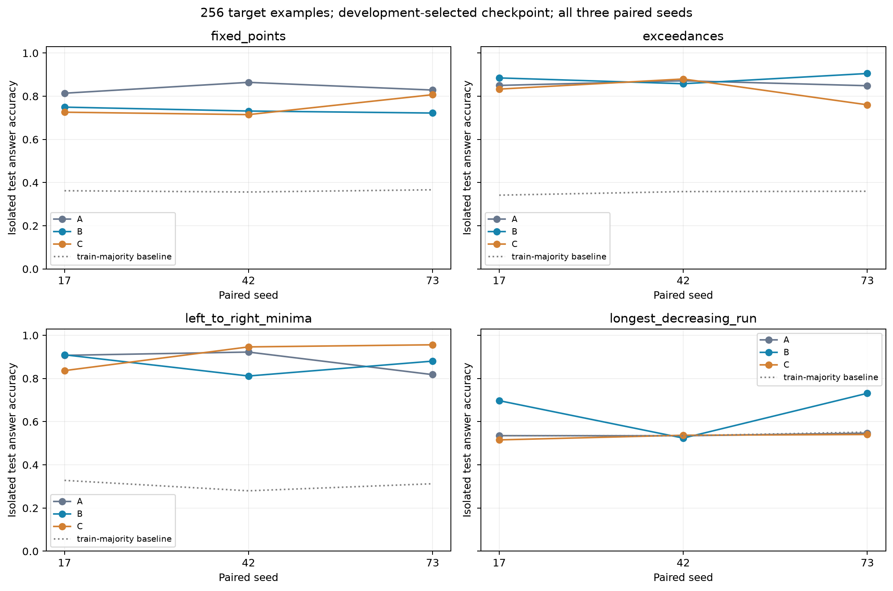
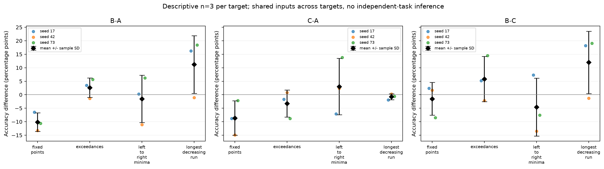
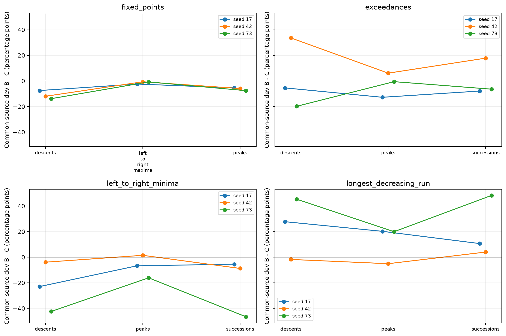

# Pilot v3：多个目标上的负迁移与任务组成诊断

本轮已完成四个目标、每目标256个训练样本、三个配对种子（17、42、73）的固定规模比较。主结果为开发集选定的36个 A/B/C checkpoint；全部108个学习率候选的 best 与 endpoint 共216条测试结果均保留。所有方案只依据数学定义、训练集和开发集选定，统一在冻结选择后生成的独立新测试上评估。

本轮 B−A 的均值为负出现在 2/4 个目标，其中 1/4 个目标三个种子均为负；C−A 相应为 3/4 和 1/4。B−C 在 4/4 个目标上随种子改变符号。这里报告观察到的差异，不用三个种子作强统计推断，也不把 B−C 直接解释为某条数学关系的纯因果效应。

## 主要结果

准确率为三个种子的均值；差值单位为百分点，± 为逐种子差值的样本标准差（不是置信区间）。

| 目标 | A | B | C | B−A 均值±SD | C−A 均值±SD | B−C 均值±SD |
| --- | --- | --- | --- | --- | --- | --- |
| fixed_points | 83.56% | 73.44% | 74.93% | -10.12 ± 3.45 | -8.63 ± 6.40 | -1.50 ± 6.07 |
| exceedances | 85.68% | 88.26% | 82.44% | +2.59 ± 3.60 | -3.24 ± 5.01 | +5.83 ± 8.37 |
| left_to_right_minima | 88.25% | 86.72% | 91.29% | -1.53 ± 8.80 | +3.04 ± 10.46 | -4.57 ± 10.72 |
| longest_decreasing_run | 53.89% | 65.09% | 53.11% | +11.20 ± 10.69 | -0.78 ± 1.11 | +11.98 ± 11.53 |

负 / 零 / 正的种子个数如下；无收益和方向相反的结果都保留。

| 目标 | B−A 负/零/正 | C−A 负/零/正 | B−C 负/零/正 |
| --- | --- | --- | --- |
| fixed_points | 3/0/0 | 3/0/0 | 1/0/2 |
| exceedances | 1/0/2 | 2/0/1 | 1/0/2 |
| left_to_right_minima | 1/0/2 | 1/0/2 | 2/0/1 |
| longest_decreasing_run | 1/0/2 | 2/0/1 | 1/0/2 |

本轮观察到B−A和C−A都在三个种子中为负的目标为 fixed_points；这描述三个种子的实际方向，不代表统计显著性或未见任务上的普遍负迁移。 longest_decreasing_run 的A/C测试表现接近训练众数基线：逐种子A减基线为 +0.00、+0.00、-0.49，C减基线为 -1.95、+0.24、-1.12 个百分点（按seed 17/42/73排序）。B相对A收益出现在seed 17/73，没有收益的seed为 42；对应B−A为 +16.21、-1.07、+18.46 个百分点。 B的相关源longest_increasing_run开发准确率依次为 72.17%、63.18%、86.62%，显示源学习状态与目标收益同时随seed变化；seed也同时改变输入池与初始化，三个配对观察不足以认定因果来源。 目标资格门槛是在8192条单任务训练样本下通过，不意味着A在256条样本及800步适配预算下也能学会；因此目标资格与本轮小样本学习失败需分别解释。

每个目标、每个种子的原始主结果如下（[CSV](artifacts/results_selected.csv)）。测试集的多数基线用该种子256条目标训练数据中频率最高的答案构造，不用测试集众数。

| 目标 | seed | 条件 | 新测试准确率 | 开发准确率 | 所选LR | 所选步数 | 多数基线 | 训练来源 |
| --- | --- | --- | --- | --- | --- | --- | --- | --- |
| fixed_points | 17 | A | 81.40% | 81.54% | 0.0003 | 700 | 36.23% | 历史权重复用 |
| fixed_points | 17 | B | 74.95% | 76.56% | 0.0003 | 800 | 36.23% | 历史权重复用 |
| fixed_points | 17 | C | 72.61% | 74.71% | 0.0003 | 500 | 36.23% | 历史权重复用 |
| exceedances | 17 | A | 85.01% | 85.35% | 0.0001 | 800 | 34.18% | 本轮训练 |
| exceedances | 17 | B | 88.48% | 87.50% | 0.0003 | 500 | 34.18% | 本轮训练 |
| exceedances | 17 | C | 83.30% | 84.28% | 0.0003 | 800 | 34.18% | 本轮训练 |
| left_to_right_minima | 17 | A | 90.72% | 94.04% | 0.0003 | 800 | 32.81% | 本轮训练 |
| left_to_right_minima | 17 | B | 90.97% | 93.16% | 0.0003 | 700 | 32.81% | 本轮训练 |
| left_to_right_minima | 17 | C | 83.64% | 86.23% | 0.0003 | 800 | 32.81% | 本轮训练 |
| longest_decreasing_run | 17 | A | 53.52% | 56.93% | 0.0003 | 100 | 53.52% | 本轮训练 |
| longest_decreasing_run | 17 | B | 69.73% | 72.27% | 0.0001 | 800 | 53.52% | 本轮训练 |
| longest_decreasing_run | 17 | C | 51.56% | 56.25% | 3e-05 | 100 | 53.52% | 本轮训练 |
| fixed_points | 42 | A | 86.43% | 85.74% | 0.0003 | 800 | 35.64% | 历史权重复用 |
| fixed_points | 42 | B | 73.14% | 74.22% | 0.0003 | 500 | 35.64% | 历史权重复用 |
| fixed_points | 42 | C | 71.48% | 70.70% | 0.0003 | 700 | 35.64% | 历史权重复用 |
| exceedances | 42 | A | 87.16% | 87.79% | 0.0001 | 800 | 35.84% | 本轮训练 |
| exceedances | 42 | B | 85.79% | 85.64% | 0.0003 | 700 | 35.84% | 本轮训练 |
| exceedances | 42 | C | 87.99% | 88.96% | 0.0003 | 600 | 35.84% | 本轮训练 |
| left_to_right_minima | 42 | A | 92.24% | 91.80% | 0.0003 | 400 | 27.98% | 本轮训练 |
| left_to_right_minima | 42 | B | 81.15% | 82.81% | 0.0001 | 800 | 27.98% | 本轮训练 |
| left_to_right_minima | 42 | C | 94.63% | 95.12% | 0.0001 | 800 | 27.98% | 本轮训练 |
| longest_decreasing_run | 42 | A | 53.47% | 55.86% | 0.0003 | 100 | 53.47% | 本轮训练 |
| longest_decreasing_run | 42 | B | 52.39% | 54.88% | 3e-05 | 100 | 53.47% | 本轮训练 |
| longest_decreasing_run | 42 | C | 53.71% | 56.05% | 3e-05 | 100 | 53.47% | 本轮训练 |
| fixed_points | 73 | A | 82.86% | 84.08% | 0.0001 | 400 | 36.67% | 本轮训练 |
| fixed_points | 73 | B | 72.22% | 72.56% | 0.0003 | 500 | 36.67% | 本轮训练 |
| fixed_points | 73 | C | 80.71% | 79.98% | 0.0003 | 800 | 36.67% | 本轮训练 |
| exceedances | 73 | A | 84.86% | 87.50% | 0.0001 | 800 | 35.99% | 本轮训练 |
| exceedances | 73 | B | 90.53% | 91.02% | 0.0003 | 400 | 35.99% | 本轮训练 |
| exceedances | 73 | C | 76.03% | 78.32% | 0.0003 | 700 | 35.99% | 本轮训练 |
| left_to_right_minima | 73 | A | 81.79% | 84.77% | 0.0001 | 700 | 31.25% | 本轮训练 |
| left_to_right_minima | 73 | B | 88.04% | 86.91% | 0.0003 | 700 | 31.25% | 本轮训练 |
| left_to_right_minima | 73 | C | 95.61% | 95.80% | 0.0003 | 800 | 31.25% | 本轮训练 |
| longest_decreasing_run | 73 | A | 54.69% | 55.47% | 3e-05 | 400 | 55.18% | 本轮训练 |
| longest_decreasing_run | 73 | B | 73.14% | 72.95% | 0.0003 | 800 | 55.18% | 本轮训练 |
| longest_decreasing_run | 73 | C | 54.05% | 55.47% | 0.0001 | 100 | 55.18% | 本轮训练 |

## 任务目录、目标冻结与组成

`TASK_CATALOG.csv` 盘点了 57 条当前注册/历史接口记录，其中 PermWorld 有 48 个端点、32个标量 property 任务和4个输出编码转换端点。目录行数不是独立数学任务数：输入长度和参数取值是参数变体，one-line/cycle/Lehmer/inversion-vector 是同一数学对象的编码变体，编码转换单独标注。GraphWorld、MatrixGroupWorld 和历史有限域内容只作目录盘点，本轮没有运行。关系检查覆盖 n=1…7 的全部5913个置换以及2048个 n=10 随机置换；有限检查验证实现，恒等关系依据定义成立。

四个目标及组成如下。对每一行，目标(p)=相关源任务(T(p))，答案映射均为恒等；B/C 共有的三个任务固定。反演、反序、补值覆盖三类输入变换。固定点与超越数同属较宽的位置比较任务族，不能夸大任务多样性。

四条B关系的答案映射全为恒等；没有覆盖非平凡答案映射或多任务加和恒等式。目录收录了这些其他关系，本轮按可学习性和有限规模约束未纳入。

| 目标 | 定义 | B的相关源 | 输入变换T | C的替换源 | 三个公共源 |
| --- | --- | --- | --- | --- | --- |
| fixed_points | 固定点数 # {i:p_i=i} | anti_fixed_points | C(p)_i=n+1-p_i | successions | descents, peaks, left_to_right_maxima |
| exceedances | 超越数 # {i:p_i>i} | deficiencies | I(p)=p⁻¹ | recoils | descents, peaks, successions |
| left_to_right_minima | 从左至右严格新最小值的个数 | right_to_left_minima | R(p)_i=p_{n+1-i} | longest_increasing_run | descents, peaks, successions |
| longest_decreasing_run | 最长连续严格下降段长度（至少1） | longest_increasing_run | C(p)_i=n+1-p_i | left_to_right_maxima | descents, peaks, successions |

计划在单任务开发实验前冻结。目标入选门槛为 seed17 的单任务4800步开发准确率≥90%，且至少比训练众数开发基线高15个百分点；没有使用迁移测试结果挑目标。

| 目标 | 单任务开发准确率 | 训练众数开发基线 | 预设门槛通过 |
| --- | --- | --- | --- |
| fixed_points | 99.71% | 36.43% | True |
| exceedances | 100.00% | 33.20% | True |
| left_to_right_minima | 99.90% | 31.45% | True |
| longest_decreasing_run | 99.90% | 55.76% | True |

替换任务在预先声明的候选集合内，依据 seed17 源训练答案直方图总变差 TV、单任务4800步开发准确率差、600/1200/2400/3600/4800步开发准确率差的均值三项相加选最小值；并列按候选顺序。fixed_points 保留原 successions 替换作为历史锚点，exceedances 也只有一个预设候选，故这两项没有通过多候选优化改善匹配。所有输入长度均为10，长度分布完全相同，剩余难度和答案分布差异明确保留。

| 目标 | 相关源 | 替换候选 | TV | 终点准确率差绝对值 | 曲线差绝对值均值 | 总分 | 选中 |
| --- | --- | --- | --- | --- | --- | --- | --- |
| fixed_points | anti_fixed_points | successions | 0.0443 | 0.3125 | 0.4580 | 0.8148 | True |
| exceedances | deficiencies | recoils | 0.0109 | 0.0010 | 0.1727 | 0.1845 | True |
| left_to_right_minima | right_to_left_minima | cycle_count | 0.0239 | 0.5254 | 0.5111 | 1.0604 | False |
| left_to_right_minima | right_to_left_minima | longest_increasing_run | 0.2119 | 0.0010 | 0.0822 | 0.2951 | True |
| longest_decreasing_run | longest_increasing_run | left_to_right_maxima | 0.2006 | 0.0020 | 0.0902 | 0.2927 | True |
| longest_decreasing_run | longest_increasing_run | cycle_count | 0.2181 | 0.5264 | 0.4293 | 1.1738 | False |

未纳入最终源集合的候选也保留单任务记录。下表由实际4800步终点生成，开发准确率<90%仅表示本配置未充分学会，不表示任务固有困难；未选候选通常只有设计seed17参照，不补齐三个种子。

| 未选候选 | seed | 单任务train | 单任务dev | 开发多数基线 | 90%描述性门槛 |
| --- | --- | --- | --- | --- | --- |
| cycle_count | 17 | 53.45% | 47.36% | 33.50% | 未充分学会 |

C只表示没有被标注为具有本实验对应的直接输入变换/答案映射关系，绝不表示数学上完全无关。目录保存了其他已知关系；反例检查只否定检查过的直接恒等式，不证明不存在更复杂关系。答案分布相近也不意味着学习过程相近。

## 单任务与组合学习参照

所有实际源任务均有三个种子的单任务参照，使用与组合训练相同的每种子初始化、8192条源训练池和1024条开发池。各任务按长度的记录只有 n=10；不声称长度外推。全量 train/dev 准确率、answer CE、EOS CE、双token CE、多数基线和学习曲线保留在 [单/多任务对照](artifacts/single_vs_multi_sources.csv) 与 [完整源曲线](artifacts/source_learning_all.csv)。

新训练的单任务及多任务记录0/600/1200/2400/3600/4800步全量指标；但fixed_points的seed17/42复用源模型缺少2400步之前的全量train/dev曲线，仅保留2400步原预算终点和v2续训3000/3600/4200/4800步记录。对应B/C图线从2400步开始，早期空缺未插值或补造；本轮新增单任务曲线不填补这些历史多任务记录。

单任务4800步每任务暴露307200次，是四任务4800步中单个任务76800次暴露的4倍；另保存单任务1200步76800次暴露参照。单任务1200步的学习率轨迹/最终学习率与组合4800步不同，且看到的不同输入数可能不同。因此下列分类是描述性诊断，不能单独识别纯任务干扰效应：单任务4800步开发准确率<90%记为“本配置单任务未充分学会”；≥90%且组合低至少5个百分点记为“单任务能学会、组合训练下降”；其余为“不足以认定组合训练下降”。

按目标×条件×种子×源任务共96个出现次数，三类分别为 14、65、17。同一源任务在不同组合中重复出现，这不是96个独立任务；第一类也不是任务具有内在学习困难的结论。

这三个类别按单任务学习程度定义，不能涵盖组合改善：单任务未充分学会而组合提高至少5个百分点的记录仍落在第一类。因此另行按组合4800减单任务4800的开发准确率统计正负两方向，±5个百分点仅作描述门槛，不改变冻结协议或上述分类。既报告全部逻辑任务出现次数，也按seed×任务×source终点state hash去掉完全相同模型的重复；去重后仍共享任务、输入、初始化和源组成，仍不是独立样本。

| 计数范围 | 记录数 | 改善≥5pp | 下降≥5pp | 差值绝对值<5pp |
| --- | --- | --- | --- | --- |
| 原始逻辑任务出现次数 | 96 | 7 | 70 | 19 |
| seed×任务×source state去重 | 84 | 6 | 60 | 18 |

下面分别保留最大三个改善和最大三个下降记录（若某方向不足三个则全部列出），相同state重复出现的逻辑run放在同一行。完整去重表见 [source_learning_effects_unique.csv](artifacts/source_learning_effects_unique.csv)。这些只是源开发指标的描述性例子，未用于测试选择。

| 方向 | seed | 源任务 | 单4800 dev | 组合4800 dev | 差值pp | 出现的逻辑run |
| --- | --- | --- | --- | --- | --- | --- |
| 改善 | 73 | successions | 48.93% | 92.48% | +43.55 | s73_left_to_right_minima_C;s73_longest_decreasing_run_B |
| 改善 | 17 | successions | 68.65% | 86.62% | +17.97 | s17_exceedances_C |
| 改善 | 73 | successions | 48.93% | 61.23% | +12.30 | s73_exceedances_C |
| 下降 | 17 | descents | 100.00% | 47.56% | -52.44 | s17_fixed_points_B |
| 下降 | 17 | descents | 100.00% | 51.27% | -48.73 | s17_longest_decreasing_run_C |
| 下降 | 73 | descents | 100.00% | 52.44% | -47.56 | s73_longest_decreasing_run_C |

组合改善和下降都可能依赖具体seed及优化过程。单任务4800步和组合4800步具有相同的总优化器更新数及全局学习率轨迹，但单任务的每任务暴露为组合的4倍，组合还引入任务交替；这些差别使纯任务干扰仍无法被单独识别。单任务1200步只匹配每任务暴露，学习率历史与总更新数不同。故改善不能直接证明因果协同，下降也不能直接证明纯任务干扰。不同方向共同保留，避免把“单任务未学会”误读为“所有组合也未学会”。

以下为三个种子均值。原始表保留每个种子与训练集指标。

| 目标 | 条件 | 源任务 | 单1200 dev | 单4800 dev | 组合4800 dev | 组合dev CE | 组合dev多数基线 |
| --- | --- | --- | --- | --- | --- | --- | --- |
| fixed_points | B | anti_fixed_points | 99.32% | 99.93% | 90.79% | 0.246 | 36.56% |
| fixed_points | B | descents | 99.80% | 99.97% | 54.92% | 1.011 | 36.82% |
| fixed_points | B | peaks | 95.90% | 99.90% | 61.82% | 0.833 | 50.75% |
| fixed_points | B | left_to_right_maxima | 98.99% | 99.87% | 96.78% | 0.095 | 33.04% |
| fixed_points | C | successions | 47.17% | 69.56% | 53.61% | 1.048 | 40.33% |
| fixed_points | C | descents | 99.80% | 99.97% | 66.05% | 0.797 | 36.82% |
| fixed_points | C | peaks | 95.90% | 99.90% | 68.16% | 0.712 | 50.75% |
| fixed_points | C | left_to_right_maxima | 98.99% | 99.87% | 98.08% | 0.069 | 33.04% |
| exceedances | B | deficiencies | 99.41% | 99.87% | 99.71% | 0.030 | 34.47% |
| exceedances | B | descents | 99.80% | 99.97% | 83.07% | 0.409 | 36.82% |
| exceedances | B | peaks | 95.90% | 99.90% | 68.07% | 0.733 | 50.75% |
| exceedances | B | successions | 47.17% | 69.56% | 69.21% | 0.771 | 40.33% |
| exceedances | C | recoils | 76.63% | 99.90% | 67.97% | 0.757 | 36.98% |
| exceedances | C | descents | 99.80% | 99.97% | 80.31% | 0.486 | 36.82% |
| exceedances | C | peaks | 95.90% | 99.90% | 70.51% | 0.674 | 50.75% |
| exceedances | C | successions | 47.17% | 69.56% | 68.07% | 0.752 | 40.33% |
| left_to_right_minima | B | right_to_left_minima | 99.09% | 99.97% | 94.95% | 0.131 | 32.32% |
| left_to_right_minima | B | descents | 99.80% | 99.97% | 55.01% | 1.007 | 36.82% |
| left_to_right_minima | B | peaks | 95.90% | 99.90% | 70.05% | 0.665 | 50.75% |
| left_to_right_minima | B | successions | 47.17% | 69.56% | 48.60% | 1.139 | 40.33% |
| left_to_right_minima | C | longest_increasing_run | 90.04% | 99.71% | 73.99% | 0.637 | 52.28% |
| left_to_right_minima | C | descents | 99.80% | 99.97% | 78.09% | 0.519 | 36.82% |
| left_to_right_minima | C | peaks | 95.90% | 99.90% | 77.18% | 0.546 | 50.75% |
| left_to_right_minima | C | successions | 47.17% | 69.56% | 68.88% | 0.748 | 40.33% |
| longest_decreasing_run | B | longest_increasing_run | 90.04% | 99.71% | 73.99% | 0.637 | 52.28% |
| longest_decreasing_run | B | descents | 99.80% | 99.97% | 78.09% | 0.519 | 36.82% |
| longest_decreasing_run | B | peaks | 95.90% | 99.90% | 77.18% | 0.546 | 50.75% |
| longest_decreasing_run | B | successions | 47.17% | 69.56% | 68.88% | 0.748 | 40.33% |
| longest_decreasing_run | C | left_to_right_maxima | 98.99% | 99.87% | 97.49% | 0.076 | 33.04% |
| longest_decreasing_run | C | descents | 99.80% | 99.97% | 54.33% | 1.023 | 36.82% |
| longest_decreasing_run | C | peaks | 95.90% | 99.90% | 65.49% | 0.772 | 50.75% |
| longest_decreasing_run | C | successions | 47.17% | 69.56% | 47.92% | 1.140 | 40.33% |

公共任务 B/C 开发准确率差的绝对值平均为 14.00 个百分点，最大为 48.24 个百分点（36个任务×种子×目标出现次数）。公共任务学习差异作为组成训练结果保留；不能假设仅被替换任务不同、其他任务表征/学习状态就相同。

另外，24个逻辑预训练run只对应 7 个不同的有序源组合、6 个不同的无序源集合；三个种子合计 21 个不同终点模型state hash，3 组hash重复（重复额外run数 3）。相同seed、输入和有序源组合可以训练出完全一致权重；无序集合相同但槽位顺序不同不保证逐位相同。引擎仍执行各逻辑run，新增计算按实际执行计数，不能把重复状态当独立source模型证据。详见 [组合及state去重审计](artifacts/source_composition_reuse.csv)。

## 训练、适配和测试协议

使用原 PermWorld one-line tokenizer/vocabulary、Transformer（4层、宽256、8头、dropout0.1、绑定embedding/output权重）。所有四个目标从所有预训练源集合排除。源池8192、源开发1024；目标训练256、开发1024、新测试2048，每种子在目标间与 A/B/C 间复用相同置换输入、按相应数学定义生成标签。三个种子使用各自输入池；目标间共享输入意味着跨目标结果并非独立样本。

B/C均四任务，batch64每任务精确16，4800次更新，学习率前100步warmup至3e−4、至2400步余弦下降到3e−5，再保持3e−5到4800步；没有继续自动延长。AdamW(weight_decay=.01, betas=.9/.999, eps=1e−8)、梯度裁剪1、FP32权重/评估、BF16训练、TF32关闭。训练损失为答案token和EOS各占一半的交叉熵；准确率为给定输入与任务prompt后的完整188词表argmax答案，EOS单独报告。

每个 A/B/C 拥有相同三档LR（3e−4、1e−4、3e−5）、各800步、相同采样顺序，前100步warmup后余弦到初始LR的0.1。每100步计算全部训练/开发指标；先最大化开发答案准确率，再最小化开发answer CE，再最早更新步，再按声明LR顺序破同分，step0不入选。目标已有专有token/output绑定行恢复为同种子step0值，优化器状态清空，源参数严格加载。选择LR计数为 {0.0003: 23, 0.0001: 9, 3e-05: 4}。候选400→800步固定窗口中，65/108个开发CE上升，18/108个开发准确率下降；不把经最佳开发点选择后的终点差距直接当作独立过拟合证据。

`DESIGN_FROZEN.json` 冻结设计、源码和数据；`FROZEN_PROTOCOL.json` 冻结目标/组成；`SELECTIONS_FROZEN.json` 冻结36项开发选择和权重hash。随后才生成第二轮之后的新测试：统一排除所有 v1/v2 输入、v3训练/开发输入及其 inverse/reverse/complement 完整变换轨道，并隔离新测试种子间轨道，审计交集为0。新测试不用于选择目标、替换任务、LR或checkpoint。全部108候选的best/endpoint在冻结后统一评估，披露216行不产生追加选择。

fixed_points 的seed17/42精确复用v2两倍预算的4个预训练权重和18个适配候选，文件hash与配置/数据兼容性核对后在本轮新测试上重新评估。这部分保留历史探索性质，不能称作独立重新训练的重复实验；seed73及其余三个目标为本轮新训练。最终审计status=passed，已核对v1/v2代码、配置、数据、结果和checkpoint等348个历史文件的字节hash，保留检查通过。 完整最终审计：passed，见 FINAL_AUDIT.json。

## 计算成本与局限

下表训练timer总计新增 72.34 分钟；阶段墙钟合计 73.75 分钟。训练timer包含各自全量评估、保存和部分记账开销，复用历史timer范围略有不同，不将历史复用时间计为本轮新增。阶段时间另包含标签/隔离检查、选择和216次测试等，不能与训练timer相加；汇总绘图和最终审计另行执行，未计入引擎阶段墙钟。计时范围逐行见 `compute_by_run.csv`，阶段时间见 `stage_timings.csv`。

| 类型 | 成本来源 | 运行数 | 更新数 | 输入tokens | 监督tokens | 训练timer分钟 |
| --- | --- | --- | --- | --- | --- | --- |
| single | 新增 | 32 | 153,600 | 275,251,200 | 19,660,800 | 31.83 |
| multi | 新增 | 20 | 96,000 | 172,032,000 | 12,288,000 | 23.27 |
| multi | 历史复用 | 4 | 19,200 | 34,406,400 | 2,457,600 | 8.63 |
| adapt | 新增 | 90 | 72,000 | 129,024,000 | 9,216,000 | 17.25 |
| adapt | 历史复用 | 18 | 14,400 | 25,804,800 | 1,843,200 | 8.67 |

每个新组合run实际输入tokens为8,601,600、监督tokens614,400，每源任务采样比例25%；每适配候选输入tokens1,433,600、监督tokens102,400。输入tokens计完整28-token训练序列的前向输入，包含答案与EOS；监督tokens计两个损失位置。全量评估与保存耗时包含在timer中，但上述训练token计数不包含评估token。

本轮只比较固定256样本、固定4800步预训练和固定800步适配下的迁移表现，不建立完整样本效率曲线或scaling law。仅三个配对种子、四个经过可学习性筛选的PermWorld目标、单一长度/模型/编码；设计选择使用seed17开发记录。学习率候选的最佳开发值有选择偏差，测试保持冻结评估但多候选结果仅供披露；不能在本轮测试上挑选下一份“最佳”主结论。没有跨预算扫描，因此本轮效应以v2延长预算的特定学习率轨迹为条件，不能声称预算无关。相同答案分布、已知变换关系、源任务学习程度、共同训练影响和初始化种子仍可能共同解释B/C差异。

一个具体混杂是exceedances的C用recoils替换deficiencies，而公共源包含descents，因此引入已知源—源关系recoils(I(p))=descents(p)（见目录审计的descent_inverse关系）。B/C同时改变源集合内部的关系结构和指定的目标—源关系，不能把差值只归因于后者。

## 下一阶段建议

优先深化组合分析：B−C的方向随具体目标或seed改变，公共源任务的学习状态也随B/C组合变化，同时存在单任务学会而组合下降的记录。先保持任务数、目标样本数和总预算，围绕公共源任务学习差异做匹配/每任务暴露量/优化轨迹控制，再增加少量更独立的目标任务族。上述是基于本轮观察的研究优先级，不是显著性检验。四个目标仍在PermWorld，fixed_points与exceedances同属位置比较类；暂不优先扩大源任务数量，以免同时改变任务数量、暴露量和组成。

本轮到此停止扩展，等待后续指导。

## 文件与复现

- [三个种子全部候选原始结果](artifacts/results_seed17.csv)、[seed42](artifacts/results_seed42.csv)、[seed73](artifacts/results_seed73.csv)；[216行全集](artifacts/results_all_candidates.csv)、[36行主结果](artifacts/results_selected.csv)。
- [配对差值](artifacts/paired_deltas.csv)、[差值汇总](artifacts/paired_deltas_summary.csv)、[终点与开发选择对照](artifacts/selected_vs_endpoint.csv)；所有均值与样本SD见 [results_summary.csv](artifacts/results_summary.csv)。
- [单/多任务对照](artifacts/single_vs_multi_sources.csv)、[公共源任务差异](artifacts/common_source_differences.csv)、[候选匹配差异](artifacts/replacement_matching.csv)。
- [全部目标train/dev曲线](artifacts/target_curves.csv)；图在 `artifacts/figures/target_selected_*.png` 和 `source_learning_*.png`，原始每run曲线/权重hash在 `adapt/`、`single/`、`multi/`。
- [冻结配置](artifacts/FROZEN_PROTOCOL.json)、[计算成本](artifacts/compute_summary.csv)、[阶段耗时](artifacts/stage_timings.csv)、[审计](artifacts/FINAL_AUDIT.json)；任务目录与复现命令见实验目录 `README.md`。
