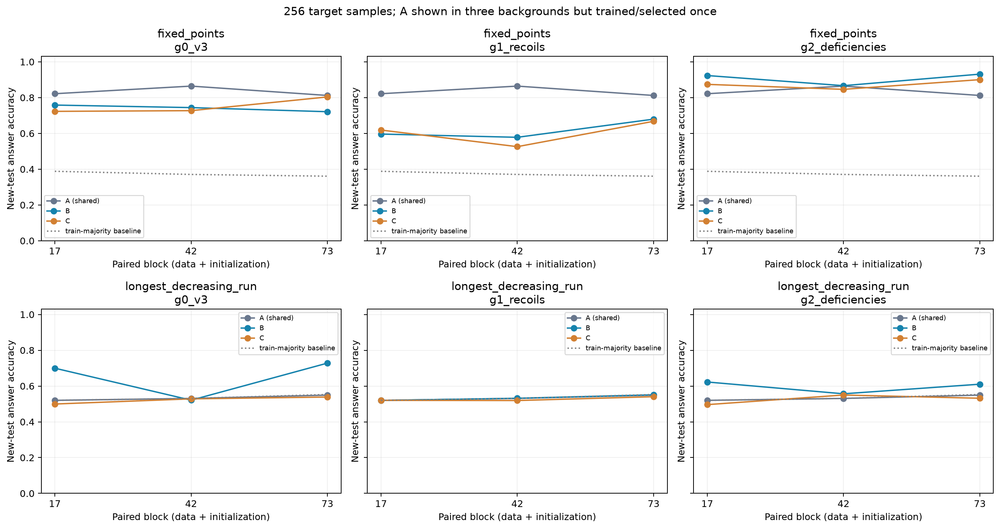
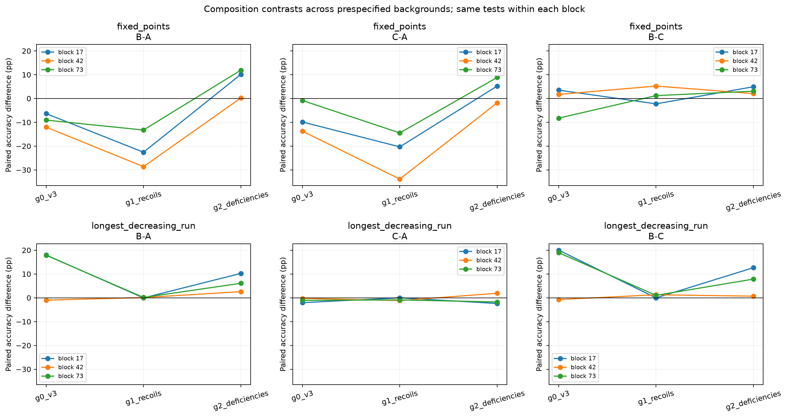
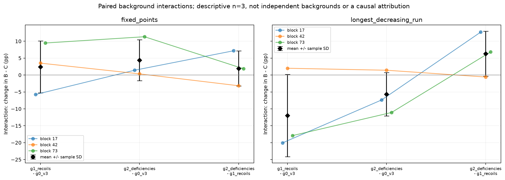

# Pilot v4：背景任务是否改变组成效应

完成两个探索性目标、三个预先冻结背景、三个配对块、固定256目标训练样本的有限比较。主结果为42个唯一开发选择；共享A仅训练/选择一次，加入三个背景比较后展示54行，不能计作54个独立训练。全部126个学习率候选的best和endpoint在同一新测试协议下评估，252行全部保留，不按测试重选。

本轮最清楚的现象是：固定点在原背景的负迁移可随背景改变，LDR在g1的原有收益消失，但这不能由候选源的终点准确率单独解释。下文同时保留效应幅度、逐块差异、训练终点和反例；n=3仅作描述，不作为背景、任务或初始化的一般因果结论。

## 主结果与背景交互

准确率为三个配对块均值；差值以百分点计，±为逐块差值的样本SD，不是置信区间。背景间A为同一权重与同一测试预测，均值重复显示仅便于对照。

| 目标 | 背景 | A | B | C | B−A均值±SD | C−A均值±SD | B−C均值±SD |
| --- | --- | --- | --- | --- | --- | --- | --- |
| fixed_points | g0_v3 | 83.27% | 74.12% | 75.13% | -9.15 ± 2.83 | -8.14 ± 6.62 | -1.01 ± 6.34 |
| fixed_points | g1_recoils | 83.27% | 61.80% | 60.40% | -21.47 ± 7.75 | -22.87 ± 9.94 | +1.40 ± 3.74 |
| fixed_points | g2_deficiencies | 83.27% | 90.71% | 87.35% | +7.44 ± 6.29 | +4.09 ± 5.41 | +3.35 ± 1.46 |
| longest_decreasing_run | g0_v3 | 53.34% | 64.96% | 52.21% | +11.62 ± 10.91 | -1.12 ± 0.90 | +12.74 ± 11.68 |
| longest_decreasing_run | g1_recoils | 53.34% | 53.40% | 52.65% | +0.07 ± 0.10 | -0.68 ± 0.61 | +0.75 ± 0.70 |
| longest_decreasing_run | g2_deficiencies | 53.34% | 59.65% | 52.59% | +6.32 ± 3.84 | -0.75 ± 2.32 | +7.06 ± 6.02 |

以下数列均按配对块17/42/73排序。fixed_points在g0/g1的B−A和C−A均为3/3负，g2的B−A变为+10.16/+0.24/+11.91pp，C−A为+5.22/-1.81/+8.84pp。原固定点负迁移依赖背景，不能泛化成这两个候选组成的固有属性；g2中块42的B收益仅约0.24pp，三个同号不能当作已确立的普遍收益。g2同时提高B和C，且两者都含deficiencies的多输入联合目标关系，不能把绝对迁移改善全归于B的直接相关候选。

longest_decreasing_run的g0 B−A为+17.97/-0.98/+17.87pp，g1缩至-0.05/+0.10/+0.15pp，g2为+10.25/+2.59/+6.10pp。g1的B/C均在训练众数对应的测试基线附近，原g0的块17/73收益消失；g2保留部分收益，块42从原无收益变为小幅正收益。

交互定义为Δ(B−C)=(B−C)_后背景−(B−C)_前背景，按同一配对块和相同新测试输入相减。正数表示后背景更有利于B相对C，不等于B本身必然改善；可同时检查B−A和C−A。

| 目标 | 后背景−前背景 | 块17交互pp | 块42交互pp | 块73交互pp | 交互均值±SD(pp) | 负/零/正块数 | B−C符号翻转块数 |
| --- | --- | --- | --- | --- | --- | --- | --- |
| fixed_points | g1_recoils-g0_v3 | -5.76 | +3.52 | +9.47 | +2.41 ± 7.68 | 1/0/2 | 2 |
| fixed_points | g2_deficiencies-g0_v3 | +1.42 | +0.34 | +11.33 | +4.36 ± 6.06 | 0/0/3 | 1 |
| fixed_points | g2_deficiencies-g1_recoils | +7.18 | -3.17 | +1.86 | +1.95 ± 5.18 | 1/0/2 | 1 |
| longest_decreasing_run | g1_recoils-g0_v3 | -20.07 | +2.00 | -17.92 | -12.00 ± 12.17 | 2/0/1 | 2 |
| longest_decreasing_run | g2_deficiencies-g0_v3 | -7.37 | +1.42 | -11.08 | -5.68 ± 6.42 | 2/0/1 | 1 |
| longest_decreasing_run | g2_deficiencies-g1_recoils | +12.70 | -0.59 | +6.84 | +6.32 ± 6.66 | 1/0/2 | 1 |

fixed_points：B−C随背景改变符号的配对块为[17, 73]；三个块同方向的背景交互为['g2_deficiencies-g0_v3']。 longest_decreasing_run：B−C随背景改变符号的配对块为[17, 42]；三个块同方向的背景交互为无。 符号记录须结合幅度解读：LDR的g1块17 B−C仅−0.0488pp，等于2048个测试样本中的一个；g2块42 B−C为+0.6836pp，而开发B−C为−0.3906pp。这些接近零的差异不足以支持稳定优劣，不能用符号翻转计数代替效应量。

42项唯一主结果如下（[CSV](artifacts/results_selected.csv)）；A的background为shared。每种子84行全部候选原始结果见报告末链接。多数基线使用该块256条目标训练数据的众数，在测试集计算命中率。

| 目标 | 背景 | 配对块 | 条件 | 新测试准确率 | 多数基线 | 选择LR | 选择步 | 训练来源 |
| --- | --- | --- | --- | --- | --- | --- | --- | --- |
| fixed_points | shared | 17 | A | 82.18% | 38.82% | 0.0003 | 700 | 复用 |
| fixed_points | g0_v3 | 17 | B | 75.83% | 38.82% | 0.0003 | 800 | 复用 |
| fixed_points | g0_v3 | 17 | C | 72.31% | 38.82% | 0.0003 | 500 | 复用 |
| fixed_points | g1_recoils | 17 | B | 59.62% | 38.82% | 0.0003 | 700 | 新增 |
| fixed_points | g1_recoils | 17 | C | 61.87% | 38.82% | 0.0003 | 700 | 新增 |
| fixed_points | g2_deficiencies | 17 | B | 92.33% | 38.82% | 0.0003 | 200 | 新增 |
| fixed_points | g2_deficiencies | 17 | C | 87.40% | 38.82% | 0.0003 | 400 | 新增 |
| longest_decreasing_run | shared | 17 | A | 52.00% | 52.00% | 0.0003 | 100 | 复用 |
| longest_decreasing_run | g0_v3 | 17 | B | 69.97% | 52.00% | 0.0001 | 800 | 复用 |
| longest_decreasing_run | g0_v3 | 17 | C | 49.95% | 52.00% | 3e-05 | 100 | 复用 |
| longest_decreasing_run | g1_recoils | 17 | B | 51.95% | 52.00% | 3e-05 | 100 | 新增 |
| longest_decreasing_run | g1_recoils | 17 | C | 52.00% | 52.00% | 3e-05 | 100 | 新增 |
| longest_decreasing_run | g2_deficiencies | 17 | B | 62.26% | 52.00% | 3e-05 | 400 | 新增 |
| longest_decreasing_run | g2_deficiencies | 17 | C | 49.61% | 52.00% | 3e-05 | 100 | 新增 |
| fixed_points | shared | 42 | A | 86.43% | 37.06% | 0.0003 | 800 | 复用 |
| fixed_points | g0_v3 | 42 | B | 74.41% | 37.06% | 0.0003 | 500 | 复用 |
| fixed_points | g0_v3 | 42 | C | 72.71% | 37.06% | 0.0003 | 700 | 复用 |
| fixed_points | g1_recoils | 42 | B | 57.81% | 37.06% | 0.0003 | 800 | 新增 |
| fixed_points | g1_recoils | 42 | C | 52.59% | 37.06% | 0.0003 | 600 | 新增 |
| fixed_points | g2_deficiencies | 42 | B | 86.67% | 37.06% | 0.0001 | 500 | 新增 |
| fixed_points | g2_deficiencies | 42 | C | 84.62% | 37.06% | 0.0003 | 700 | 新增 |
| longest_decreasing_run | shared | 42 | A | 53.08% | 53.08% | 0.0003 | 100 | 复用 |
| longest_decreasing_run | g0_v3 | 42 | B | 52.10% | 53.08% | 3e-05 | 100 | 复用 |
| longest_decreasing_run | g0_v3 | 42 | C | 52.83% | 53.08% | 3e-05 | 100 | 复用 |
| longest_decreasing_run | g1_recoils | 42 | B | 53.17% | 53.08% | 3e-05 | 100 | 新增 |
| longest_decreasing_run | g1_recoils | 42 | C | 51.90% | 53.08% | 3e-05 | 100 | 新增 |
| longest_decreasing_run | g2_deficiencies | 42 | B | 55.66% | 53.08% | 3e-05 | 500 | 新增 |
| longest_decreasing_run | g2_deficiencies | 42 | C | 54.98% | 53.08% | 3e-05 | 100 | 新增 |
| fixed_points | shared | 73 | A | 81.20% | 36.08% | 0.0001 | 400 | 复用 |
| fixed_points | g0_v3 | 73 | B | 72.12% | 36.08% | 0.0003 | 500 | 复用 |
| fixed_points | g0_v3 | 73 | C | 80.37% | 36.08% | 0.0003 | 800 | 复用 |
| fixed_points | g1_recoils | 73 | B | 67.97% | 36.08% | 0.0003 | 800 | 新增 |
| fixed_points | g1_recoils | 73 | C | 66.75% | 36.08% | 0.0003 | 800 | 新增 |
| fixed_points | g2_deficiencies | 73 | B | 93.12% | 36.08% | 0.0003 | 600 | 新增 |
| fixed_points | g2_deficiencies | 73 | C | 90.04% | 36.08% | 3e-05 | 600 | 新增 |
| longest_decreasing_run | shared | 73 | A | 54.93% | 55.27% | 3e-05 | 400 | 复用 |
| longest_decreasing_run | g0_v3 | 73 | B | 72.80% | 55.27% | 0.0003 | 800 | 复用 |
| longest_decreasing_run | g0_v3 | 73 | C | 53.86% | 55.27% | 0.0001 | 100 | 复用 |
| longest_decreasing_run | g1_recoils | 73 | B | 55.08% | 55.27% | 3e-05 | 100 | 新增 |
| longest_decreasing_run | g1_recoils | 73 | C | 54.05% | 55.27% | 3e-05 | 100 | 新增 |
| longest_decreasing_run | g2_deficiencies | 73 | B | 61.04% | 55.27% | 0.0001 | 600 | 新增 |
| longest_decreasing_run | g2_deficiencies | 73 | C | 53.17% | 55.27% | 0.0001 | 200 | 新增 |

g1的LDR适配不是整个训练过程都无法拟合。六项开发选择均退回LR=3e−5、step100的早期checkpoint；所选train为52.73%–56.64%，同LR800步终点train已升至81.25%–95.31%，终点test却降至43.51%–48.88%。这支持后期拟合提高而泛化恶化、开发规则退回早期基线附近模型，不能把所选train接近众数误写成全程没有学到训练数据。

| 块 | 条件 | 选择LR | 选择步 | 所选train | 终点train | 所选dev | 终点dev | 所选test | 终点test |
| --- | --- | --- | --- | --- | --- | --- | --- | --- | --- |
| 17 | B | 3e-05 | 100 | 53.52% | 81.25% | 56.84% | 49.32% | 51.95% | 46.48% |
| 17 | C | 3e-05 | 100 | 53.12% | 85.16% | 56.35% | 46.19% | 52.00% | 43.51% |
| 42 | B | 3e-05 | 100 | 52.73% | 89.84% | 55.86% | 49.22% | 53.17% | 48.88% |
| 42 | C | 3e-05 | 100 | 56.64% | 95.31% | 54.88% | 48.05% | 51.90% | 46.68% |
| 73 | B | 3e-05 | 100 | 54.69% | 89.84% | 55.37% | 47.17% | 55.08% | 48.10% |
| 73 | C | 3e-05 | 100 | 55.86% | 89.45% | 53.61% | 43.65% | 54.05% | 44.19% |

## 有限设计与既有数据平台

案例fixed_points和longest_decreasing_run根据v3结果选定，属于探索性案例；不代表完整任务库，也不是独立于v3的目标选择。相关/替换候选保持v3不变：fixed_points为anti_fixed_points/successions，longest_decreasing_run为longest_increasing_run/left_to_right_maxima。两条目标—相关源关系都使用补值C(p)_i=n+1−p_i及恒等答案映射：target(p)=related(C(p))；不覆盖所有数学关系。

| 目标 | 背景 | B候选slot0 | C候选slot0 | 公共slot1 | 公共slot2 | 公共slot3 |
| --- | --- | --- | --- | --- | --- | --- |
| fixed_points | g0_v3 | anti_fixed_points | successions | descents | peaks | left_to_right_maxima |
| fixed_points | g1_recoils | anti_fixed_points | successions | recoils | peaks | left_to_right_maxima |
| fixed_points | g2_deficiencies | anti_fixed_points | successions | descents | deficiencies | left_to_right_maxima |
| longest_decreasing_run | g0_v3 | longest_increasing_run | left_to_right_maxima | descents | peaks | successions |
| longest_decreasing_run | g1_recoils | longest_increasing_run | left_to_right_maxima | recoils | peaks | successions |
| longest_decreasing_run | g2_deficiencies | longest_increasing_run | left_to_right_maxima | descents | deficiencies | successions |

g0_v3保留原背景；g1_recoils只将公共slot1的descents换成recoils；g2_deficiencies只将公共slot2的peaks换成deficiencies。新增背景在本轮迁移训练/测试之前依据定义及既有单任务参照冻结，没有声称难度或答案分布完全匹配。每个背景内部B/C仅slot0不同，公共三个slot相同。跨背景则任务本身和集合内部已知关系结构也可能变化，不能将效应仅归因于候选与目标的直接关系，也不能称C数学上无关。目录、输入变换/答案映射和复用检查分别保存在实验根目录TASK_CATALOG.csv、DATA_PLATFORM.md及references/REUSE_AUDIT.md。

冻结的 [BACKGROUND_MATCHING.csv](catalog/BACKGROUND_MATCHING.csv) 显示：g1被换任务的源训练答案分布TV为0.00989–0.01428，但recoils的单任务早期学习明显慢于descents；g2的TV为0.76013–0.76526，答案分布差异很大，早期学习轨迹也不同。总体等分布不等于有限池直方图完全一致，更不等于优化难度匹配。下表是冻结前已有记录的描述，背景没有根据这些数值搜索最优得分。

| 块 | 背景 | 替换 | 答案TV | 原任务dev1200 | 新任务dev1200 | 原任务dev4800 | 新任务dev4800 | 曲线绝对差均值pp |
| --- | --- | --- | --- | --- | --- | --- | --- | --- |
| 17 | g1_recoils | descents→recoils | 0.01428 | 99.90% | 62.79% | 100.00% | 99.80% | 16.56 |
| 17 | g2_deficiencies | peaks→deficiencies | 0.76013 | 94.82% | 99.90% | 100.00% | 99.90% | 3.93 |
| 42 | g1_recoils | descents→recoils | 0.00989 | 99.71% | 74.02% | 99.90% | 100.00% | 12.48 |
| 42 | g2_deficiencies | peaks→deficiencies | 0.76135 | 96.09% | 99.22% | 99.71% | 100.00% | 4.69 |
| 73 | g1_recoils | descents→recoils | 0.01294 | 99.80% | 93.07% | 100.00% | 99.90% | 8.79 |
| 73 | g2_deficiencies | peaks→deficiencies | 0.76526 | 96.78% | 99.12% | 100.00% | 99.71% | 4.75 |

同样需要保留B/C候选对本身的剩余差异，不能只核对公共背景替换。以下 [candidate_matching.csv](artifacts/candidate_matching.csv) 从冻结的源答案直方图和既有单任务参考曲线计算，三背景共用同一候选对；没有使用本轮新增预训练、适配或测试来挑候选。原选择证据为 [v3 replacement_matching.csv](../pilot_v3_multitarget/artifacts/replacement_matching.csv)：fixed_points保持历史anti_fixed_points/successions锚点，longest_decreasing_run沿用v3基于seed17开发记录选定的longest_increasing_run/left_to_right_maxima；本轮只是描述其三个配对块上的匹配程度。

| 目标 | 块 | B候选 | C候选 | 答案TV | B单dev1200 | C单dev1200 | B单dev4800 | C单dev4800 | 曲线绝对差均值pp |
| --- | --- | --- | --- | --- | --- | --- | --- | --- | --- |
| fixed_points | 17 | anti_fixed_points | successions | 0.04431 | 99.12% | 47.17% | 99.90% | 68.65% | 45.80 |
| fixed_points | 42 | anti_fixed_points | successions | 0.05200 | 99.80% | 55.47% | 99.90% | 91.11% | 31.91 |
| fixed_points | 73 | anti_fixed_points | successions | 0.03320 | 99.02% | 38.87% | 100.00% | 48.93% | 55.94 |
| longest_decreasing_run | 17 | longest_increasing_run | left_to_right_maxima | 0.20056 | 93.07% | 99.61% | 100.00% | 99.80% | 9.02 |
| longest_decreasing_run | 42 | longest_increasing_run | left_to_right_maxima | 0.21887 | 87.89% | 98.44% | 99.51% | 99.80% | 9.53 |
| longest_decreasing_run | 73 | longest_increasing_run | left_to_right_maxima | 0.20776 | 89.16% | 98.93% | 99.61% | 100.00% | 9.41 |

这张表与背景匹配表分别描述两类替换：TV接近不保证学习速度相同，4800步都学会也不保证早期轨迹一致。它们是保留的混杂说明，不是本轮重新优化组成的依据。

组合冻结后、查看本轮新迁移结果之前，定义级科学复核补充了原目录未覆盖的关系；未改组合、数据、预算或选择规则，详见 [catalog_addenda/README.md](catalog_addenda/README.md)。记D=deficiencies，I=反演，R=一行反序，C=补值，则 fixed_points(p)=n−D(p)−D(I(p))，anti_fixed_points(p)=n−D(C(p))−D(R(I(p)))。因此fixed_points的g2中B/C都含有能通过多个变换输入联合重建目标的背景任务，不能把C理解为不含目标数学联系；单个输入的一个D标签不足以确定目标。正式训练不提供这种配对查询、联合答案或关系损失，池内轨道隔离也不保留不同的变换等价输入。这是隐含数学联系，并非单标签泄漏或模型实际使用该恒等式的证据。

g1是移除descents再换成recoils，并非新增一对共存的descents/recoils源任务。对于longest_decreasing_run，LDR/LIR/descents/peaks共享局部比较符号序列：descents计下降边，LDR/LIR分别取最长连续下降/上升段，peaks计局部峰；这些标量答案不能互相决定。g1移除descents但保留peaks，g2保留descents但移除peaks并加入位置不等计数，对计算结构的改变不同。背景的边缘答案分布、学习动态、源—源/多输入关系和局部计算结构均随之变化，单一关系图边数不足以概括本实验。

模型/数据/预算保持v3兼容：PermWorld n=10、one-line encoding、Transformer 4层/256宽/8头/dropout0.1、188词表与绑定embedding/output，FP32权重/评估、BF16训练、TF32关闭。源池8192与源开发1024，目标训练256与开发1024，最终新测试每块2048。两个目标、各背景和A/B/C在块内共享输入池；此共享并不使跨目标或背景成为独立样本。

配对块标签17/42/73联合索引初始化和数据池，不能当作数据生成RNG seed：s17/s42源于顺序使用RNG20261018，s73源于RNG2026101803；模型初始化seed分别17/42/73。预训练采样/dropout seed=块标签+1000，适配为+2000，新测试RNG2026101805。训练/开发池及step0权重逐字节复用v3，seed_provenance.json记录来源。块间差异混合输入、初始化及优化随机性，本轮未独立干预这些因素。

## 源学习、暴露与解释限制

每预训练run4800步，batch64的slot0…3每步精确16条，四任务采样比例各25%。各slot累计76800次暴露；input/label/index stream hash逐slot核对，同块所有背景/条件共享输入索引及slot赋值。对固定数学任务的相同slot，标签流也相同。完整144行 [source_exposures.csv](artifacts/source_exposures.csv) 保留不同输入数、真实暴露、tokens和hash；不能将76800次暴露当76800个不同输入。

全部源任务train/dev准确率、answer/EOS/two-token CE、按n=10多数基线和曲线保留，[source_learning_table.csv](artifacts/source_learning_table.csv)另连接v3相同输入/初始化的单任务1200/4800步参照。没有新增单任务计算。单任务4800与组合4800具有相同总更新数及全局LR轨迹，但每任务暴露是组合4倍，任务交替也不同；单任务1200只匹配每任务暴露，LR历史和总更新不同，无法据此孤立识别纯干扰。

相对单任务4800步的源开发差异，改善和下降都保留。±5pp仅为描述门槛，去重按seed×任务×source终点state hash；同一任务在多个组合的出现次数并非独立样本。36逻辑源run共有36个不同终点state hash。

| 范围 | 记录数 | 改善≥5pp | 下降≥5pp | 绝对差<5pp |
| --- | --- | --- | --- | --- |
| logical_occurrences | 144 | 4 | 92 | 48 |
| unique_seed_task_source_state | 144 | 4 | 92 | 48 |

背景内部相同公共任务B/C开发准确率差的绝对值最大为48.24pp。跨背景逐slot检查：[source_background_slot_changes.csv](artifacts/source_background_slot_changes.csv)对同一数学任务计算变化；若slot内任务被替换，仅展示两边任务和指标，差值留空，避免把两个任务的准确率差当成同一任务学习改变。

以下为按目标交互绝对值排序的最多四个描述性案例。候选B/C源开发变化是同一任务在后背景减前背景；公共源列只统计未换任务的slot。这里只并列保存状态变化，不拟合相关系数、不作因果归因，也未用这些表追加实验或选择主结果。

| 目标 | 块 | 后−前背景 | 目标交互pp | B候选源dev变化pp | C候选源dev变化pp | 同任务公共源最大绝对变化pp |
| --- | --- | --- | --- | --- | --- | --- |
| longest_decreasing_run | 17 | g1_recoils-g0_v3 | -20.07 | -15.82 | +0.98 | 12.99 |
| longest_decreasing_run | 73 | g1_recoils-g0_v3 | -17.92 | -34.86 | -0.59 | 49.51 |
| longest_decreasing_run | 17 | g2_deficiencies-g1_recoils | +12.70 | +16.60 | -0.39 | 31.15 |
| fixed_points | 73 | g2_deficiencies-g0_v3 | +11.33 | +4.98 | -7.62 | 11.52 |

下面进一步列出两个B候选的源学习状态，数列按17/42/73排列。单1200步只匹配每任务暴露，LR历史和总更新仍不同。

| 目标 | 背景 | B候选源 | 组合train三块 | 组合dev三块 | 单1200 dev三块 |
| --- | --- | --- | --- | --- | --- |
| fixed_points | g0_v3 | anti_fixed_points | 88.48%/92.03%/95.20% | 88.57%/90.04%/93.75% | 99.12%/99.80%/99.02% |
| fixed_points | g1_recoils | anti_fixed_points | 99.40%/88.12%/97.11% | 99.41%/85.74%/96.39% | 99.12%/99.80%/99.02% |
| fixed_points | g2_deficiencies | anti_fixed_points | 98.85%/77.56%/99.15% | 98.73%/76.07%/98.73% | 99.12%/99.80%/99.02% |
| longest_decreasing_run | g0_v3 | longest_increasing_run | 75.85%/61.21%/89.07% | 72.17%/63.18%/86.62% | 93.07%/87.89%/89.16% |
| longest_decreasing_run | g1_recoils | longest_increasing_run | 57.32%/54.92%/55.62% | 56.35%/53.61%/51.76% | 93.07%/87.89%/89.16% |
| longest_decreasing_run | g2_deficiencies | longest_increasing_run | 72.35%/72.47%/70.78% | 72.95%/69.63%/66.31% | 93.07%/87.89%/89.16% |

peaks在g1−g0的两目标×B/C×三块中有12/12项开发准确率下降。LDR的相关源LIR在g1的train/dev均较低，且低于其单任务1200步参照；这与块17/73目标收益消失并列出现，但块42原本没有收益，不能称所有块目标同向下降。

候选源终点准确率不足以解释迁移：fixed_points块17从g0到g1_recoils，anti_fixed_points源dev 88.57%→99.41%，目标B测试75.83%→59.62%；fixed_points块42从g0到g2_deficiencies，anti_fixed_points源dev 90.04%→76.07%，目标B测试74.41%→86.67%。此外fixed_points的g2相对g0，C候选successions源dev变化为-2.44/-11.33/-7.62pp，而C目标测试变化为+15.09/+11.91/+9.67pp，三个块均是源候选下降、目标提高。

LDR的g2内公共源B−C开发差异：descents为+40.53/+9.57/+29.69pp；successions为+32.91/+9.28/+18.75pp；deficiencies为-0.59/+0.39/-0.29pp。因此目标B/C差异同时伴随公共descents/successions学习变化，deficiencies则接近相同，不能分解为独立机制。组合也非只损害源任务：LDR-B的successions相对单任务4800的改善包括g2_deficiencies块17 +10.64pp；g0_v3块73 +43.55pp；g2_deficiencies块73 +15.92pp。不等每任务暴露、任务交替与三个块的优化差异仍限制干扰/协同归因。

g0复用源曲线有历史空缺：fixed_points块17/42只有2400及3000/3600/4200/4800全量train/dev记录；对应图线从2400开始，未补造早期点。新训练run及其余兼容v3记录有0/600/1200/2400/3600/4800步指标。按长度参照只有n=10，不宣称长度外推。

## 适配选择、隔离及预算

B/C各4800步，源LR为100步warmup至3e−4、2400步余弦到3e−5、随后常数3e−5至4800；不再延长。AdamW(weight_decay=.01, betas=.9/.999, eps=1e−8)，梯度裁剪1。每适配条件同三档LR（3e−4/1e−4/3e−5）、每档800步、warmup100后余弦到初始LR的0.1；所有块内候选共享适配数据及采样顺序。目标已有专有token的绑定embedding/output行恢复同块step0值，严格加载预训练权重，重置优化器，无新输出头。

每100步评估全量训练/开发，依次按最高开发答案准确率、最低开发answer CE、最早步数、声明LR顺序选择，step0排除。答案准确率在完整词表prompt-only argmax计算；答案与EOS各占训练loss一半。42项唯一选择的LR计数为{0.0003: 21, 0.0001: 6, 3e-05: 15}；全部候选400→800固定窗口有106/126开发CE上升、32/126开发准确率下降，保留最佳开发与训练终点对照，不把选择后差距直接解释为独立过拟合证据。

FROZEN_PROTOCOL锁定六个目标/背景组成、源码与既有证据；SELECTIONS_FROZEN锁定42项选择及checkpoint hash后才生成独立新测试。新测试排除v1/v2/v3所有输入及v4训练/开发的inverse/reverse/complement完整轨道，三个新测试池也隔离；块内目标/背景/条件统一评估。测试不用于选择背景、LR或checkpoint。最终审计passed；1134个历史文件字节hash已核对；完整证据见FINAL_AUDIT.json。

预训练36逻辑run中12复用、24新增；126适配候选中18个共享A与36个g0 B/C复用，72个新增。精确复用基于有序任务tuple、输入池、初始化、采样及预算兼容，不仅比较无序任务集合。历史权重在新测试上重评估，不是本轮重新训练的独立重复。所有252候选best/endpoint测试记录保留；测试次数及其评估开销在本轮阶段时间中，不计入训练token数。

| 阶段 | 来源 | run数 | 更新数 | 训练input tokens | 监督tokens | 训练timer分钟 |
| --- | --- | --- | --- | --- | --- | --- |
| pretrain | 新增 | 24 | 115,200 | 206,438,400 | 14,745,600 | 20.94 |
| pretrain | 历史复用 | 12 | 57,600 | 103,219,200 | 7,372,800 | 17.92 |
| adapt | 新增 | 72 | 57,600 | 103,219,200 | 7,372,800 | 13.52 |
| adapt | 历史复用 | 54 | 43,200 | 77,414,400 | 5,529,600 | 15.62 |

本轮新增训练timer合计34.46分钟，引擎阶段墙钟合计36.03分钟。timer包含训练、全量train/dev评估、保存及部分记账，复用timer来自历史阶段且范围略异，不计本轮新增；两种时间不能相加。审计与绘图另行运行，不在引擎阶段计时。输入tokens计完整28-token训练前向序列，监督tokens计答案/EOS两个位置；不含评估tokens。本轮单任务参照为既有记录复用，不再付训练成本。

## 结论边界与下一步

这是一项两个经v3结果挑选案例、三个背景、三个配对块的有限探索。背景和任务共享数据、初始化、来源权重；样本数固定256，预训练固定4800、适配每档800，不建立样本效率曲线或scaling law。非正收益、负迁移、方向翻转以及未充分学会的源/目标均保留。目标先前在8192条单任务数据下通过可学习性门槛，不能保证在256条条件下也学会；需要结合多数基线解读小样本结果。

两个目标每个背景下的C具有相同无序任务集合，只是successions与left_to_right_maxima在slot0/slot3互换。相同索引/slot流下，任务分配到的具体输入随之不同，因此C的训练权重/表现可以不同；目标任务没有进入预训练输入，不能把跨目标C差异解释成目标名称改变了预训练。这也进一步限制两个案例的独立性。

下一阶段优先完善“关系类型×背景计算结构”的任务目录和有限组合对照，而非直接增加源任务数量。当前证据是：固定点负迁移可在g2改变，LDR收益在g1消失，公共源学习同时变化，且候选源准确率与目标收益存在反例。候选库宜明确覆盖以下类别，把分布匹配、学习曲线匹配和关系类别分开标注：

1. **直接可逆变换及答案映射。** 保留complement/reverse/inverse下恒等答案关系作为锚点，增加非恒等仿射映射参照，例如同一descents任务在补值输入上满足d(Cp)=n−1−d(p)。这是同任务的变换/映射变体，不计作新独立任务。
2. **边缘等分布但计算结构不同。** 以现有descents/recoils/exceedances等Eulerian统计作候选，区分one-line下邻接位置比较、逆位置比较和对角线位置比较；g1表明TV接近仍会伴随早期学习和组合效果差异，不能只匹配答案直方图。
3. **多源或多输入联合关系。** 标注fixed/exceedances/deficiencies的位置划分、D(p)与D(Ip)联合恢复fixed，以及cycle_count=fixed_points+nontrivial_cycle_count；区分同输入多源答案与变换输入多查询。以后若检验模型是否利用这些关系，须另行冻结成对输入/关系约束干预，不能拿本轮隐含关系当已利用机制。
4. **共享局部计算结构但标量不互定。** 用已有LIR/LDR/descents/peaks/valleys及局部三元组计数组织背景，区分共同中间比较序列、等式与上下界，避免将共同计算统计的保留/删除简化成关系边数变化。
5. **单向信息关系及其他计算族。** 现有cycle_count到parity的模2映射、cycle分解相关计数可提供不同于局部/位置统计的结构，但应先复核单任务可学习性；v3的cycle_count候选曾未达学习门槛，不能直接把未学会任务当已匹配对照。

组合层面先保留固定四源数、固定预算和有序slot配对，明确哪些组仅改边缘分布/学习速度，哪些组同时改变局部结构或联合关系。若跨目标比较相同C集合，还应单独处理slot到输入的分配。以上为后续研究建议，并未执行新目标、成对查询、slot控制或训练；不依据本轮候选测试最高分再搜索最优背景。

本轮已按预设规模停止；没有追加学习率、预算、背景或目标，等待后续指导。

## 文件

- [42唯一主结果](artifacts/results_selected.csv)、[54背景对照展示行](artifacts/results_display_ABC.csv)、[252全部候选](artifacts/results_all_candidates.csv)。
- 每块原始CSV：[17](artifacts/results_seed17.csv)、[42](artifacts/results_seed42.csv)、[73](artifacts/results_seed73.csv)。
- [配对组成差值](artifacts/paired_deltas.csv)、[背景交互逐块](artifacts/background_interactions.csv)、[交互汇总](artifacts/background_interactions_summary.csv)、[终点对照](artifacts/selected_vs_endpoint.csv)。
- [源学习/单任务参照](artifacts/source_learning_table.csv)、[公共源B/C差异](artifacts/common_source_BC.csv)、[源与目标交互并列记录](artifacts/interaction_source_context.csv)。
- [沿用B/C候选对的分布与难度差异](artifacts/candidate_matching.csv)，选择来源为 [v3冻结前的匹配记录](../pilot_v3_multitarget/artifacts/replacement_matching.csv)。
- [完整目标曲线](artifacts/target_curves.csv)、[源曲线](artifacts/source_curves.csv)、[冻结配置](artifacts/FROZEN_PROTOCOL.json)、[成本](artifacts/compute_summary.csv)、[阶段耗时](artifacts/stage_timings.csv)；复现命令见README.md。
- [独立统计重算与CSV绑定审计](artifacts/STATISTICS_AUDIT.json)，与权重/协议最终审计分开记录。
- [冻结后的定义级关系复核补充](catalog_addenda/README.md)；它在查看本轮新迁移结果之前完成，不触发新实验，也不改写冻结目录。
