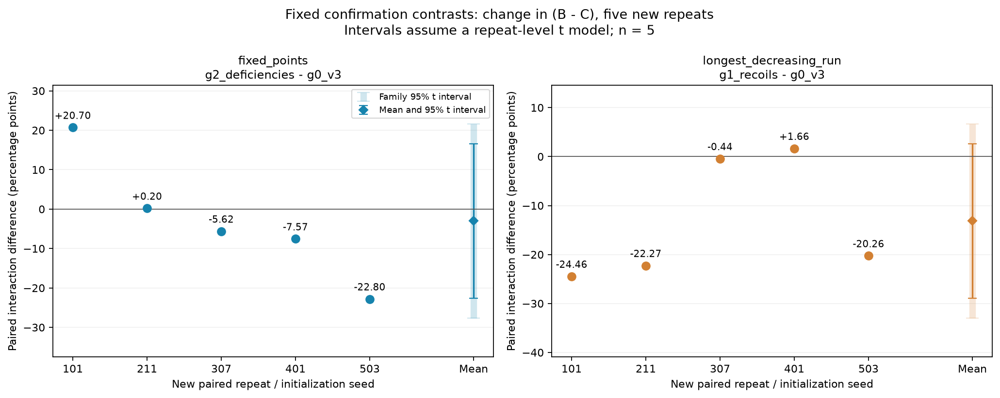
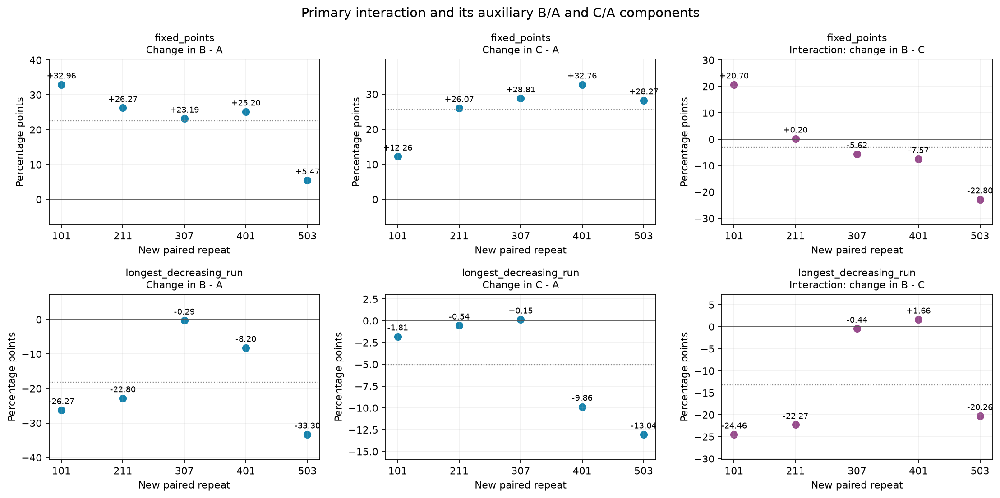

# pilot_v5: confirmation of fixed background-interaction hypotheses

This round completes two fixed contrasts proposed from v4 exploration, with five new paired data/initialization repeats. The primary quantity is computed within each repeat: `Δ(B−C)=(B−C)_new_background−(B−C)_original_background`. It is not a comparison of separate SDs for two background means.

- **fixed_points**: The prespecified mean direction did not reproduce. Mean interaction -3.02pp; 2/5 repeats match the prespecified direction. 95% paired-t interval [-22.57, +16.54]pp; two-contrast Bonferroni simultaneous interval [-27.63, +21.60]pp.
- **longest_decreasing_run**: The confirmation point estimate has the same direction as exploration, but both individual and simultaneous intervals include 0; stable evidence of a background effect has not been established. Mean interaction -13.15pp; 4/5 repeats match the prespecified direction. 95% paired-t interval [-28.89, +2.58]pp; two-contrast Bonferroni simultaneous interval [-32.97, +6.66]pp.

This validation is limited to these two preselected cases at n=10, 256 target examples, and fixed budgets. The old three seeds are exploratory; the new five repeats are confirmatory. They are not pooled as eight repeats. Uniform new tests were generated only after training and development selection finished; all negative gains, unlearned tasks, and inconsistent results are retained.

## Recompute exploration before freezing confirmation

All targets' g1−g0 and g2−g0 differences were recomputed from v4's 42 unique selected raw rows. The 12 per-seed background differences and plots are in the [exploratory analysis](exploratory/EXPLORATORY_ANALYSIS_ZH.md). FP g2−g0 exploratory mean Δ(B−A)/Δ(C−A)/Δ(B−C) is +16.59/+12.22/+4.36pp, with primary interactions +1.42/+0.34/+11.33pp by seed. LDR g1−g0 is −11.56/+0.44/−12.00pp, with primary interactions −20.07/+2.00/−17.92pp. Shared A cancels exactly in background differences.

Prespecified H1: fixed_points, original→deficiencies background, expecting a positive primary interaction. H2: longest_decreasing_run, original→recoils background, expecting a negative primary interaction. Directions come from v4 exploration, not independent theoretical predictions. This round does not confirm the other two background contrasts, change directions from new results, switch to one-sided tests, or add repeats.

| Target | Candidate B / candidate C | Original three common sources | New three common sources |
| --- | --- | --- | --- |
| fixed_points | anti_fixed_points / successions | descents, peaks, left_to_right_maxima | descents, deficiencies, left_to_right_maxima |
| longest_decreasing_run | longest_increasing_run / left_to_right_maxima | descents, peaks, successions | recoils, peaks, successions |

Candidates occupy fixed slot0 and common sources slots 1–3. Neither target enters any pretraining group. Mathematical task relations and instance isolation are distinct checks. Group definitions and statistical methods were hash-frozen before new formal training; see the [frozen configuration](artifacts/FROZEN_PROTOCOL.json) and [stats_plan.json](stats_plan.json).

## Confirmation results from five new repeats

| Target | v4 exploratory mean pp | v5 confirmation mean±sample SD pp | Per-repeat range pp | 95% paired-t interval pp | Two-contrast simultaneous interval pp |
| --- | --- | --- | --- | --- | --- |
| fixed_points | +4.36 | -3.02 ± 15.75 | [-22.80, +20.70] | [-22.57, +16.54] | [-27.63, +21.60] |
| longest_decreasing_run | -12.00 | -13.15 ± 12.67 | [-24.46, +1.66] | [-28.89, +2.58] | [-32.97, +6.66] |

| Target | New repeat/initialization seed | Δ(B−A) pp | Δ(C−A) pp | Primary Δ(B−C) pp |
| --- | --- | --- | --- | --- |
| fixed_points | 101 | +32.96 | +12.26 | +20.70 |
| fixed_points | 211 | +26.27 | +26.07 | +0.20 |
| fixed_points | 307 | +23.19 | +28.81 | -5.62 |
| fixed_points | 401 | +25.20 | +32.76 | -7.57 |
| fixed_points | 503 | +5.47 | +28.27 | -22.80 |
| longest_decreasing_run | 101 | -26.27 | -1.81 | -24.46 |
| longest_decreasing_run | 211 | -22.80 | -0.54 | -22.27 |
| longest_decreasing_run | 307 | -0.29 | +0.15 | -0.44 |
| longest_decreasing_run | 401 | -8.20 | -9.86 | +1.66 |
| longest_decreasing_run | 503 | -33.30 | -13.04 | -20.26 |

The following means over five repeats provide context on accuracy levels and majority baselines. A is trained and selected once per target/repeat and repeated in background display tables. The 60 display rows correspond to 50 unique selected models, not 60 independent selections.

| Target | Background | A accuracy | B accuracy | C accuracy | Target majority baseline |
| --- | --- | --- | --- | --- | --- |
| fixed_points | g0_v3 | 80.96% | 67.10% | 62.83% | 36.30% |
| fixed_points | g2_deficiencies | 80.96% | 89.72% | 88.47% | 36.30% |
| longest_decreasing_run | g0_v3 | 53.56% | 71.67% | 57.40% | 53.67% |
| longest_decreasing_run | g1_recoils | 53.56% | 53.50% | 52.38% | 53.67% |

LDR random-initialization A has mean accuracy 53.56%, close to its 53.67% majority baseline; B/C in the recoils background are also near that baseline. Target learning therefore remains substantially limited at 256 samples and the current adaptation budget. A cancels exactly from the primary interaction, leaving its definition unchanged, but benefit levels must be interpreted alongside this training limitation.

Intervals use the five paired interaction differences directly, with SD denominator n−1. Individual intervals use df=4 and t=.975 quantile 2.776445. Bonferroni simultaneous intervals for the two primary contrasts have 97.5% marginal coverage each and critical value 3.495406. The latter do not require independence between the two target contrasts, but t coverage still assumes approximately independent normal repeat-level values. Five repeats cannot test normality or tails. Distinct RNG/initialization streams also do not imply strictly IID pools, because cross-block orbit exclusion creates finite-population sampling-without-replacement dependence. Intervals include finite-test-pool random variation and do not cover all task families.

| Target | Two-sided sign-flip p | Two-sided sign p | Direction matches/nonzero n | Leave-one-out mean range pp |
| --- | --- | --- | --- | --- |
| fixed_points | 0.6250 | 1.0000 | 2/5 | [-8.95, +1.93] |
| longest_decreasing_run | 0.1875 | 0.3750 | 4/5 | [-16.86, -10.33] |

The sign-flip diagnostic enumerates 32 sign assignments and requires independent sign symmetry around zero; it is not a treatment-randomization test guaranteed by this design. The sign test additionally assumes independent repeats with positive/negative probability 1/2 and concerns sign/median tendencies rather than the mean. With five nonzero repeats, both have minimum two-sided p=0.0625, so conventional significance cannot be promised. Leave-one-out means describe sensitivity to one repeat and do not replace the primary analysis. Auxiliary Δ(B−A)/Δ(C−A) and source learning are descriptive only, without expanding the testing family or selecting significant findings afterward.

## Joint mathematical relations and data isolation

Actual task implementations and independent checks are documented in the [mathematical relations](mathematics/README.md) and [audit results](mathematics/MATH_AUDIT.json). The inventory distinguishes formulas/proofs, empirical observations, and unchecked claims. Exhaustive and random larger-n checks validate implementations; finite verification is not a general proof. In particular, distinguish recovering a target jointly from source answers on the same input from recovering it when additional transformed-input queries are allowed.

At each position i, p(i) is exactly one of equal to, greater than, or less than i, so `fixed_points(p)+exceedances(p)+deficiencies(p)=n`. Same-input exceedances and deficiencies answers jointly determine fixed_points. The new FP background contains deficiencies but not exceedances, so this identity alone does not establish same-input joint recovery by the current group. Also, `exceedances(p)=deficiencies(inverse(p))`; if an extra inverse-permutation query is allowed, `fixed_points(p)=n−deficiencies(p)−deficiencies(inverse(p))`. This round supplies no explicit paired queries or joint-reasoning supervision.

**Both B and C in the FP deficiencies background have this exact cross-input joint relation; C is not a control without target mathematical relations.** The mathematical audit provides n=10 counterexamples for all 12 v4 groups: equal n and equal four-source scalar answers on the same input do not uniquely recover the target. Restricting queries to four sources × eight I/R/C transformations, or 32 answers, all six B groups recover the target from transformed candidate queries, and FP g2 C recovers it from two deficiencies queries. Each of the remaining five C groups has an n=10 insufficiency counterexample. This excludes only the specified answer-query model, not computation from raw input or other unchecked relations. See [TARGET_JOINT_DERIVABILITY.csv](mathematics/audit/TARGET_JOINT_DERIVABILITY.csv) and [explicit counterexamples](mathematics/audit/COUNTEREXAMPLES.csv).

Verification completed exhaustive S1…S7 coverage of 5913 inputs plus 4096 n=10 fixtures. Twenty definitions under eight transformations received 1,601,440 independent label comparisons, and 28 formulas/bounds each received 10,009 checks. Fixtures validate mathematical implementations only; they were not used for training or transfer-configuration selection. Empirically observed associations and unchecked mechanisms are separately recorded in [OBSERVED_ASSOCIATIONS.csv](mathematics/audit/OBSERVED_ASSOCIATIONS.csv) and [UNCHECKED_CLAIMS.csv](mathematics/audit/UNCHECKED_CLAIMS.csv).

The related candidate anti_fixed_points connects to fixed_points through complement/reversal input transforms; LIR/LDR connect through complement or reversal. descents, runs, peaks/valleys also share local comparison structure. These are legitimate mathematical relations, not automatically leakage. Leakage checks concern actual train/dev/test inputs and full inverse/reverse/complement orbit overlap. Whether a group's complete source scalar answers recover a target, and whether transformed queries are required, is specified group by group in the mathematical inventory and counterexamples. Unchecked relations are not declared absent.

## Auxiliary source-learning results and limits on mechanisms

Each four-source run has 4800 steps with batch64,16 examples per task per step, and exactly 25% sampling. Each task receives 76800 exposures,2150400 input tokens, and 153600 supervised tokens. Actual unique-input counts, stream hashes, length-specific (n=10) train/dev accuracy, answer CE, EOS CE, and majority baselines are retained in [source_learning_table.csv](artifacts/source_learning_table.csv) and [source_exposures.csv](artifacts/source_exposures.csv).

| Target | Background | Condition | Candidate source | Mean train | Mean dev | Dev range | Dev majority baseline |
| --- | --- | --- | --- | --- | --- | --- | --- |
| fixed_points | g0_v3 | B | anti_fixed_points | 99.19% | 99.08% | [98.05%, 99.41%] | 37.03% |
| fixed_points | g0_v3 | C | successions | 49.26% | 46.66% | [41.80%, 51.27%] | 39.00% |
| fixed_points | g2_deficiencies | B | anti_fixed_points | 98.51% | 98.50% | [97.66%, 99.32%] | 37.03% |
| fixed_points | g2_deficiencies | C | successions | 51.44% | 48.95% | [44.82%, 56.05%] | 39.00% |
| longest_decreasing_run | g0_v3 | B | longest_increasing_run | 76.78% | 74.04% | [56.54%, 96.29%] | 54.00% |
| longest_decreasing_run | g0_v3 | C | left_to_right_maxima | 98.21% | 97.73% | [96.58%, 98.93%] | 31.35% |
| longest_decreasing_run | g1_recoils | B | longest_increasing_run | 57.02% | 57.01% | [53.22%, 62.11%] | 54.00% |
| longest_decreasing_run | g1_recoils | C | left_to_right_maxima | 97.06% | 96.27% | [93.16%, 98.05%] | 31.35% |

| Target | Repeat | Target interaction pp | B candidate source dev background difference pp | C candidate source dev background difference pp | Max absolute unchanged-common-source dev difference pp |
| --- | --- | --- | --- | --- | --- |
| fixed_points | 101 | +20.70 | -0.49 | -2.25 | 21.88 |
| fixed_points | 211 | +0.20 | -1.56 | +12.11 | 11.13 |
| fixed_points | 307 | -5.62 | +1.27 | -2.15 | 4.39 |
| fixed_points | 401 | -7.57 | -1.17 | +3.52 | 7.91 |
| fixed_points | 503 | -22.80 | -0.98 | +0.20 | 8.30 |
| longest_decreasing_run | 101 | -24.46 | -23.05 | +1.46 | 33.11 |
| longest_decreasing_run | 211 | -22.27 | -15.14 | -0.78 | 9.47 |
| longest_decreasing_run | 307 | -0.44 | -2.25 | -5.76 | 13.28 |
| longest_decreasing_run | 401 | +1.66 | -10.55 | -1.27 | 8.20 |
| longest_decreasing_run | 503 | -20.26 | -34.18 | -0.98 | 35.06 |

These 10 entries cover all repeats, not cases selected by transfer magnitude. Candidate-source columns compare the same task's development accuracy across backgrounds; the common-source maximum includes only unchanged task definitions. Replaced peaks/deficiencies or descents/recoils tasks have their levels/baselines juxtaposed, without treating different-task accuracy differences as learning changes. The maximum absolute within-background common-task B/C development difference is 45.70pp; see [common_source_BC.csv](artifacts/common_source_BC.csv) for full records.

Source records support descriptions that composition changes accompany changed source learning and that some sources remain unlearned under the current budget. They do not prove that source-accuracy changes cause transfer interactions. Sources and targets may jointly depend on optimization, shared computation, answer distributions, representation competition, and finite samples; these mediators were not independently manipulated. Mathematical derivability does not mean the Transformer learned or used the formula. Repeats with opposing source/transfer changes are fully retained, without post hoc explanations limited to intuitive cases.

The independent description of source learning before testing is saved in [SOURCE_LEARNING_NOTES.md](SOURCE_LEARNING_NOTES.md); its audit records that TEST_COMPLETE did not yet exist. Only the following section juxtaposes source records with frozen target results, distinguishing evidence from interpretation.

**FP: joint improvement in B/C appears again, but the prespecified positive replacement interaction does not reproduce.** Mean anti_fixed_points source dev changes from 99.08% to 98.50%, both near 99%. In 4/5 repeats this source dev decreases while B target accuracy increases. Failure to learn the related candidate in the original background therefore cannot uniformly explain this target, and candidate-source accuracy cannot directly proxy target benefit. Mean background changes in B−A and C−A are +22.62/+25.63pp. Both improve in all five repeats, but C improves more on average; the primary interaction is -3.02pp. deficiencies is well learned in both B/C new backgrounds, and both admit the formula for cross-input joint recovery of FP. This is an important design fact, but the round does not prove that the model used the formula, so joint gains cannot be directly attributed to this pathway.

**LDR: lower source learning accompanies lower B target benefit, but does not establish an interaction mechanism.** Mean LIR source dev changes from 74.04% to 57.01%, decreasing in all five repeats. New-background mean train is 57.02%, and mean development majority baseline is 54.00%. Both train and development are low, supporting insufficient source learning under this budget rather than only a generalization gap after training fit. B target accuracy also decreases in all five repeats, with mean B−A background change -18.17pp. C−A simultaneously changes by -5.02pp, leaving mean primary interaction -13.15pp. Important counterexamples are retained: seed401: LIR source dev changes by -10.55pp, target B by -8.20pp and C by -9.86pp, yet the primary interaction is +1.66pp. The interaction depends on both B and C; looking only at declining B-source learning misses this.

**Common sources are not uniformly harmed.** Across the two LDR conditions,10 same-task peaks background differences contain 8 decreases and 2 increases; positive entries are C/seed211: +2.34pp; C/seed307: +2.93pp. Thus the v4 observation that peaks always declined does not reproduce entry by entry. Changes in common sources and successions depend on seed/condition; the composition effect is not a simultaneous decline in all sources.

Existing records support these concurrent changes, low training-learning levels, and counterexamples. They cannot distinguish shared computational structure, optimization speed/gradient competition, answer distributions, use of joint relations, or adaptation-stage plasticity. No mediator interventions, gradient experiments, or explicit transformed-input queries were performed, and no mechanism was established.

Old v3 single-task records are copied as historical references in [historical_single_references.csv](artifacts/historical_single_references.csv); no single-task retraining was performed. They use old seeds/pools and are not strictly paired controls for new multitask runs. Single1200 matches only per-task exposure, with different LR history and total updates; single4800 has four times the multitask per-task exposure. New-multitask minus old-single-task gaps therefore cannot directly identify composition interference. Complete new source and target curves are retained; selected-LR train/dev plots are in the [figures directory](artifacts/figures).

## Configuration, actual budget, and reproduction

| Repeat | Initialization seed | Train/dev generation seed | Test generation seed |
| --- | --- | --- | --- |
| R1 | 101 | 2026101901 | 2026101951 |
| R2 | 211 | 2026101902 | 2026101952 |
| R3 | 307 | 2026101903 | 2026101953 |
| R4 | 401 | 2026101904 | 2026101954 |
| R5 | 503 | 2026101905 | 2026101955 |

Every repeat uses a freshly initialized model and an independent data-seed stream, without reusing old weights as new repeats. The five new repeats are isolated from each other and all v1–v4 inputs using the same full transformation-orbit rule. Each block has source_train8192/source_dev1024/target_train256/target_dev1024 and test 2048. Targets/backgrounds/conditions share corresponding inputs within a block; task definitions determine target labels. Source sampling/dropout seed=initialization seed+1000, adaptation=+2000. Full generation order and data hashes are in seed_provenance, DATA_READY, and test_data_audit.

The model remains a4-layer Transformer, width256,8 heads, MLP4, dropout.1, tied input/output embedding, vocabulary188, PermWorld one-line, n=10, with 3,240,448 parameters. Each training forward has 28 tokens, with supervision only on answer/EOS; prefix tokens do not contribute loss. B/C each receive 4800 steps:100-step warmup to 3e−4, cosine decay to 3e−5 at 2400, then constant through 4800. Each adaptation condition retains three LRs 3e−4/1e−4/3e−5,800 steps each,100-step warmup and cosine decay to 0.1 of the initial value. No new hyperparameter search was added.

Full train/dev evaluation occurs every 100 steps, excluding step0. Selection prioritizes highest development answer accuracy, lowest development answer CE, earliest step, then fixed LR order. LR counts for 50 unique selected models: {'0.0003': 28, '0.0001': 5, '3e-05': 17}. Adaptation strictly loads source parameters, restores the target token's tied embedding/output row to the block's step0 value, and uses fresh AdamW state. AdamW wd=.01, betas=.9/.999, eps=1e−8, clip1; BF16 training, FP32 weights/evaluation, TF32 disabled.

All 50 development selections are frozen before generating five new test pools. All 300 best/endpoint results across LRs are retained diagnostically, without test-based model reselection. Primary analysis uses only 50 selected rows; endpoint comparisons are in [selected_vs_endpoint.csv](artifacts/selected_vs_endpoint.csv). The [final independent CPU audit](artifacts/FINAL_AUDIT.json) passed:1,801 historical files remained byte-identical,25 input pools were independently replayed, and 425 checkpoints, parameter loading, target-row resetting, optimizer counters,50 development selections, and all paired statistics passed verification. The core audit took 63.35 seconds; it checked saved evidence and weights without rerunning neural inference. Commands, file responsibilities, and resumption instructions are in the [README](README.md).

| Stage | Runs | Updates | Input tokens | Supervised tokens | Run timer minutes |
| --- | --- | --- | --- | --- | --- |
| pretrain | 40 | 192000 | 344064000 | 24576000 | 91.79 |
| adapt | 150 | 120000 | 215040000 | 15360000 | 28.66 |

New training timers total 120.45 minutes; engine-stage wall time totals 122.79 minutes. Training timers include training, full train/dev evaluation, checkpoint saving, and bookkeeping, not pure GPU time. The two measures are not added; the final historical-file preservation check, independent auditing, and plotting are separate. All 40 pretraining runs and 150 adaptation candidates are new, totaling 312000 updates and 559104000 input tokens. Budgets were not extended, and no new single-task training was performed. Checkpoints/configuration are retained for later CKA integration.

## Next-stage task-family expansion plan and stopping point

See [TASK_FAMILY_PLAN.md](TASK_FAMILY_PLAN.md), frozen before new transfer results. Prioritize existing cycle-decomposition, global ordered-subsequence, and permutation-block families to provide different computational references for studied local comparisons and position-inequality counts. Next add displacement/pairwise-order and pattern counts; parameter instances are not independent families. Future genuinely new families include undirected connectivity/cycle rank, finite-field rank/kernel with singular matrices, and quadratic/bilinear forms over odd-characteristic fields. These new generators are not implemented or certified in this round. Each family should receive independent oracle checks and single-task development before compositions are frozen, retaining unlearned candidates. Two preselected cases cannot establish a universal ranking of families.

The platform should separate mathematical task_id, parameters, encoding, and input transforms. Single-task relations record domain conditions, direction, input actions, and answer maps. Joint relations use multi-input/multi-source hyperedges to record required source sets, query transformations, formulas/proofs, and verification scope; observed associations and unchecked markers are stored separately. Generators reuse base-instance→transform→label oracle→uniform split/orbit deduplication→encoding, recording versions, seeds, actual pool hashes, sampling slots, and exposures. Legitimate relation-derived tasks are not automatically leakage; instance isolation and relation categories are audited separately.

This round completes only five new repeats for the two prespecified contrasts. Effect direction, magnitude uncertainty, and mechanistic conjectures are reported separately. No more background variants for these targets, extra repeats, training budgets, or learning rates are added, pending further guidance.

## Main deliverables

- [Paired differences by repeat](artifacts/confirmation_paired_differences.csv), [Primary/auxiliary summaries](artifacts/confirmation_summary.csv), [Exploration and confirmation separately](artifacts/confirmation_vs_exploration.csv).
- [50 unique primary results](artifacts/results_selected.csv), [All 300 candidate best/endpoint results](artifacts/results_all_candidates.csv); Raw CSV per repeat: [101](artifacts/results_seed101.csv), [211](artifacts/results_seed211.csv), [307](artifacts/results_seed307.csv), [401](artifacts/results_seed401.csv), [503](artifacts/results_seed503.csv).
- [Source learning](artifacts/source_learning_table.csv), [Actual exposures](artifacts/source_exposures.csv), [Same-source changes across backgrounds](artifacts/source_background_changes.csv), [Source and target interactions side by side](artifacts/source_interaction_context.csv).
- [Statistical audit](artifacts/confirmation_statistics_audit.json), [Final independent audit](artifacts/FINAL_AUDIT.json), [Mathematical verification](mathematics/MATH_AUDIT.json), [Frozen statistical plan](stats_plan.json).
