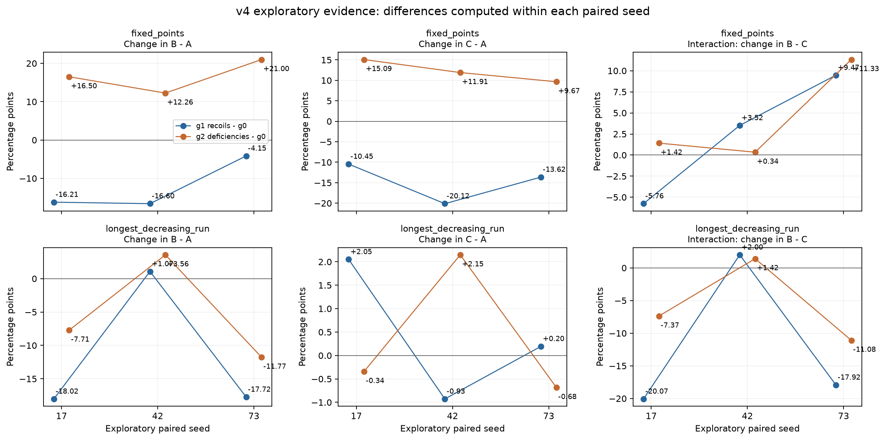

# v4 现有结果的逐种子配对重算

本文件只读取既有 `pilot_v4_backgrounds/artifacts/results_selected.csv`，没有新增训练，也不读取 v5 验证结果。旧种子17/42/73仅为探索证据。全部结果使用各自按开发集选出的checkpoint在同一v4新测试池上的准确率；A在各背景共享。

对于每个种子，先计算 `Δ(B−A)=(B新−A)−(B原−A)`、`Δ(C−A)=(C新−A)−(C原−A)`，再计算主交互 `Δ(B−C)=(B新−C新)−(B原−C原)`。共享A使前两项分别等于B与C本身的背景差；交互等于前两项之差。以下数字为百分点，CSV保留准确率比例原值。

| 目标 | 背景改变 | seed | Δ(B−A) pp | Δ(C−A) pp | Δ(B−C) pp |
| --- | --- | --- | --- | --- | --- |
| fixed_points | g1_recoils−g0 | 17 | -16.2109 | -10.4492 | -5.7617 |
| fixed_points | g1_recoils−g0 | 42 | -16.6016 | -20.1172 | +3.5156 |
| fixed_points | g1_recoils−g0 | 73 | -4.1504 | -13.6230 | +9.4727 |
| fixed_points | g2_deficiencies−g0 | 17 | +16.5039 | +15.0879 | +1.4160 |
| fixed_points | g2_deficiencies−g0 | 42 | +12.2559 | +11.9141 | +0.3418 |
| fixed_points | g2_deficiencies−g0 | 73 | +20.9961 | +9.6680 | +11.3281 |
| longest_decreasing_run | g1_recoils−g0 | 17 | -18.0176 | +2.0508 | -20.0684 |
| longest_decreasing_run | g1_recoils−g0 | 42 | +1.0742 | -0.9277 | +2.0020 |
| longest_decreasing_run | g1_recoils−g0 | 73 | -17.7246 | +0.1953 | -17.9199 |
| longest_decreasing_run | g2_deficiencies−g0 | 17 | -7.7148 | -0.3418 | -7.3730 |
| longest_decreasing_run | g2_deficiencies−g0 | 42 | +3.5645 | +2.1484 | +1.4160 |
| longest_decreasing_run | g2_deficiencies−g0 | 73 | -11.7676 | -0.6836 | -11.0840 |

| 目标 | 背景改变 | Δ(B−A)均值 pp | Δ(C−A)均值 pp | Δ(B−C)均值 pp | 交互逐seed范围 pp |
| --- | --- | --- | --- | --- | --- |
| fixed_points | g1_recoils−g0 | -12.3210 | -14.7298 | +2.4089 | [-5.7617, +9.4727] |
| fixed_points | g2_deficiencies−g0 | +16.5853 | +12.2233 | +4.3620 | [+0.3418, +11.3281] |
| longest_decreasing_run | g1_recoils−g0 | -11.5560 | +0.4395 | -11.9954 | [-20.0684, +2.0020] |
| longest_decreasing_run | g2_deficiencies−g0 | -5.3060 | +0.3743 | -5.6803 | [-11.0840, +1.4160] |

fixed_points的deficiencies背景相对原背景，B−A平均增加16.59pp、C−A平均增加12.22pp，因此主交互只有+4.36pp；三个种子均为正，但幅度从约+0.34到+11.33pp。不能把B单独的改善全部归于相关源相对替换源的优势。

longest_decreasing_run的recoils背景相对原背景，主交互平均−12.00pp，三个种子中两个为负、一个为正；主要表现为B的变化，而C平均变化较小。另两组探索组合也保留，未据其结果增加验证对比。

这些是直接逐种子相减的结果，不通过两组各自的标准差判断背景差异是否可靠。三个探索块和依据同批结果挑出的对比不能提供独立验证；本轮不对这三块作显著性承诺。下一步固定验证FP的g2−g0正方向、LDR的g1−g0负方向，使用五个新数据/初始化配对单元，统计方案见 `../stats_plan.json`。探索与验证分别报告，不合并成八重复。

原始重算数据：[exploratory_paired_differences.csv](exploratory_paired_differences.csv)。全部12条交互另与v4旧交互CSV逐项核对，在1e−12精度内一致；该旧表没有参与重算，见[审计](exploratory_statistics_audit.json)。
