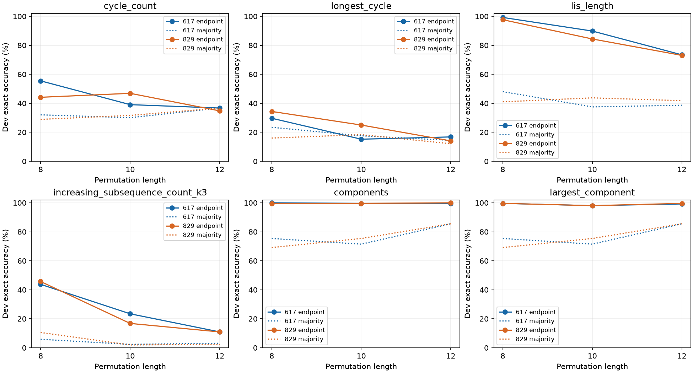

# PermWorld 数据平台 v0.1 交付报告

已完成三个任务族的统一接口、注册表、精确生成器、版本化序列协议、固定数据、正确性证书，以及六个预选代表任务的两个种子单任务标定。旧两个背景交互对比已停止追加，pilot_v5 的未复现与不确定结论保持原样；本轮没有迁移组合搜索。

## 平台交付与有效数量

| 任务族 | 重点模板数 | 默认实例数 | 固定长度非恒定实例数 |
| --- | ---: | ---: | ---: |
| 循环分解 | 6 | 8 | 8 |
| 全局子序列 | 5 | 9 | 7 |
| 排列块 | 5 | 7 | 7 |

保留全部48个旧端点，新增6个端点，共54个。扣除两项参数别名与四项表示输出端点，是48个规范数学模板，但不等于同样数量的独立数学能力。完整目录声明62个实例；规范数据物化56个单输入非别名实例。实际暴露一种输入编码 one_line_v1。

重点族共16模板/24声明实例；I₁=D₁=n，两者保留并标注为固定长度常数。因此有23个相同输入函数类、22个非恒定类。按已登记的保持答案值变换合并，是20类/19个非恒定类；再允许 components/global_descents 的加一映射，是19/18。这些是明示关系下的计数口径，不是数学独立性声明。其他275对实例均保存了相同输入下答案不同的见证；相同输入不重复也不意味着不存在联合关系。

cycle_length_count(k=1,2,3)已有 fixed_points/two_cycle_count/three_cycle_count 对应；D₂=length，I₂=binom(n,2)−length。新增端点与实际新增计算能力不能混计。已有 shortest_cycle 等旧任务完整保留。参数k=4的CPU示例只是运行时配置，没有增加模板计数。

22个非恒定实例对应本版n=8/10/12及默认k=1/2/3；小n、k>n会出现额外退化，不能称为在每个合法长度都非恒定。

[任务注册表](registry/TASK_REGISTRY.json)包含定义、合法长度、参数、精确算法、输出范围和类型、族、复杂度、实测标签生成成本及关系证据；[实例表](registry/TASK_INSTANCES.csv)和[有效计数](registry/TASK_COUNTS.json)独立保存。

## 数据、输出协议与正确性

固定数据覆盖n=8/10/12、两个数据单元，共9,216个不同排列、516,096个精确标签。每单元每长度1024训练、256开发、256保留测试。统一拒绝v1–v5及本轮角色/单元间的完整inverse/reverse/complement轨道重合；随机流重放、重复与泄漏检查通过。提议是均匀置换，轨道拒绝后的池不能声称均匀轨道或严格IID。生成计时8.74秒（不含随后独立核验）。

答案协议显式版本为 permworld_sequence_v1，旧188个token ID不变、词表追加到203项。大整数用带界符的base100，结构答案用嵌套列表；不取模或截断。n=30,k=15的计数155117520已往返验证。全部重点实例可在128上下文中编码；部分旧结构/二元任务在大n超长，读取明确拒绝。六个标量代表的训练不能代替全部结构化输出任务的可学习性标定。

数据质量表保存真实答案分布、观察常数与多数基线。标准数据中确有32个k=3递增子序列计数≥100，实际使用了多token路径；smoke另外显式用答案220检验变长标签、因果遮罩、padding、完整自回归评估、保存恢复与新优化器。开发/测试多数基线由训练标签确定。数据平台和标定对并列结构类别的合法tie-break不同，六个标定代表不受影响。

独立数学证书穷举S₁…S₇并补192个固定大n输入，合计6,105个fixture；272,741次标签对照和445,581次新公式逐点检查全部通过，CPU约10.71秒。循环用并查集交叉核验，子序列用子集枚举，RSK用增长图，排列块用集合切点。有限检查与一般公式证明分别登记。29条v5关系仅复用定义与证书哈希，历史公式重新核验次数为0。

[关系清单](mathematics/RELATIONS.json)分开记录单任务映射、联合查询及输入变换；明确是否需不同输入答案。证明/定理、有限核验、经验关联、未检查项分别标注。没有登记关系不等于“无关”，合法关系不自动成为泄漏。二元旧任务接口可调用，但本版本没有生成并认证二元数据池。

## 有限单任务标定结果

代表任务在正式训练前冻结：循环的总数/最长循环，子序列的LIS/长度3计数，排列块的块数/最大块。每任务两种子617、829，分别对应数据种子2026102001、2026102002；每run2400更新、batch64，三个长度各800更新，单档学习率3e-4。固定终点为主要参照；开发集最佳checkpoint另存，不冒充独立测试成绩。没有按表现换任务、改变种子或延长预算。

下表为固定终点的完整答案+EOS开发准确率；基线是各长度训练多数答案在开发集上的表现，先按样本数合并长度，再对两个种子取平均。

| 任务 | seed617 | seed829 | 两种子均值 | 多数基线均值 | 训练均值 | 高于基线 |
| --- | ---: | ---: | ---: | ---: | ---: | ---: |
| cycle_count | 43.75% | 41.93% | 42.84% | 32.68% | 73.88% | +10.16 pp |
| longest_cycle | 20.57% | 24.48% | 22.53% | 16.99% | 57.41% | +5.53 pp |
| lis_length | 87.50% | 85.03% | 86.26% | 41.80% | 97.62% | +44.47 pp |
| increasing_subsequence_count(k=3) | 26.04% | 24.48% | 25.26% | 4.36% | 46.61% | +20.90 pp |
| components | 99.74% | 99.74% | 99.74% | 77.08% | 99.97% | +22.66 pp |
| largest_component | 98.96% | 99.09% | 99.02% | 77.08% | 99.93% | +21.94 pp |

按长度表现、完整训练/开发曲线、终点与开发最佳的对照，见[标定报告](calibration/CALIBRATION_REPORT.md)、[逐种子原始CSV](calibration/results_by_seed.csv)及[曲线CSV](calibration/learning_curves.csv)。所有代表均保留。高多数基线的块任务必须看超基线幅度；其他任务即使明显超过基线，也不能把中等准确率称为充分学会。低训练表现支持当前配置学习不足，训练与开发落差还可能包含泛化问题；这些结果不能区分算法难度、优化、表示或预算作用。

具体观察：cycle_count和longest_cycle的训练—开发差距分别约31.04和34.88个百分点，不能只归因为没有拟合训练数据；cycle_count在n=12的平均开发35.74%还略低于多数基线36.72%。LIS在n=8达到98.44%，n=12为73.24%；长度3子序列计数在n=12仅10.94%，训练也只有33.15%，仍有明显学习不足。两个排列块代表均接近99%且高于基线约22个百分点，说明本配置可学会这两个具体统计，但不证明整个族都容易。三个长度都参加训练，这些长度差异不是未见长度外推结论。

训练/开发曲线图：[循环分解](calibration/figures/cycle_decomposition_curves.png)、[全局子序列](calibration/figures/global_subsequence_curves.png)、[排列块](calibration/figures/permutation_blocks_curves.png)。逐种子原始表：[617](calibration/results_seed617.csv)、[829](calibration/results_seed829.csv)。

结构化rsk_shape和其余未选代表的任务尚无本轮学习标定；[LEARNABILITY_INDEX.csv](LEARNABILITY_INDEX.csv)逐实例明确区分已标定/未运行。两个种子不足以排序整个任务族。保留测试对象虽有质量核验，但没有任何模型测试前向，不能把开发曲线解释为新测试性能，也没有跨长度外推、迁移或scaling结论。

## 成本、保存和收口

实际完成12个run、28,800次更新、52,841,514个非padding训练输入tokens，训练run计时合计14.23分钟，包含每200步全量train/dev评估与checkpoint保存。RTX5070上结构为4层/宽256/8头，203词表下参数量3,244,288；与旧188词表的模型结构相同，参数空间并非完全相同。统一更新预算不等于统一token成本，实际值逐run保存于[compute.csv](calibration/compute.csv)，软件环境见[ENVIRONMENT.json](ENVIRONMENT.json)。

最终审计已通过：2,740个v1–v5历史文件字节保持不变；26个标定checkpoint（含2个初始化）读取检查；24个best/endpoint开发前向重算与保存结果一致，1248条曲线和36864条输入暴露记录核对通过。该前向复算使用冻结模型与评估器，标签正确性由独立数学算法另行保证。[平台审计](PLATFORM_AUDIT.json)、[标定审计](calibration/CALIBRATION_AUDIT.json)与[集成审查](INTEGRATION_REVIEW.json)保留完整证据。

历史文件审计与训练并行执行；平台审计seconds包含等待标定完成的墙钟时间，不能与训练计时相加当作总耗时。没有重新训练或改写任何v5结果。

完整可运行命令及示例见[README](README.md)。源码、数据、配置、CSV、图、证书和环境记录归档；checkpoint按项目惯例保存在本地，不纳入Git。为防改写冻结证据，重新生成注册表/证书和重跑训练应使用新的目录。

下一步应先依据固定标定区分哪些具体模板已达到可用水平、哪些需要另行冻结的训练协议诊断；不能从族名称直接推断难度或独立性。今后选组合时明确排除常数/别名的虚增，并查询单任务及联合关系的输入条件。本轮停止于平台v0.1和有限标定，不自动追加两个旧目标的背景变体或新的迁移搜索。
