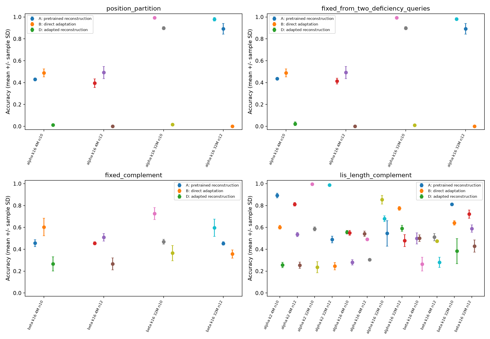
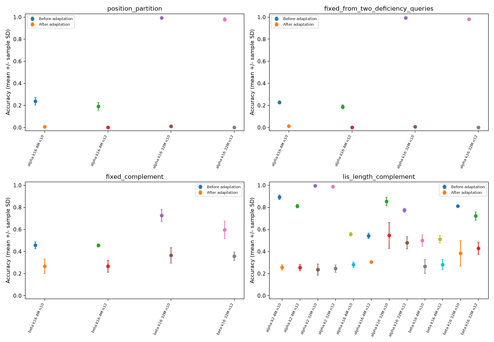

# Registered relation readout on existing models

Base commit: `5db3bc9001110f96eee40918225da06144d5426a`. Inference only; no new training repeats, training, checkpoint reselection or task-library expansion. Existing historical records and publication files remain byte-identical.

Checkpoint audit: 78/78 file hashes match the archived completion/selection records (24 pretrained, 48 selected adaptations, six shared scratch-trained target baselines). Formal evaluation status: complete; 78/78 checkpoints, 34.9 seconds, fixed 7200-second wall limit. Scratch baselines are target models trained from shared random initialization, not untrained random heads.

The three units are the original training repeats (4103, 5207, 6301). Each has 512 new inputs at each of n=10 and n=12; every method within a repeat shares those inputs. Historical full inverse/reverse/complement orbits and all new test orbits are excluded globally. Transformed queries are declared queries of one object, never additional independent samples.

## Per-route comparisons

Values below average the two lengths within each training repeat, then report the mean and sample SD across three original repeats. Detailed per-length/per-repeat values and all diagnostics are in the CSV files. No best-of-route aggregation is performed.

| Route | Condition | A reconstruction | B direct adaptation | C scratch | D adapted reconstruction | A minus B |
|---|---|---:|---:|---:|---:|---:|
| position_partition | chain_alpha, k16, 4M | 41.21 +/- 2.02 | 49.02 +/- 4.59 | 65.36 +/- 2.41 | 0.65 +/- 0.49 | -7.81 +/- 2.72 |
| position_partition | chain_alpha, k16, 32M | 98.63 +/- 0.83 | 89.52 +/- 3.11 | 65.36 +/- 2.41 | 0.85 +/- 0.31 | 9.11 +/- 2.75 |
| fixed_from_two_deficiency_queries | chain_alpha, k16, 4M | 42.51 +/- 1.66 | 49.02 +/- 4.59 | 65.36 +/- 2.41 | 1.20 +/- 0.84 | -6.51 +/- 4.03 |
| fixed_from_two_deficiency_queries | chain_alpha, k16, 32M | 98.73 +/- 0.54 | 89.52 +/- 3.11 | 65.36 +/- 2.41 | 0.55 +/- 0.06 | 9.21 +/- 2.88 |
| fixed_complement | chain_beta, k16, 4M | 45.54 +/- 1.94 | 55.63 +/- 5.67 | 65.36 +/- 2.41 | 26.60 +/- 5.76 | -10.09 +/- 6.88 |
| fixed_complement | chain_beta, k16, 32M | 66.11 +/- 6.53 | 46.09 +/- 1.73 | 65.36 +/- 2.41 | 36.07 +/- 5.13 | 20.02 +/- 7.96 |
| lis_length_complement | chain_alpha, k2, 4M | 85.19 +/- 1.40 | 56.80 +/- 1.81 | 46.84 +/- 1.33 | 25.49 +/- 2.31 | 28.39 +/- 2.36 |
| lis_length_complement | chain_alpha, k2, 32M | 99.09 +/- 0.06 | 53.78 +/- 2.34 | 46.84 +/- 1.33 | 24.06 +/- 4.17 | 45.31 +/- 2.40 |
| lis_length_complement | chain_alpha, k16, 4M | 54.88 +/- 1.41 | 52.08 +/- 0.79 | 46.84 +/- 1.33 | 29.20 +/- 1.31 | 2.80 +/- 1.88 |
| lis_length_complement | chain_alpha, k16, 32M | 81.35 +/- 2.81 | 63.54 +/- 2.18 | 46.84 +/- 1.33 | 51.20 +/- 8.60 | 17.81 +/- 3.16 |
| lis_length_complement | chain_beta, k16, 4M | 50.49 +/- 3.93 | 48.76 +/- 2.15 | 46.84 +/- 1.33 | 27.25 +/- 2.88 | 1.73 +/- 2.90 |
| lis_length_complement | chain_beta, k16, 32M | 76.60 +/- 1.49 | 61.49 +/- 0.74 | 46.84 +/- 1.33 | 40.62 +/- 8.45 | 15.10 +/- 0.83 |

The fixed 4M and 32M comparisons show why route annotation alone is insufficient: both alpha fixed-point formulas trail direct adaptation at 4M but exceed it at 32M. The beta complement route also changes from a deficit at 4M to an advantage at 32M. LIS reconstruction has its strongest accuracy in alpha k2 at 32M, while alpha k16 has substantially lower source readout accuracy. These are prespecified condition comparisons, not a selected route or an argument for changing the source set after this test. Adapted readout D often deteriorates sharply, particularly for the two fixed-point arithmetic routes; direct target success therefore does not imply preserved source-query competence.

Availability is structural: alpha k16 supports both fixed-point arithmetic routes; beta k16 supports the fixed-point complement route. LIS complement is available for alpha k2, alpha k16 and beta k16. Other combinations are NA and are enumerated separately in availability.json; they are never counted as incorrect.

## Query checks and research interpretation

Every correct route recovered its target exactly under oracle source answers on all 3072 new objects. The executor also checks that every model case with all required source answers correct reconstructs correctly. Wrong-query oracle accuracies are retained in `oracle_checks.csv`, including accidental successes.

- position_partition: wrong-query oracle accuracy 27.60%. Available pretrained conditions: 2. Across these fixed conditions, all-source correctness changes from 60.04% before adaptation to 0.42% after adaptation; A error-cancellation frequency is 9.88% of objects.
- fixed_from_two_deficiency_queries: wrong-query oracle accuracy 25.91%. Available pretrained conditions: 2. Across these fixed conditions, all-source correctness changes from 59.72% before adaptation to 0.47% after adaptation; A error-cancellation frequency is 10.90% of objects.
- fixed_complement: wrong-query oracle accuracy 29.17%. Available pretrained conditions: 2. Across these fixed conditions, all-source correctness changes from 55.83% before adaptation to 31.33% after adaptation; A error-cancellation frequency is 0.00% of objects.
- lis_length_complement: wrong-query oracle accuracy 24.64%. Available pretrained conditions: 6. Across these fixed conditions, all-source correctness changes from 74.60% before adaptation to 32.97% after adaptation; A error-cancellation frequency is 0.00% of objects.

These annotations support concrete decisions about source coverage, legal query construction, and whether learned source answers are accurate enough for a specific external readout. Differences between A and D measure retained source prediction ability after adaptation. Error cancellation separates mathematically correct source reasoning from an accidentally correct reconstructed target. The wrong-query controls diagnose query sensitivity; their nonzero oracle success rates show why they are not unrelated tasks or fair competing algorithms.

Formula-assisted reconstruction supplies external mathematical information and one or two source queries. It has a different information and inference budget from direct target adaptation. These results do not show that a model discovered or internally used a formula, do not establish a mechanism, and do not imply superiority over data-selection methods. Conditions and routes are descriptive comparisons, not extra independent training repeats.

## Artifacts and accounting

`source_predictions.jsonl` records complete source/direct token generations, queried permutations, EOS and legality. `raw_predictions.jsonl` records each target reconstruction and per-query correctness. `summary_per_repeat.csv` and `summary_mean_sd.csv` contain the requested metrics; `query_diagnostics.csv` contains paired correct-minus-wrong contrasts. `compute.csv` records actual batched forward calls and synchronized elapsed time per checkpoint, length and source task. Identical query arrays within one checkpoint/length are cached; two-query routes still require two logical source answers per object. Shared predictions must not be charged again as physical forwards. Total formal wall time includes loading, encoding and raw-output writes; smoke timing is separate. No output is clipped, reduced modulo, filled in or replaced by a majority. Illegal source outputs propagate failure.

Measured physical inference: 6342 batched model forwards, 202752 queried objects, and 18.477 synchronized prediction seconds. `route_compute.csv` joins every route/direct repeat-length condition to its measured physical block IDs, forward counts and time. Blocks shared across routes or diagnostics must not be summed twice. Checkpoint-internal identities, parent hashes, initialization states, actual source exposures and development selections are verified in `PROVENANCE_AUDIT.json`. Adaptation checkpoints have no archived final-state digest field: their complete file hashes are verified and new state digests are recorded separately without rebinding archived hashes.

Across 202752 target evaluation records (including distinct routes and query diagnostics), there are 13 records with an illegal required output, 0 EOS failures and 960 out-of-range reconstructions. These are record counts with shared predictions, not independent samples or unique physical generation counts. All 32595 correct-route cases with every required source answer correct passed executor consistency. Detailed failure rates appear by condition in the summary tables. `query_diagnostics_mean_sd.csv` reports the paired correct-minus-wrong differences across the original repeats.

## New-test labeling and paired-repeat review

The 89.52% direct-adaptation result above is measured on this experiment's newly generated test inputs. The historical 88.44% result uses a different test set and remains an archived result. Their difference must not be interpreted as model improvement: the selected checkpoint is unchanged. The two arithmetic routes share checkpoints and test objects and are parallel readouts, not independent replications. Source-query degradation after adaptation is descriptive and does not establish that it caused the target accuracy gap.

The table below retains each original paired repeat for alpha k16, 32M. Each value averages n=10 and n=12 within that repeat; differences are in percentage points.

| Route | Original seed | A new-test accuracy (%) | B new-test accuracy (%) | A minus B (pp) |
|---|---:|---:|---:|---:|
| position_partition | 4103 | 98.7305 | 86.7188 | +12.0117 |
| position_partition | 5207 | 97.7539 | 88.9648 | +8.7891 |
| position_partition | 6301 | 99.4141 | 92.8711 | +6.5430 |
| fixed_from_two_deficiency_queries | 4103 | 98.8281 | 86.7188 | +12.1094 |
| fixed_from_two_deficiency_queries | 5207 | 98.1445 | 88.9648 | +9.1797 |
| fixed_from_two_deficiency_queries | 6301 | 99.2188 | 92.8711 | +6.3477 |
