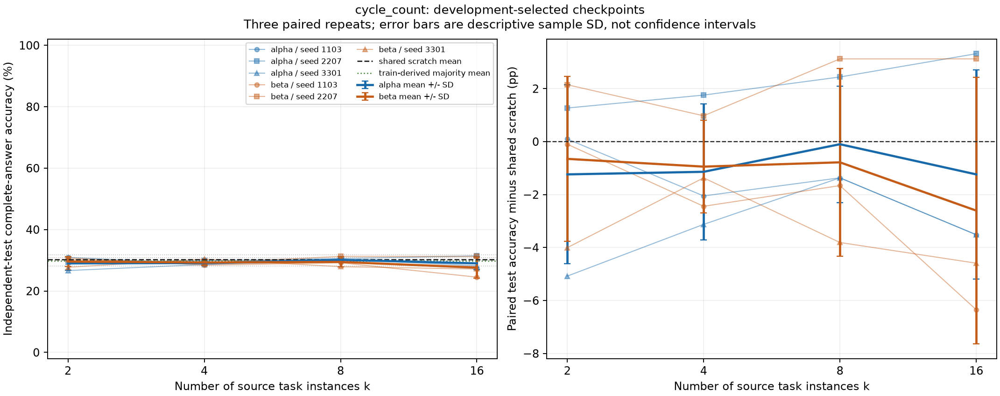
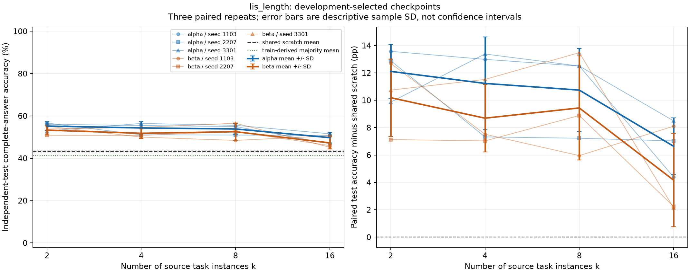
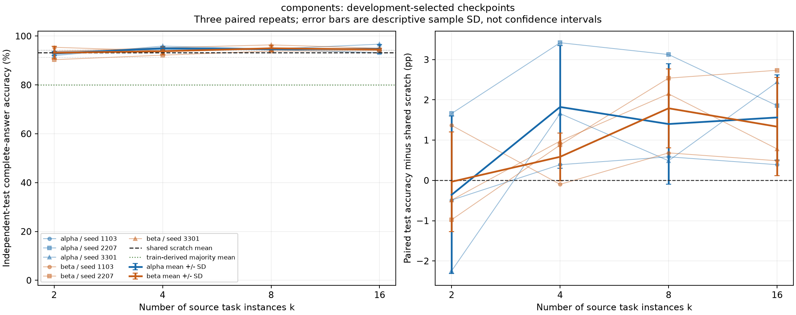
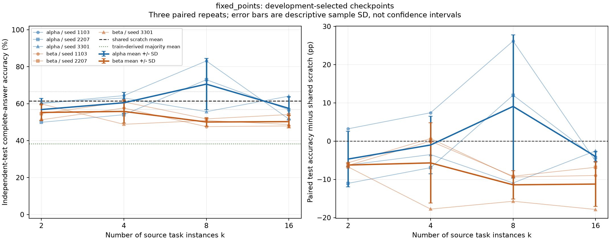

# First PermWorld task-count experiment

All 24 pretraining models and 108 target-training runs completed. The four held-out targets are cycle_count, lis_length, components and fixed_points. Each pretraining model is reused for all four targets; each of the 12 scratch runs is shared across all eight source-set conditions. This report retains the complete prespecified scope, including negative transfer, no gain and incomplete source learning. No task replacement, learning-rate search or budget extension follows the results.

The primary result uses the checkpoint selected by development accuracy, then answer cross-entropy, then earliest update. A fixed 800-update endpoint is also reported for every run. Both were fixed before generating the independent test objects; test performance never changes selection. All accuracies require generation of the complete answer and EOS from the prompt alone.

## Findings from the completed test

The response to increasing source count depends on the target and chain: 0/8 target-chain mean curves are nondecreasing across every k. A higher count does not give a uniform improvement in this fixed-token comparison.

**LIS retains transfer gains, but adding tasks weakens them.** Alpha falls from 55.21% at k=2 to 49.74% at k=16; beta falls from 53.29% to 47.27%. The paired k16-minus-k2 differences are negative in 3/3 alpha repeats and 3/3 beta repeats. Nevertheless, all eight condition means remain above the 43.10% scratch reference in this run. This distinguishes reduced transfer benefit from negative transfer.

**Cycle count shows no mean transfer gain.** 8/8 pretrained condition means are at or below scratch (30.24%). The mean k16-minus-k2 change is +0.00 pp for alpha and -1.95 pp for beta, with mixed repeat signs. The small changes and paired spreads do not support a reliable count trend.

**Components has modest gains above a strong scratch model.** Scratch already reaches 93.20%. 6/8 condition means are higher; k=16 gains are +1.56 pp for alpha and +1.33 pp for beta. Alpha's k16-minus-k2 change is positive in 3/3 repeats; beta's is positive in 2/3. Neither mean curve improves at every step.

**Fixed points is strongly nonmonotonic and chain dependent.** Alpha's k=8 accuracy is 70.57%, with paired gains +26.17, +12.01, -10.94 pp in seed order [1103, 2207, 3301]. Its mean gain +9.08 pp has sample SD 18.73 pp; the negative repeat remains part of the result. Alpha then falls to 57.45% at k=16 (-4.04 pp versus scratch). Beta has negative mean transfer at all four k, including -11.23 pp at k=16. No best-k configuration is selected from these tests. Alpha16's known joint target formulas therefore do not guarantee a transfer benefit under this training budget.

**Source records support underlearning and exposure dilution as issues to examine, without proving a mechanism.** For a source present throughout alpha, LDS development accuracy decreases from 87.83% at k=2 to 54.30% at k=16 (majority 43.16%). Beta's decreasing-subsequence-count source (subsequence length 3) falls from 16.80% to 5.27% (majority 2.99%). These changes accompany the weaker LIS transfer at larger task counts, while per-task exposure also falls. Nontrivial-cycle count in alpha16 is 47.27% against the same 47.27% majority baseline; alpha16 even/odd-cycle sources are 45.12%/60.68% against 45.38%/60.87%. Availability of a joint identity is therefore separate from demonstrated learning of its source statistics. For fixed points, alpha's exceedances source falls from 74.35% at k=8 to 42.71% at k=16, concurrent with its target decline. In contrast, the k=16 largest/smallest-component sources remain at 94.40%/97.85% in alpha and 94.21%/97.92% in beta, above their 81.58% majority baseline. These are descriptive examples from the complete source table; they do not distinguish optimization interference, reduced exposure, representation effects or formula use.

## Independent-test results

Values below are means over three paired repeat units. Parentheses show sample SD of the **within-repeat gain over the shared scratch baseline**, in percentage points. These are descriptive spreads, not confidence intervals or tests of significance.

| Target | Chain | k=2: accuracy; gain (SD) | k=4 | k=8 | k=16 | Shared scratch accuracy |
|---|---|---:|---:|---:|---:|---:|
| cycle_count | chain_alpha | 29.00%; -1.24 (3.38) | 29.10%; -1.14 (2.57) | 30.14%; -0.10 (2.20) | 29.00%; -1.24 (3.95) | 30.24% |
| cycle_count | chain_beta | 29.59%; -0.65 (3.11) | 29.30%; -0.94 (1.75) | 29.46%; -0.78 (3.55) | 27.64%; -2.60 (5.04) | 30.24% |
| lis_length | chain_alpha | 55.21%; +12.11 (1.97) | 54.33%; +11.23 (3.39) | 53.84%; +10.74 (3.04) | 49.74%; +6.64 (2.08) | 43.10% |
| lis_length | chain_beta | 53.29%; +10.19 (2.82) | 51.79%; +8.69 (2.46) | 52.54%; +9.44 (3.79) | 47.27%; +4.17 (3.41) | 43.10% |
| components | chain_alpha | 92.84%; -0.36 (1.96) | 95.02%; +1.82 (1.52) | 94.60%; +1.40 (1.49) | 94.76%; +1.56 (1.06) | 93.20% |
| components | chain_beta | 93.16%; -0.03 (1.24) | 93.78%; +0.59 (0.59) | 94.99%; +1.79 (0.98) | 94.53%; +1.33 (1.22) | 93.20% |
| fixed_points | chain_alpha | 56.80%; -4.69 (7.26) | 60.48%; -1.01 (7.50) | 70.57%; +9.08 (18.73) | 57.45%; -4.04 (1.39) | 61.49% |
| fixed_points | chain_beta | 55.24%; -6.25 (0.54) | 55.79%; -5.70 (10.46) | 50.07%; -11.43 (3.72) | 50.26%; -11.23 (5.85) | 61.49% |

The following k=16 versus k=2 comparison describes the change along each fixed chain for development-selected checkpoints; it is a paired k=16 minus k=2 accuracy difference. The shared scratch baseline cancels within each repeat. The SD is computed from those three differences, not from marginal condition SDs. This is neither a significance test nor a scaling-law fit.

| Target | Chain | Mean k16 minus k2 (sample SD) | Three individual differences |
|---|---|---:|---|
| cycle_count | chain_alpha | +0.00 (3.14) pp | -3.61, +2.05, +1.56 pp |
| cycle_count | chain_beta | -1.95 (3.80) pp | -6.25, +0.98, -0.59 pp |
| lis_length | chain_alpha | -5.47 (3.92) pp | -9.18, -5.86, -1.37 pp |
| lis_length | chain_beta | -6.02 (2.23) pp | -4.59, -4.88, -8.59 pp |
| components | chain_alpha | +1.92 (2.42) pp | +0.88, +0.20, +4.69 pp |
| components | chain_beta | +1.37 (2.30) pp | -0.88, +3.71, +1.27 pp |
| fixed_points | chain_alpha | +0.65 (8.06) pp | -8.50, +6.74, +3.71 pp |
| fixed_points | chain_beta | -4.98 (5.51) pp | -3.32, -0.49, -11.13 pp |

[Per-repeat k contrasts](paired_k_contrasts.csv) and [their paired summaries](k_contrast_summary.csv) also retain the adjacent 2-to-4, 4-to-8 and 8-to-16 changes, both checkpoint policies and each length. These contrasts reuse the same three units and do not create additional independent replications.

The plots show each repeat separately and retain the two chains. Scratch baselines repeat visually to aid comparison but were trained only once per target and repeat.

## What the experiment controls, and what changes with k

k counts nonconstant task instances after removing exact same-input aliases, not independent mathematical information. The pool has 24 instances from 22 templates. Every prefix has distinct templates, so its template count also equals k. Two nested chains have different membership at every k. Their broad family counts match: cycle/subsequence at k=2; one cycle/subsequence/block/legacy instance at k=4; two of each at k=8; and 4/3/4/5 at k=16. The k=2 sets consequently do not cover every family. Definitions and membership were frozen before training, using no transfer outcome.

Increasing k changes task composition, mathematical relationships, answer distributions and per-task exposure. Alpha at k=16 contains cycle_count=even_cycle_count+odd_cycle_count and fixed_points=n-exceedances-deficiencies (also even+odd-nontrivial_cycle_count). Beta lacks those registered complete same-input query sets but has fixed_points(p)=anti_fixed_points(complement(p)). Transformed LIS/LDS and component/global-descent relations are retained. These legal relationships are not input leakage; neither their availability nor observed learning curves establish a learned mechanism. Other joint derivations remain unclassified. The curves do not isolate a pure causal count effect.

Task sampling is balanced by examples, with maximum task exposure difference at most one example at the stopping boundary. Total nonpadding prompt-plus-answer sequence tokens are capped at 4,000,000 per pretrained model; supervised tokens are recorded separately. Variable prompt and answer lengths therefore produce unequal token shares across tasks despite uniform example sampling. A final whole-example prefix is used without truncating answers, and the unspent token tail is reported. Learning rate follows consumed-token progress.

## Source learning and adaptation diagnostics

Source evaluation occurs at initialization, the first update crossing half the token budget, and the fixed endpoint. Training accuracy uses a fixed 256-object probe per length; source development uses all 256 objects per length. Majority labels come from each complete 4,096-object training pool per length. These curves may reveal underlearning or covariation with transfer, but they do not identify a mechanism.

Across the 180 source-task/run endpoint records, 61 have development accuracy at or below their train-derived majority baseline. These records are overlapping tasks and shared models, not independent observations. Full per-task/per-length values, losses, exposure and probe-to-development gaps remain in the CSVs.

Development selects an update earlier than 800 in 90/108 runs. On the independent test, the preselected checkpoint is higher than the endpoint in 59 runs and lower in 26; the rest tie. These descriptive counts do not select a new protocol. See [checkpoint diagnostics](checkpoint_diagnostics.csv) and [comparison figure](figures/checkpoint_comparison.png).

## Fixed data, model and budget

All conditions share the same role-specific inputs within each repeat. Inputs are isolated by complete inverse/reverse/complement orbits across source training, source development, target training, target development, final test and prior experiments. Generation checks conservative finite-domain capacity before rejection sampling and never relaxes isolation. Lengths 10 and 12 occur in every training/evaluation role, so per-length performance is not unseen-length extrapolation. Each target uses 128 training examples per length (256 total), 256 development examples per length, and 512 final test examples per length.

The model is the platform's 4-layer, width-256, 8-head Transformer with the current 203-token vocabulary and context length 128. Input encoding is one_line_v1 and sequence encoding is permworld_sequence_v1. Loss averages answer-token-plus-EOS cross-entropy within each example, then across examples. The parameterized I3/D3 sources exercise exact multi-token values above 99. At adaptation, all four held-out task-token rows in the tied embedding/output matrix are reset to the paired initial values; other pretrained weights are loaded exactly. AdamW is freshly created. Training uses 800 updates, batch size 64, initial LR 3e-4, 100-update warmup and cosine decay to 3e-5. There is one learning-rate candidate and eight eligible development checkpoints per condition.

| Initialization seed | Data seed | Pretraining sampling seed | Adaptation sampling seed |
|---:|---:|---:|---:|
| 1103 | 2026102101 | 2026102181 | 2026102191 |
| 2207 | 2026102102 | 2026102182 | 2026102192 |
| 3301 | 2026102103 | 2026102183 | 2026102193 |

Target majority answers are chosen separately from the 128 training labels at each length. Their mean independent-test accuracies are shown below; they are shared across conditions and are not fitted to test labels.

| Target | n=10 majority | n=12 majority |
|---|---:|---:|
| cycle_count | 31.38% | 28.19% |
| lis_length | 45.31% | 37.37% |
| components | 78.06% | 81.84% |
| fixed_points | 38.22% | 38.28% |

## Actual compute

| Stage | Runs | Updates | Nonpadding sequence tokens | Supervised tokens | Cumulative run minutes |
|---|---:|---:|---:|---:|---:|
| pretraining | 24 | 48,614 | 95,999,744 | 6,226,830 | 36.11 |
| baseline_adaptation | 12 | 9,600 | 18,432,000 | 1,228,800 | 8.02 |
| pretrained_adaptation | 96 | 76,800 | 147,456,000 | 9,830,400 | 40.06 |

Pretraining uses 1,953–2,084 updates per model; unused token tails range from 0 to 25. Independent test evaluation took 1.05 minutes. Training-stage wall time was 85.00 minutes. Per-run timers include training, development evaluations and checkpoint/table writes; encoding and audit overhead are separate. The stage timer overlaps the run timers and must not be added to them. Padded sequence tokens, answer-only tokens, actual exposures and per-run memory are retained in [compute.csv](compute.csv) and [task exposures](task_exposures.csv).

## Limits and next decision

There are three paired repeat units, not 24 independent pretrained observations per target or 108 independent transfer replications. Conditions share initialization, objects, target sampling and scratch baselines; four targets also share each pretrained model. Pairing is preserved by subtracting the corresponding baseline inside each repeat. The two fixed chains are compositions, not random samples of all possible source sets. Small repeat counts and finite test sets leave substantial uncertainty; marginal standard deviations of two conditions cannot establish a difference.

This is a finite task-count curve at two lengths, one model, one token budget and 256 target examples. It is not a sample-efficiency curve or evidence of a scaling law. The next priority is to separate reduced source exposure from composition and source learnability in a separately prespecified comparison, using the cross-chain LIS decline and chain-dependent fixed-points behavior as evidence to investigate. Merely increasing k beyond 16 would leave those explanations mixed. Any composition controls or budget changes require a new protocol; no additional training or source replacement is run here.

- [Raw test results](raw_test_results.csv), [paired gains](paired_deltas.csv), [summary](summary.csv)
- [Source learning](source_learning.csv), [matched source summaries](source_summary.csv), [target training/development curves](adaptation_curves.csv), [majority baselines by length](majority_per_length.csv)
- [Frozen protocol](FROZEN_PROTOCOL.json), [development selections](FROZEN_SELECTIONS.json), [task design and relationships](design/README.md)
- [Reproduction instructions](README.md)

The separate [historical preservation verification](PRESERVATION_VERIFICATION.json) checked the archived file bytes, including local checkpoints, and resolved the prior English translation through its existing ledger. Historical scientific manifests were not rewritten for this study.

The [independent completed-run audit](RUN_AUDIT.json) passed, checking all 24 source and 108 target runs, replaying their recorded sampling streams, rebuilding the three initializations, and validating checkpoint/configuration bindings and development-only selection. It recomputed 2 development checkpoint forwards and performed no new test neural forwards. See [per-run accounting](audit_run_accounting.csv) and [development-forward checks](audit_development_forwards.csv) for the detailed evidence.

[Complete source answer distributions](source_answer_distributions.csv) and their [distribution audit](SOURCE_DISTRIBUTION_AUDIT.json) are retained. Different tasks have different answer supports and imbalance, so raw accuracies across tasks are interpreted relative to their own training-derived majority references.
