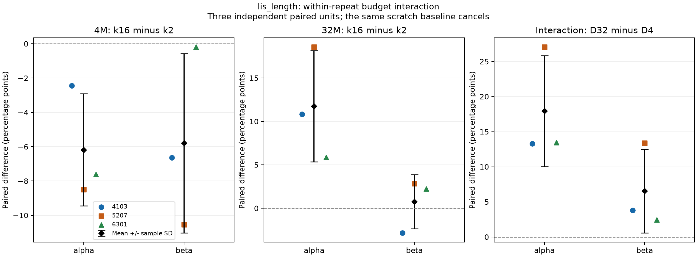
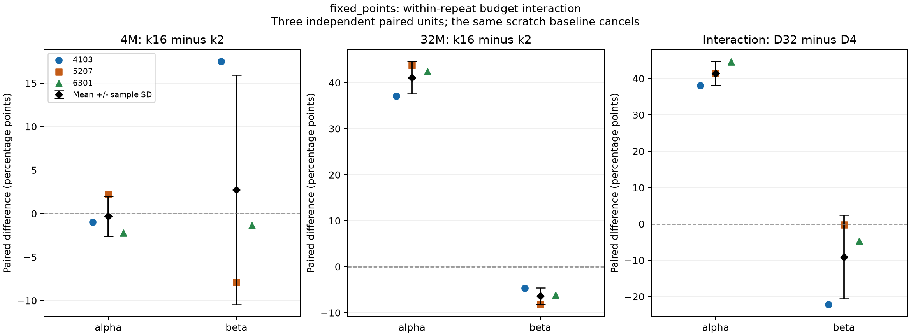
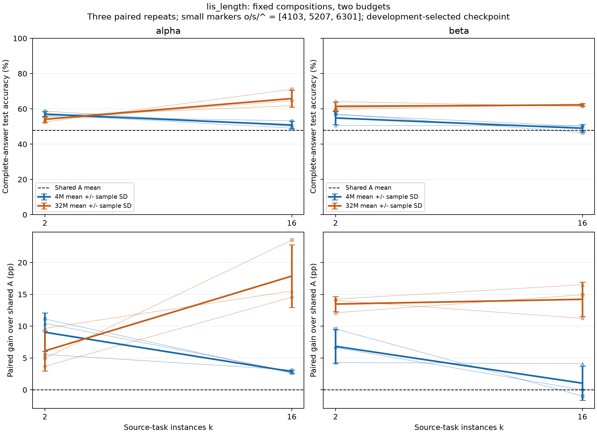
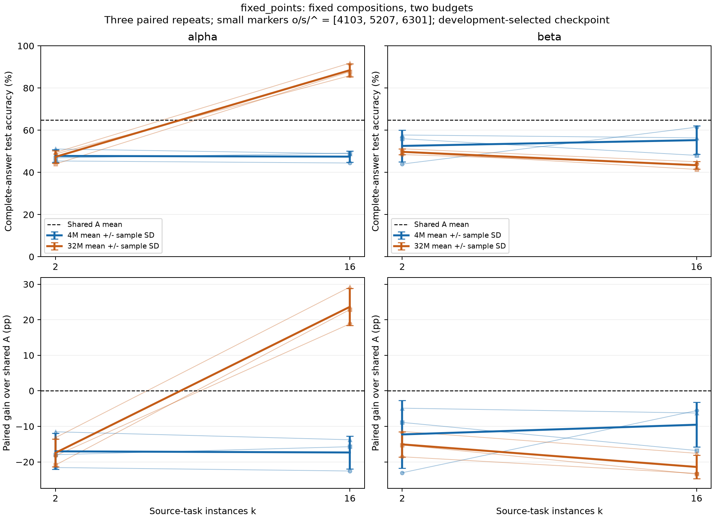
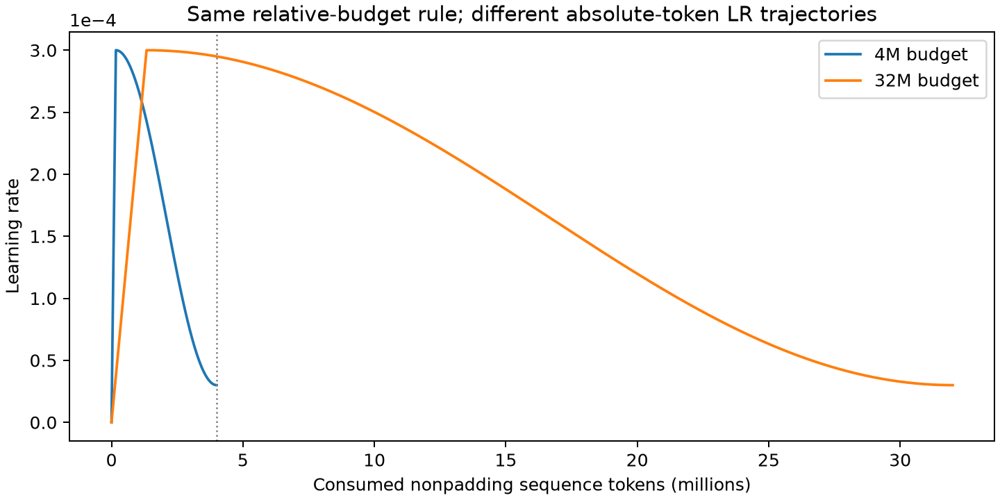
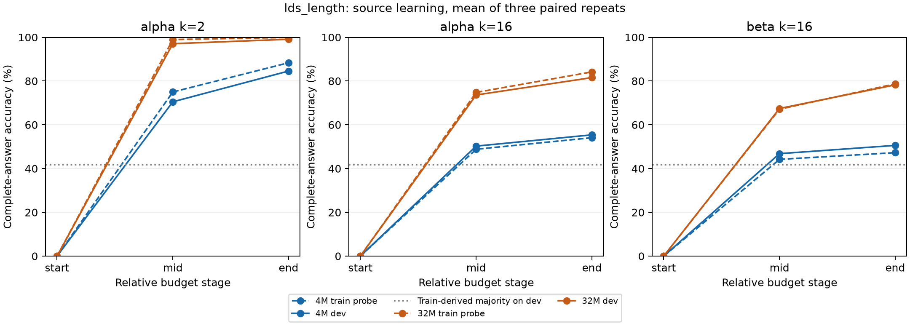
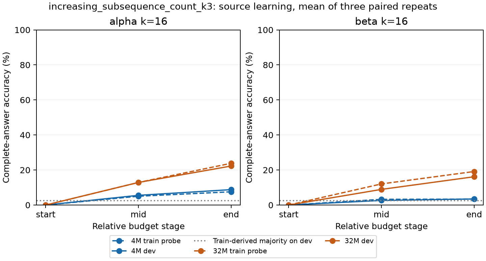
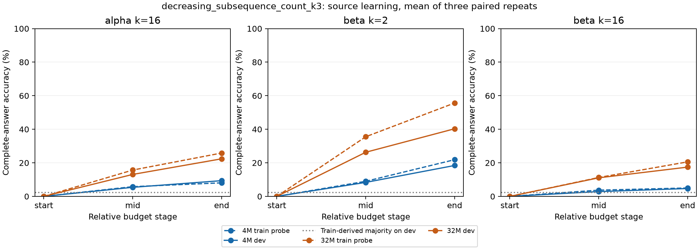

# PermWorld task-count v2: paired interaction between task count and training budget

The frozen scope is complete: **24 pretrained models, 48 adaptations from pretrained models, and 6 shared random-initialization baselines**, totaling 54 target-training runs. LIS length is the primary target and fixed_points is auxiliary; each target still uses only 256 adaptation examples. The three new paired repeats are 4103, 5207, and 6301. Learning-rate schedules were fixed in advance; checkpoint selection used development data only. Independent test inputs were generated and evaluated together after selections were frozen. No outcome triggered extra budget, task replacement, or additional search.

This hypothesis follows v1's exploratory observations that LIS performance declined with increasing k and that fixed_points transfer depended on the task chain. Old v1 results are not repeats of this study and are not pooled with the new seeds. Both chains retain only k=2 and k=16 from their original lists, trained from the same paired random initialization to 4M or 32M tokens; task composition within each chain and k is unchanged across budgets.

## Primary results: compute within-repeat differences before summarizing

D4 denotes k16−k2 at the 4M budget, D32 denotes k16−k2 at 32M, and the interaction is D32−D4. A positive interaction means the larger budget improves k16 relative to k2; it does not imply higher absolute accuracy in every condition or the elimination of negative transfer. All values below are percentage points. The ± term is the sample standard deviation of the three paired differences, not a confidence interval.

| Target | Chain | Mean D4 | Mean D32 | Mean interaction ± SD | Range of three interactions |
|---|---|---:|---:|---:|---:|
| lis_length | alpha | -6.18 | +11.75 | +17.94 ± 7.89 | [+13.28, +27.05] |
| lis_length | beta | -5.79 | +0.75 | +6.54 ± 5.96 | [+2.44, +13.38] |
| fixed_points | alpha | -0.33 | +41.08 | +41.41 ± 3.27 | [+38.09, +44.63] |
| fixed_points | beta | +2.73 | -6.35 | -9.08 ± 11.55 | [-22.17, -0.29] |

Individual repeats are shown below. All three differences are computed within the same chain, initialization, data, and sampling repeat unit; they cannot be replaced by the two conditions' separate standard deviations. The shared random-initialization baseline cancels exactly in the interaction.

| Target | Chain | Initialization seed | D4 | D32 | D32−D4 |
|---|---|---:|---:|---:|---:|
| lis_length | alpha | 4103 | -2.44 | +10.84 | +13.28 |
| lis_length | alpha | 5207 | -8.50 | +18.55 | +27.05 |
| lis_length | alpha | 6301 | -7.62 | +5.86 | +13.48 |
| lis_length | beta | 4103 | -6.64 | -2.83 | +3.81 |
| lis_length | beta | 5207 | -10.55 | +2.83 | +13.38 |
| lis_length | beta | 6301 | -0.20 | +2.25 | +2.44 |
| fixed_points | alpha | 4103 | -0.98 | +37.11 | +38.09 |
| fixed_points | alpha | 5207 | +2.25 | +43.75 | +41.50 |
| fixed_points | alpha | 6301 | -2.25 | +42.38 | +44.63 |
| fixed_points | beta | 4103 | +17.48 | -4.69 | -22.17 |
| fixed_points | beta | 5207 | -7.91 | -8.20 | -0.29 |
| fixed_points | beta | 6301 | -1.37 | -6.15 | -4.79 |

**lis_length**: alpha has a mean interaction of +17.94 percentage points, positive in 3/3 repeats; beta has a mean interaction of +6.54 percentage points, positive in 3/3 repeats. These are observations from the current limited repeats, not a budget law for all task compositions.

**fixed_points**: alpha has a mean interaction of +41.41 percentage points, positive in 3/3 repeats; beta has a mean interaction of -9.08 percentage points, positive in 0/3 repeats. These are observations from the current limited repeats, not a budget law for all task compositions.

At 4M, the new LIS seeds reproduce v1's direction: k16 is below k2 in all three repeats of both chains. With the larger budget, alpha k16 overtakes k2 in all three repeats. Beta also has positive interactions in all three repeats, but its 32M k16−k2 difference itself is positive in two repeats and negative in one, with a mean near zero. Beta therefore supports a reduction of the original k16 disadvantage rather than a stable k16 advantage. The two chains share three repeat units; their six within-chain interactions cannot be treated as six independent repeats.

fixed_points shows opposite directions across chains: alpha k16 improves markedly at 32M, whereas beta k16 worsens. Beta's interaction ranges from −22.17 to −0.29 percentage points, indicating unstable magnitude. Budget effects depend on task composition and target; these results do not establish that larger budgets generally eliminate negative transfer.

## V1 exploratory evidence: reported separately, not pooled with this study

The old seeds were 1103, 2207, and 3301, with only a 4M budget. The table directly preserves v1's paired k16−k2 differences and the source CSV hash. Different test inputs and repeat units are not pooled with v2, and cross-round differences cannot be attributed solely to training budget.

| Target | Chain | V1 mean D4 ± SD (pp) | V1 seed differences (1103 / 2207 / 3301) |
|---|---|---:|---|
| lis_length | alpha | -5.47 ± 3.92 | -9.18 / -5.86 / -1.37 |
| lis_length | beta | -6.02 ± 2.23 | -4.59 / -4.88 / -8.59 |
| fixed_points | alpha | +0.65 ± 8.06 | -8.50 / +6.74 / +3.71 |
| fixed_points | beta | -4.98 ± 5.51 | -3.32 / -0.49 / -11.13 |

The [v1 exploratory reference CSV](v1_exploratory_reference.csv) explains only the hypothesis's origin; all interaction estimates in this study come from v2.

## Condition accuracy and gains over shared A

| Target | Chain | k | Budget | Mean test accuracy | Mean paired gain over A ± SD (pp) |
|---|---|---:|---:|---:|---:|
| lis_length | baseline | 0 | 0M | 47.98% | +0.00 ± 0.00 |
| lis_length | alpha | 2 | 4M | 57.03% | +9.05 ± 3.04 |
| lis_length | alpha | 2 | 32M | 54.10% | +6.12 ± 3.14 |
| lis_length | alpha | 16 | 4M | 50.85% | +2.86 ± 0.25 |
| lis_length | alpha | 16 | 32M | 65.85% | +17.87 ± 4.93 |
| lis_length | beta | 2 | 4M | 54.82% | +6.84 ± 2.64 |
| lis_length | beta | 2 | 32M | 61.46% | +13.48 ± 1.19 |
| lis_length | beta | 16 | 4M | 49.02% | +1.04 ± 2.69 |
| lis_length | beta | 16 | 32M | 62.21% | +14.23 ± 2.71 |
| fixed_points | baseline | 0 | 0M | 64.81% | +0.00 ± 0.00 |
| fixed_points | alpha | 2 | 4M | 47.79% | -17.02 ± 5.10 |
| fixed_points | alpha | 2 | 32M | 47.36% | -17.45 ± 3.92 |
| fixed_points | alpha | 16 | 4M | 47.46% | -17.35 ± 4.62 |
| fixed_points | alpha | 16 | 32M | 88.44% | +23.63 ± 5.22 |
| fixed_points | beta | 2 | 4M | 52.54% | -12.27 ± 9.54 |
| fixed_points | beta | 2 | 32M | 49.74% | -15.07 ± 3.57 |
| fixed_points | beta | 16 | 4M | 55.27% | -9.54 ± 6.30 |
| fixed_points | beta | 16 | 32M | 43.39% | -21.42 ± 3.33 |

All four LIS conditions at 32M exceed their shared A in every repeat. However, alpha k2 mean accuracy falls from 57.03% to 54.10%, showing that a positive interaction can include poorer small-k performance. Alpha k16 improves from 50.85% to 65.85%, which is the main change behind its reversal. Beta k2 and k16 both improve with budget, from 54.82%→61.46% and 49.02%→62.21%, respectively.

For fixed_points, only alpha k16 at 32M has positive mean transfer: 88.44% accuracy and +23.63 percentage points over A, positive in all three repeats. The other seven conditions have negative mean gains. Beta k16 at 32M reaches only 43.39%, or −21.42 percentage points relative to A. The large alpha interaction must not obscure these retained negative results.

## What changes with the larger budget

Both budgets start from paired random initialization with fresh AdamW optimizers; 32M does not continue the decayed 4M endpoint. The relative-budget progress rule is identical, but warmup lasts 166,666.67 and 1,333,333.33 tokens, respectively. At 4M consumed tokens, the 4M schedule has learning rate 3e-05, while the 32M schedule is still at 0.000294994. This comparison therefore combines the larger budget with its prespecified learning-rate trajectory; it does not separately identify the effects of update count and learning-rate trajectory. Actual per-update learning rates are in each run's updates.csv, and the analytic rule is in [learning_rate_schedule.csv](learning_rate_schedule.csv).

Both budgets use exactly the same source-training pool: 4096 objects per repeat and length, or 8192 total, not eight times as much independent data. A task may not have seen the entire pool at 4M, especially at k16. The 32M run can both increase that task's coverage of the fixed pool and repeat previously seen task-input pairs; not every additional example is a repeated task-input pair. Tasks are sampled uniformly by examples, while different prompt/answer lengths imply unequal token shares. The last batch uses only the whole-example prefix that fits the budget, retaining the unused tail. The 32M budget is approximately eight times total tokens; k16 per-task exposure is not claimed to match k2 at 4M exactly. Each task can expose at most 8192 distinct inputs; counting the same input again across tasks does not create more independent objects. Actual differences in per-task coverage, first exposures, and repeated exposures are preserved in task_exposures.csv and source_budget_comparisons.csv.

## Source learning and repeated exposure

Training accuracy uses the fixed first 256 source-training objects per length as a diagnostic probe; development uses all 256 objects per length. Majority answers are determined from the full 4096 source-training labels per length. Curves are saved at initialization, the first update crossing half the budget, and the endpoint. The focus below is LDS, I3, and D3; all other tasks remain in the CSVs.

| Chain | k | Source task | Budget | Dev accuracy | Training-probe accuracy | Dev majority baseline | Mean sample exposures | Mean distinct inputs |
|---|---:|---|---:|---:|---:|---:|---:|---:|
| alpha | 2 | lds_length | 4M | 84.57% | 88.35% | 41.73% | 66,666 | 8,189.7 |
| alpha | 2 | lds_length | 32M | 99.09% | 99.93% | 41.73% | 533,335 | 8,192.0 |
| alpha | 16 | lds_length | 4M | 55.40% | 54.10% | 41.73% | 8,064 | 5,149.0 |
| alpha | 16 | lds_length | 32M | 81.58% | 84.18% | 41.73% | 64,513 | 8,189.0 |
| alpha | 16 | increasing_subsequence_count_k3 | 4M | 8.79% | 7.55% | 2.41% | 8,064 | 5,126.3 |
| alpha | 16 | increasing_subsequence_count_k3 | 32M | 22.27% | 23.83% | 2.41% | 64,513 | 8,190.3 |
| alpha | 16 | decreasing_subsequence_count_k3 | 4M | 9.38% | 8.07% | 2.34% | 8,064 | 5,112.0 |
| alpha | 16 | decreasing_subsequence_count_k3 | 32M | 22.40% | 25.85% | 2.34% | 64,513 | 8,191.0 |
| beta | 2 | decreasing_subsequence_count_k3 | 4M | 18.42% | 21.88% | 2.34% | 62,486 | 8,188.3 |
| beta | 2 | decreasing_subsequence_count_k3 | 32M | 40.30% | 55.66% | 2.34% | 499,889 | 8,192.0 |
| beta | 16 | lds_length | 4M | 50.59% | 47.27% | 41.73% | 8,064 | 5,126.3 |
| beta | 16 | lds_length | 32M | 78.26% | 78.71% | 41.73% | 64,513 | 8,190.3 |
| beta | 16 | increasing_subsequence_count_k3 | 4M | 3.45% | 3.39% | 2.41% | 8,064 | 5,112.0 |
| beta | 16 | increasing_subsequence_count_k3 | 32M | 16.15% | 19.14% | 2.41% | 64,513 | 8,191.0 |
| beta | 16 | decreasing_subsequence_count_k3 | 4M | 4.69% | 5.01% | 2.34% | 8,064 | 5,149.0 |
| beta | 16 | decreasing_subsequence_count_k3 | 32M | 17.45% | 20.57% | 2.34% | 64,513 | 8,189.0 |

Of the 216 source-task × model endpoint records, 53 have development accuracy at or below their own majority baseline. These records reuse tasks and models and are not 216 independent experiments. Concurrent training/development gaps, source-learning improvements, and transfer interactions are associations; they do not directly establish interference, use of mathematical identities, or the absence of either.

By budget, 38/108 source-task endpoints at 4M do not exceed their majority baseline, and 15/108 still do not at 32M. Budget changes for the focus tasks are paired within repeat below; different tasks are not treated as repeats.

| Chain | k | Source task | Mean 32M−4M dev-accuracy change ± SD (pp) | Positive repeat count |
|---|---:|---|---:|---:|
| alpha | 2 | lds_length | +14.52 ± 1.59 | 3/3 |
| alpha | 16 | decreasing_subsequence_count_k3 | +13.02 ± 2.94 | 3/3 |
| alpha | 16 | increasing_subsequence_count_k3 | +13.48 ± 1.74 | 3/3 |
| alpha | 16 | lds_length | +26.17 ± 2.30 | 3/3 |
| beta | 2 | decreasing_subsequence_count_k3 | +21.88 ± 1.74 | 3/3 |
| beta | 16 | decreasing_subsequence_count_k3 | +12.76 ± 2.93 | 3/3 |
| beta | 16 | increasing_subsequence_count_k3 | +12.70 ± 0.39 | 3/3 |
| beta | 16 | lds_length | +27.67 ± 1.58 | 3/3 |

LDS and length-three subsequence-count development performance both improve with budget. At k16, distinct input coverage per task rises from about 5100 to about 8190, near the fixed-pool limit of 8192; sample exposure per task is approximately 8064→64513. Nevertheless, k16 LDS remains below alpha k2's 99.09%, and the three-element counts remain far from fully learned. At 32M, beta k2 D3 reaches 55.66% on the training probe versus 40.30% on development. This gap of about 15.36 percentage points shows that more repeated exposure does not automatically resolve generalization. Alpha k2 LDS improves from 84.57% to 99.09% while its mean LIS transfer falls, directly limiting the simple explanation that higher related-source accuracy necessarily yields better transfer.

Alpha k16 exceedances and deficiencies have an explicit joint relationship to fixed_points. Their development accuracies improve from 43.23%→99.35% and 38.93%→98.96%, respectively, alongside markedly improved fixed_points transfer. This correspondence merits future investigation. However, even_cycle_count remains near its majority baseline, so not all related mathematical quantities are fully learned. Beta k16 anti_fixed_points also improves from 44.27% to 63.35% while fixed_points transfer worsens. The existence of a valid formula and improvements on related sources are insufficient to prove that the model uses the formula. Current records cannot distinguish formula use, broader representation changes, and optimization mechanisms.

## Configuration, isolation, and adaptation checks

The model is unchanged from v1: the platform's current 203-token vocabulary, a 4-layer Transformer of width 256 with 8 heads, FFN ratio 4, dropout 0.1, context 128, and tied embedding/output head. Encodings are one_line_v1 and permworld_sequence_v1. Loss averages answer-token-plus-EOS cross-entropy within each example before averaging examples; accuracy requires free generation of the complete answer plus EOS. Multi-token I3/D3 integer answers are neither truncated nor reduced modulo a bound.

Every adaptation resets all four original held-out task-token rows, including the tied output-head rows, loads all remaining pretrained parameters exactly, and creates a fresh optimizer. It uses 800 updates, batch 64, initial LR 3e-4, 100-update warmup, then cosine decay to 3e-5. Development evaluation occurs every 100 updates, giving eight eligible checkpoints. Selection uses highest development accuracy, then lowest answer CE, then earliest update; initialization is ineligible. Every condition has exactly one LR candidate.

Complete inverse/reverse/complement orbits isolate inputs across roles, repeats, historical pilots, the platform, and v1. Capacity is checked before generation, and rules are never silently relaxed. Each target has 128×2=256 distinct adaptation objects, 256×2 development objects, and 512×2 final-test objects. Both lengths 10 and 12 appear in training, so per-length results are not length extrapolation. Final tests are generated only after development selections are frozen.

| Initialization | Data | Test | Source sampling | Adapt sampling | Source dropout | Adapt dropout |
|---:|---:|---:|---:|---:|---:|---:|
| 4103 | 2026110101 | 2026110151 | 2026110181 | 2026110191 | 2026110281 | 2026110291 |
| 5207 | 2026110102 | 2026110152 | 2026110182 | 2026110192 | 2026110282 | 2026110292 |
| 6301 | 2026110103 | 2026110153 | 2026110183 | 2026110193 | 2026110283 | 2026110293 |

Target majority answers are estimated only from the 128 training labels per length. Their mean accuracies on the new test are shown below.

| Target | n=10 majority accuracy | n=12 majority accuracy |
|---|---:|---:|
| lis_length | 46.22% | 39.06% |
| fixed_points | 36.78% | 37.83% |

Development selects an update earlier than 800 in 48 of the 54 adaptations. On the new test, the preselected checkpoint exceeds the endpoint in 28 runs and falls below it in 17; the rest tie. This is a prespecified auxiliary comparison, not a new model-selection step. Complete endpoint interactions and per-length results remain in the raw and interaction CSVs.

| Target | Chain | Mean development-selected interaction | Mean fixed-endpoint interaction (pp) |
|---|---|---:|---:|
| lis_length | alpha | +17.94 | +18.49 |
| lis_length | beta | +6.54 | +9.44 |
| fixed_points | alpha | +41.41 | +40.69 |
| fixed_points | beta | -9.08 | -5.92 |

All four target × chain mean interactions retain their directions at the fixed endpoint, so the main directions are not confined to development-selected checkpoints. Magnitudes and seed patterns still change with the checkpoint. Endpoint results are a prespecified auxiliary diagnostic and do not replace the primary results.

## Actual compute cost

| Stage | Runs | Updates | Nonpadding sequence tokens | Supervised tokens | Cumulative run minutes |
|---|---:|---:|---:|---:|---:|
| pretraining_32M | 12 | 193,641 | 383,999,811 | 24,816,121 | 87.39 |
| pretraining_4M | 12 | 24,212 | 47,999,861 | 3,101,895 | 12.20 |
| baseline_adaptation | 6 | 4,800 | 9,216,000 | 614,400 | 2.56 |
| pretrained_adaptation | 48 | 38,400 | 73,728,000 | 4,915,200 | 21.43 |

Training-stage wall time was 124.20 minutes, and independent testing took 0.51 minutes. Unused token tails range from 0–25 per pretrained model. Run timers include the respective training, development evaluation, and checkpoint/CSV writes but exclude data encoding. Stage and run timers overlap and must not be added. Per-run padded tokens, supervised tokens, sample exposures, memory, and time remain in compute.csv.

The fixed small-batch smoke timing was 113,658 tokens/s, projecting 63.35 minutes for all source-model training updates alone. Actual source-model updates took 93.60 cumulative minutes, and source runs including evaluations and writes took 99.59 minutes. The 124.20-minute stage time also includes all target adaptations and stage overhead. Smoke timing is a resource-feasibility estimate; actual recorded costs, not estimates, define the completed experiment's cost.

## Evidence limits and stopping point

The three new paired repeats are the statistical units. Two chains, two targets, multiple k/budget conditions, shared source models, and shared random baselines do not create extra independent repeats. We show individual paired differences, means, sample SDs, and ranges, without inferring significance from separate marginal condition SDs or selecting a preferred chain from outcomes. The small repeat count and finite test inputs leave substantial uncertainty.

Budget changes within a source set do not replace tasks, but changing k still changes composition, mathematical relationships, and exposure per task. The budgets also imply different absolute-token learning-rate trajectories; repeated training on a fixed pool and adding independent data are not separately identified. Alpha k16's joint fixed_points derivations and beta's transformed-input relations remain part of the design. Valid mathematical relationships are not data leakage, and these records do not show that the model uses the formulas.

Negative gains, zero gains, seed disagreement, and incomplete learning are all retained. This study addresses only the finite budget interaction for two fixed chains, two budgets, one model, two lengths, and 256 target examples; it makes no scaling-law claim. The frozen scope is complete, with no added budget or task replacement.

- [Per-repeat raw results](raw_test_results.csv), [per-repeat budget interactions](paired_budget_interactions.csv), [interaction summary](budget_interaction_summary.csv), [gains over shared A](paired_deltas.csv)
- [All source learning](source_learning.csv), [paired source-budget comparisons](source_budget_comparisons.csv), [per-task/per-length exposure](task_exposures.csv), [per-task exposure totals](task_exposure_totals.csv)
- [Target training/development curves](adaptation_curves.csv), [majority baselines by length](majority_per_length.csv), [actual compute cost](compute.csv)
- [Frozen configuration](FROZEN_PROTOCOL.json), [task lists and mathematical relationships](design/README.md), [reproduction commands](README.md)

The [independent run audit](RUN_AUDIT.json) passed, covering 24 source models, 54 target fits, 135 formal checkpoint files, and 12 budget pairs starting from the same initialization. It replayed source and target sampling and checked parameter loading, all four held-out token rows, optimizer resets, development selection, and all 324 test rows. It also recomputed 2 development checkpoints without any new test neural forwards. The audit took 110.43 seconds; see [budget pairing](audit_budget_pairing.csv), [per-run accounting](audit_run_accounting.csv), and [development-forward checks](audit_development_forwards.csv).

The initial engineering smoke encountered a mismatch between its reduced input manifest and archived hashes and stopped before training. Copying the exact original manifest/archive bytes corrected the setup, and the final smoke passed. The initial setup-failure evidence remains in smoke/failed_manifest_setup and must not be conflated with formal training failure. [SMOKE.json](SMOKE.json) records the final parameterized-task, multi-token-answer, loss, save/load, adaptation, and timing checks. The [analysis self-check](SUMMARY_SELF_CHECK.json) verifies the four-cell difference signs, shared-baseline cancellation, and rejection of missing/duplicate rows.

The [historical preservation check](PRESERVATION_AFTER.json) records preservation of previous results and v1.
