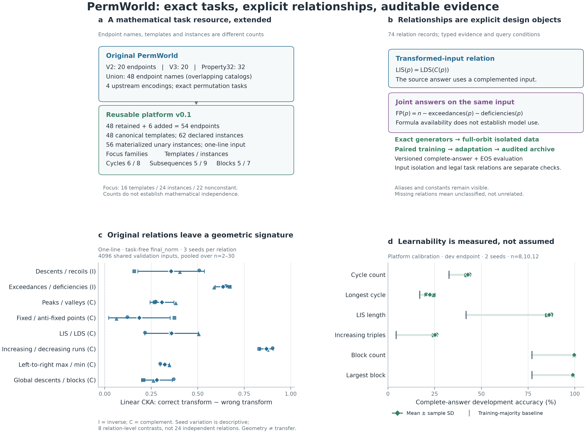
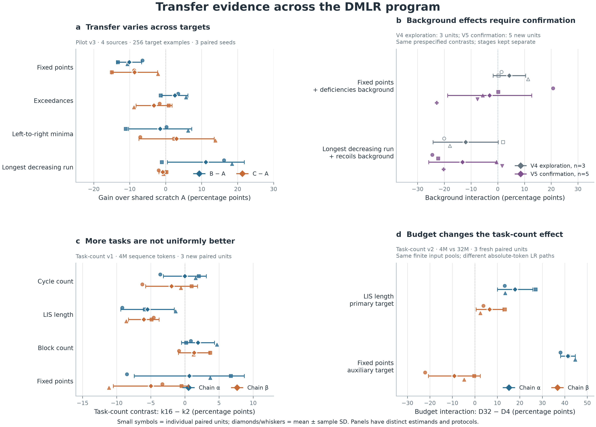

# PermWorld: A Relation-Annotated Data Platform for Composition and Budget Studies of Transfer

**DMLR working draft.** Authors, affiliations, venue and license are pending author approval. Repository names do not indicate publication acceptance. This draft synthesizes completed DMLR experiments; the literature revision adds no model training or test evaluation. Numerical evidence is pinned in the [DMLR evidence ledger](evidence/dmlr_claims.csv) and [figure sources](figures/README.md). The [resource comparison](RESOURCE_COMPARISON.md) separates verified prior capabilities from unverified ones. Original PermWorld task and generator provenance is credited below; the separate TMLR representation study is outside this manuscript.

## Abstract

How does the composition of a pretraining task set influence learning of a held-out task under a fixed training budget? We present a relation-annotated PermWorld data platform and a controlled transfer evaluation workflow. Building on the original exact-label permutation environment, the platform retains 48 legacy endpoints and exposes 54 endpoints in total, with templates, parameter instances and encodings counted separately. Multiple functions on the same permutation make it possible to specify single-task and joint answer relations, the inputs needed to use them, and their evidence status before observing transfer. These annotations distinguish mathematical derivability from source-task learning and downstream benefit. The complete-answer interface supports scalar and structured outputs; the workflow records source composition, token budgets, task exposure, paired repeats and development selection. Completed experiments show heterogeneous transfer across targets and compositions. A five-repeat confirmation does not reproduce one exploratory background interaction in direction and leaves the second uncertain. Across four targets and two nested source-task chains, fixed-token task-count curves are nonmonotonic. A new three-repeat budget comparison changes the LIS k16-minus-k2 contrast by +17.94 and +6.54 percentage points in the two chains, while fixed-points behavior remains composition dependent. The contribution is an inspectable setting for these distinctions and their conditional empirical consequences, not a general mixture optimizer, a scaling law or evidence that models execute the annotated formulas.

## 1. Introduction

Pretraining data are often described by size or domain proportions. For mathematical data, however, tasks also differ in the computations they require and in how their answers relate. Two tasks can be identical after transforming the input; several answers can jointly determine a target; and a task that appears useful mathematically can be difficult for a model to learn at a fixed budget. A useful testbed must expose these distinctions rather than treating every task name as an independent source of supervision.

Procedural mathematical data, algorithmic benchmarks and relation-aware data selection already address parts of this problem. Reasoning Gym combines verifiable generation, difficulty control, mixtures and transfer studies; Skill-It uses estimated skill dependencies to select data; and Data Mixing Laws predicts mixture behavior across training budgets and model sizes. Our question is narrower: when an answer relation can be specified independently of learning, what do source mastery and held-out adaptation actually show under a recorded composition and budget? Section 2 and the [source-backed comparison](RESOURCE_COMPARISON.md) describe the overlap with these works.

Permutations offer a compact setting with exact labels and rich relations. For a permutation p, fixed points, cycle statistics, subsequences and block decompositions share an input object but require different computations. Inverse, reversal and complement transformations expose correspondences specified independently of a model. We use these controls to study whether learning selected source tasks improves learning a held-out task, and how the answer changes with source composition and training budget.

The original PermWorld implementation supplies the inherited task definitions, exact generators, mathematical transformations and task/transfer infrastructure. The DMLR extension unifies those interfaces, registers additional endpoints and parameters, versions complete-answer encoding, and records typed relations and verification coverage. It investigates transfer through fixed-four-source pilots and later fixed-token task-count and budget experiments. Registration is not invention of a mathematical function: for example, the cycle-length-count algorithm already exists in the inherited code. The original workshop alignment study is cited background; newer representation-study results are reserved for the separate TMLR paper.

Our three contributions are: (i) a data platform that connects exact functions on a shared object space to typed answer relations, required input queries and evidence status; (ii) a paired transfer workflow that makes those annotations available alongside measured source learning, composition, token exposure and target adaptation; and (iii) conditional findings across targets, compositions and budgets, including unsuccessful confirmation and negative outcomes. The scientific distinction is between information that would suffice mathematically, information the model has learned to predict, and information that helps adaptation. Logging makes these distinctions inspectable; logging alone is not the novelty claim, and the experiments do not identify formula use.

## 2. Related work and scope

### 2.1 Procedural mathematical resources and algorithmic evaluation

Saxton et al. provide generated mathematical questions, typed composition of subproblems, and interpolation/extrapolation tests. Lample and Charton generate symbolic integration and differential-equation data using mathematical identities and check predicted solutions symbolically; they also study generalization across generation schemes. Exact generation, compositional structure and mathematical validation therefore precede this resource. We cite the formal ICLR 2019 and ICLR 2020 versions, respectively. [Saxton et al., Sections 2.1-2.5 and Appendix B](https://arxiv.org/pdf/1904.01557); [Lample and Charton, Sections 3-4 and Appendix E](https://arxiv.org/pdf/1912.01412).

CLRS organizes algorithm execution through typed inputs, outputs and intermediate hints, with controlled input sizes. Different sorting algorithms may yield identical final answers while differing in their traces; an algorithm count is not an independent-answer-function count. CLRS-Text renders traces as text and evaluates generalist language models across trained algorithms and input sizes. These are directly relevant procedural evaluation platforms, rather than merely static datasets. [Veličković et al., 2022, Sections 3-4](https://proceedings.mlr.press/v162/velickovic22a/velickovic22a.pdf); [Markeeva et al., 2024, Sections 3-5 and Appendices A-C](https://arxiv.org/html/2406.04229v1).

Reasoning Gym is the closest broad resource comparison. It already combines generated problems, answer rewards, configurable difficulty, curricula and weighted task mixtures, with within-domain held-out-task, cross-domain and external-benchmark transfer experiments. Its official code also contains scorer-consistency and task-specific generator checks. PermWorld cannot claim those capabilities as exclusive. Its narrower object space instead permits explicit statements about which source answers on which permutations suffice to reconstruct another answer. [Stojanovski et al., 2025, Sections 2, 4-5](https://proceedings.neurips.cc/paper_files/paper/2025/file/528d56195a2c77c808494c86fa7c77ad-Paper-Datasets_and_Benchmarks_Track.pdf); [pinned official implementation](https://github.com/open-thought/reasoning-gym/tree/49b07130b3fcd12f2d064bba7c43869543a0e7e7). Specific code locations and paper/code version differences are recorded in [RESOURCE_COMPARISON.md](RESOURCE_COMPARISON.md).

### 2.2 Skill dependencies and data selection

Skill-It is the closest methodological comparison for task dependencies. Its synthetic LEGO and digit-addition tasks have known generative structure. A skill is defined through a data slice and a learning response. Its formal dependency criterion compares the data needed to reach a specified metric: a uniform pair mixture must require no more data than target-only training. The graph estimators instead compare fixed-budget loss changes, then guide sampling. Thus synthetic tasks, task relations and budgeted selection are established prior work. A Skill-It training-response edge concerns learning under a procedure; a PermWorld answer identity specifies a reconstruction independent of model training. [Chen et al., 2023, Section 3, Definition 2 and Appendix C.2](https://proceedings.neurips.cc/paper_files/paper/2023/file/70b8505ac79e3e131756f793cd80eb8d-Paper-Conference.pdf); [official synthetic generators and training interface](https://github.com/HazyResearch/skill-it/tree/807b3bf7b11970f3a6fb6201cb37dcc1a3335f00).

DoReMi uses reference-relative excess loss to learn domain weights without downstream-task information. DoGE estimates source-to-target benefit from gradient interactions; its out-of-domain setup uses target data for weight estimation and also evaluates subsequent target fine-tuning. Its code logs per-domain sample counts. Neither target adaptation nor exposure logging is exclusive to PermWorld. Here, task lists and equal task-slot sampling are frozen diagnostic choices; no adaptive mixture optimizer is introduced or compared empirically. [Xie et al., 2023, Section 2 and Appendix C](https://proceedings.neurips.cc/paper_files/paper/2023/file/dcba6be91359358c2355cd920da3fcbd-Paper-Conference.pdf); [Fan et al., 2024, Sections 2-3 and Appendix B](https://proceedings.mlr.press/v235/fan24e.html); [DoGE logging implementation](https://github.com/Olivia-fsm/DoGE/blob/88400e9263dfdd69a24b28aec8533fcb1bf9363d/src/trainer.py#L772).

### 2.3 Mixture, budget and scale

Data Mixing Laws fits domain-mixture loss and combines mixture ratios, training steps and model size through a nested prediction pipeline. It already studies their joint practical influence; Appendix B distinguishes that pipeline from a single joint law. PermWorld's two-budget task-count contrast addresses a smaller question: held-out adaptation under specified task sets, with one fixed model size. It is neither a new general scaling law nor a substitute for mixture optimization across scales. [Ye et al., 2025, Sections 3-4, Algorithm 1 and Appendix B](https://proceedings.iclr.cc/paper_files/paper/2025/file/cc84bfabe6389d8883fc2071c848f62a-Paper-Conference.pdf).

### 2.4 Supported distinction and inherited work

The supported distinction is the combination of a shared permutation object, typed single/joint answer relations, explicit transformed-input query requirements, and evidence status, studied alongside source learning and held-out adaptation under recorded exposure. The inspected external resources do not establish an equivalent relation registry, but that capability remains **unverified**, not proven absent. We claim neither priority for task relationships nor empirical superiority over those resources. A formula, successful source prediction and positive transfer are three separate evidential claims.

The original PermWorld workshop work also used mathematical correspondences to study representation alignment. It is cited background, with task definitions, generators and transformations credited to the [pinned PermWorld source](https://github.com/XuanyuYang223/neurips/tree/74f0de2017115f06f11b7285366b66e7e8431d30). The present extension contributes the unified registry/answer interface, typed relation and query records, and the staged composition/budget transfer studies; it does not reattribute inherited algorithms. Final author-approved workshop citation metadata remain pending. The separate TMLR representation controls remain outside this paper.

## 3. Resource and mathematical controls

### 3.1 Objects, tasks and counting conventions

Inputs are one-based permutations of length n. The inherited task declarations contain 48 distinct endpoint names across overlapping task lists. The original task definitions, generators and inverse/reverse/complement transformations are retained. Endpoint names, mathematical templates, parameter instances and encodings are distinct counting units.

Platform v0.1 retains the 48 legacy endpoints and adds six registered endpoints. The resulting 54 endpoints correspond to 48 canonical mathematical templates after excluding designated aliases and representation outputs. Default declarations contain 62 endpoint instances, of which 56 unary non-alias instances are materialized in the platform dataset. Binary functions remain callable but do not yet have certified binary query-group data generation. These counts describe interface organization, not mathematical independence.

The three focus families cover cycle decomposition (six templates), global subsequences (five), and permutation blocks (five). Their 16 templates produce 24 default parameter instances. At the data/calibration lengths n=8,10,12, two instances are constant conditional on length: the increasing and decreasing subsequence counts at k=1 both equal n. Consequently there are 22 nonconstant focus instances. Additional equivalences are documented, including cycle-length count at k=1 equaling fixed points and decreasing-pair count equaling inversion count. The registry records definitions, parameters, constraints, exact algorithms, output bounds, complexity and measured generation cost.

### 3.2 Relation types and evidence

We distinguish a single-task relation f(p)=h(g(Tp)), a joint relation f(p)=h(g1(T1p),...,gm(Tmp)), and the input queries required to apply it. A proof from definitions, finite implementation verification and an empirical association are different evidence types. Failure to register a relation is not evidence of mathematical unrelatedness.

For example, fixed points FP, exceedances E and deficiencies D satisfy

> FP(p) + E(p) + D(p) = n.

Every position belongs to exactly one of p_i=i, p_i>i or p_i<i, which proves the identity. Also E(p)=D(p^-1). Thus FP(p)=n-D(p)-D(p^-1), but the latter requires answers on two related inputs. A source set with D(p) alone has not supplied the second answer. Relations are legitimate task structure; they become data-isolation issues only when the split or query protocol violates the declared rules.

Other registered controls include fixed/anti-fixed points under complement, LIS/LDS under complement, and subsequence-count/inversion identities. The platform records 45 new relation entries and 29 references to historical v5 certificates. Historical content is bound by source hashes rather than repeatedly re-enumerated. New-task checks use independent algorithms and exhaustive permutations through n=7 plus fixed larger fixtures: 272,741 label checks and 445,581 relation checks pass over 6,105 fixtures. Finite enumeration validates implementations within its coverage; the mathematical status of a formula is recorded separately.

Executability also has a defined scope: all 45 new records and 22 historical records have compiled reconstruction maps; seven historical records remain declarative. Query requirements can exceed the materialized source set. For example, reconstruction of LIS from the full increasing-subsequence histogram requires counts at every k=1,...,n, not just the default k=1,2,3 instances. The relation evaluator checks oracle answers; it does not establish model use of the map or imply that pretraining presents all required answers together.

### 3.3 Encoding, generation and isolation

The active platform input encoding is `one_line_v1`. The output protocol `permworld_sequence_v1` extends the inherited vocabulary from 188 to 203 tokens while preserving old IDs. It supports base-100 integers and nested lists with explicit termination. Large values and structured answers are neither truncated nor reduced modulo a fixed class count. Some legacy outputs can exceed a 128-token context; the reader rejects such examples explicitly.

Data are generated as objects before labels are attached. The canonical platform release contains 9,216 unique permutations and 516,096 labels across two repeat units and lengths 8,10,12. Train/development/test inputs are separated under the full inverse/reverse/complement orbit rule, with historical inputs excluded. The task-count studies use new pools at lengths 10 and 12 and retain the same isolation principle. Uniform proposals followed by sequential orbit rejection are not uniform orbit-class sampling and introduce finite-population dependence across units. We describe the units as paired repeats, not strictly IID samples from an unconstrained population.

Figure 1 summarizes the DMLR platform, typed relation metadata, audited generation and transfer workflow, and development-only calibration. It contains no representation-study results.

*Figure 1. Platform coverage, relation types, archived data checks and development-only learnability calibration. Template/instance counts use distinct denominators. The complete [caption and source tables](figures/README.md) state the scope of each panel; historical audit counts and calibration are not newly rerun training results.*

## 4. Experimental record and protocol boundaries

### 4.1 Transfer pilots and calibration

The pilot sequence is a staged investigation rather than one homogeneous benchmark. Pilot v1 varies target sample size 64/256/1024 for fixed points with two paired seeds. Pilot v2 diagnoses adaptation selection and source learning. Pilot v3 compares A (scratch), B (four sources including a designated related source) and C (one source replacement) for four targets, three paired seeds and 256 target examples. Targets are selected from mathematical definitions and single-task development learnability, not transfer test outcomes.

Pilot v4 examines background combinations for two cases chosen from v3, so its case selection is exploratory. Pilot v5 freezes two v4-derived contrasts and uses five new paired repeat units. It reports the paired difference in B-C between backgrounds, separately from old exploratory results. Source composition, task difficulty and answer distributions cannot be reduced to a single relation-present indicator.

Platform calibration freezes two representatives per new focus family, six tasks in total, before training. Each is trained with two seeds for 2,400 updates. Endpoint development performance is the calibration reference; no model test forward is used. These runs assess learnability at the stated configuration and lengths, not unseen-length generalization.

The early pilots use a single-answer-token evaluator suitable for their scalar tasks. Platform and task-count experiments use complete generated answers including EOS and a 203-token vocabulary. Absolute accuracy across these protocol generations must not be pooled or described as a controlled improvement from one version to another.

### 4.2 Platform-compatible task-count experiments

Task-count v1 freezes two genuinely different nested source chains with k=2,4,8,16. The 24-instance source pool spans the three focus families and legacy statistics; k counts nonconstant instances after excluding complete aliases, not independent mathematical information. All four held-out targets—cycle count, LIS length, components and fixed points—are excluded globally, as are their exact same-input answer aliases. Transformed-input and joint relations remain explicit, including answer mappings that may reveal a target.

V1 trains 24 source models: two chains times four k values times three paired repeats. Each model receives a fixed budget of four million nonpadding sequence tokens, including prompt and answer. Ninety-six adaptations reuse these models across four targets; 12 scratch baselines are shared across k and chain. Each target has 256 examples, balanced across n=10,12.

Task-count v2 is motivated by v1 and reported separately. It retains the same compositions at k=2,16 and compares four million with 32 million tokens using three new paired repeats. LIS is primary and fixed points auxiliary. Twenty-four pretrained models support 48 adaptations, plus six shared scratch baselines. Both budgets start from the same paired random initialization with empty optimizer state. They use the same relative-budget warmup/cosine rule, so their learning rates differ at the same absolute token count; the long run does not continue a fully decayed short endpoint.

The fixed source pool has 8,192 objects per repeat in v2. Extra tokens can expose unseen task-input pairs within that pool as well as repeat already seen pairs. They do not supply eight times as many independent objects. Per-task samples, tokens, unique inputs and repetitions are recorded. Uniform task slots do not imply equal token counts when answer lengths differ.

Both task-count studies use a four-layer, width-256, eight-head Transformer, context 128, dropout 0.1 and tied input/output embeddings. AdamW uses initial learning rate 3e-4, weight decay 0.01, betas (0.9,0.999), epsilon 1e-8 and gradient clipping at 1.0. Training uses BF16 on CUDA with FP32 weights/evaluation and TF32 disabled. The per-example loss is the mean cross-entropy over answer tokens plus EOS, followed by an average over examples; prompt tokens are masked.

Adaptation uses 800 updates, batch size 64, a single 3e-4 initial learning rate, 100 warmup updates and cosine decay to 3e-5. All four held-out task-token rows are reset to paired random initialization before every adaptation, with a fresh AdamW optimizer. Checkpoints are selected every 100 updates by highest complete-answer development accuracy, then lowest answer cross-entropy, then earliest update; update zero is excluded. Independent test inputs are generated after selections freeze. Selected and endpoint tests are both retained, with no test-driven selection.

### 4.3 Statistical units and estimands

For repeat r, define the count contrast at budget b as D_b,r=accuracy(k16,b,r)-accuracy(k2,b,r), and the budget interaction as I_r=D_32M,r-D_4M,r. Differences are computed within repeat before summaries. The shared scratch baseline cancels from this interaction. Reusing a pretrained model across targets or a baseline across chains does not add independent repeats.

Figures show individual repeat values and descriptive mean/sample standard deviation unless explicitly labeled otherwise. V5 retains its original t intervals, including multiplicity-adjusted intervals, with their small-sample limitations. Chains are fixed compositions, not random samples from a population of task sets. Cross-stage panels do not share one pooled error estimate.

## 5. Findings

### 5.1 Exact generation does not guarantee easy learning

Platform calibration distinguishes label correctness from learnability at a fixed budget. Mean endpoint development accuracy is 42.84% for cycle count, 22.53% for longest cycle, 86.26% for LIS, 25.26% for increasing length-3 subsequence count, 99.74% for components and 99.02% for largest component. Their respective training-derived majority baselines are 32.68%,16.99%,41.80%,4.36%,77.08%,77.08%. At n=12, cycle count falls below its majority baseline and length-3 counting remains difficult. High block-task accuracy also needs the high baseline for context. These are development measurements from two repeats, not six independently validated test claims.

### 5.2 Transfer varies across targets and backgrounds

Pilot v3 shows mean B-A differences of -10.12 percentage points for fixed points, +2.59 for exceedances, -1.53 for left-to-right minima and +11.20 for longest decreasing run. B-C changes sign across the three seeds for all four targets. Fixed points is negative relative to scratch in all seeds for both source compositions. Longest decreasing run has a positive mean B gain but one negative seed, while scratch performance remains near the majority baseline. The single-task eligibility check used more data than adaptation; passing it does not guarantee success from 256 examples.

Pilot v5 retains the distinction between discovery and validation. The fixed-points background interaction changes from an exploratory +4.36 points to -3.02 points across five new repeats, with a 95% t interval [-22.57,+16.54]. Its selected direction does not reproduce. The longest-decreasing-run interaction is -13.15 points with interval [-28.89,+2.58], consistent in direction with exploration but still uncertain. Neither supports a stable confirmed background effect. Auxiliary gains shared by B and C are not evidence for a B-C interaction.

### 5.3 Fixed-token task-count curves are nonmonotonic

Across the four targets and two chains in v1, none of the eight mean accuracy curves is nondecreasing at every k step. LIS has a negative k16-minus-k2 contrast in all three repeats of each chain, with means -5.47 and -6.02 points, although all its pretrained condition means exceed the scratch mean. Cycle-count condition means are at or below scratch. Components often benefits but is nonmonotonic. Fixed-points outcomes vary substantially across chains and seeds.

These findings concern two prespecified sequences of task sets at one total-token budget. Increasing k changes the labels learned, available mathematical relations, answer distribution and per-task exposure. The data do not isolate an abstract effect of task number independent of those changes.

### 5.4 A larger budget changes the count contrast

In new v2 repeats, LIS chain alpha changes from D_4M=-6.18 to D_32M=+11.75 points, giving interaction +17.94 (sample SD 7.89). Chain beta changes from -5.79 to +0.75 points, giving +6.54 (SD 5.96). All three interaction values are positive in each chain. A positive interaction does not mean every long-budget k16-minus-k2 comparison is positive: beta retains mixed signs at 32M.

The auxiliary fixed-points result is sharply composition dependent. Its budget interaction is +41.41 points (sample SD 3.27) for alpha and -9.08 (SD 11.55) for beta. At 32M/k16, alpha exceeds the shared scratch mean by 23.63 points while beta falls below it by 21.42. Therefore a longer budget is not a universal cure for negative transfer.

Source records help describe, but do not identify, a mechanism. In alpha/k16, exceedance and deficiency development accuracy rise from about 43.23%/38.93% to 99.35%/98.96%, alongside fixed-points improvement; their joint identity makes this informative. It does not prove formula use. Conversely, alpha/k2 LDS accuracy reaches about 99.09% at 32M while LIS transfer decreases on average, showing that source accuracy alone is not a sufficient transfer predictor. More repetitions, new task-input coverage within the fixed pool, and differing absolute learning-rate trajectories remain part of the budget intervention.

*Figure 2. Four complementary downstream views: cross-target transfer, exploratory versus new-repeat background interactions, four-target task-count endpoint contrasts and the budget interaction. Every panel retains paired units and its own protocol. See [captions and raw plot tables](figures/README.md); the supplementary figure shows all four k values rather than only endpoints.*

## 6. Limitations and implications

The mathematical environment permits exact evaluation and controlled relations, but it remains a synthetic finite setting. The DMLR platform experiments use one architecture, one active input representation and a small length range. They do not establish transfer to natural language, unseen mathematical domains or longer permutations. Three paired repeats in the task-count studies provide limited uncertainty information; fixed chains do not support task-set population inference.

Known mathematical information, optimization difficulty, answer imbalance and exposure vary jointly in many compositions. The joint derivability of a target is not evidence that a model computes that derivation. Failed confirmation, majority-level target performance and underlearned sources remain scientifically relevant outcomes.

The literature comparison is a bounded inspection of primary papers and pinned code, not an exhaustive absence proof or a performance benchmark against other platforms. No controlled comparison with Reasoning Gym, CLRS-Text or the data-selection methods is available. Likewise, the present evidence does not isolate the value of relation annotations from the choice of tasks. Source-training accuracy in the task-count records is measured on a fixed probe of 256 inputs per length, not the full source pool. These limitations constrain both novelty and mechanism claims.

The pipeline changes between early pilots and the platform are intentional and documented. Complete-answer evaluation is necessary for multi-token and structured outputs; it also prevents a single pooled accuracy analysis across the full history. The platform's checks cover declared lengths and algorithms, not every possible parameter/input regime. Binary task splits and some long-context outputs remain engineering gaps.

Resource availability also has limits. Source, data, protocols, raw results and figure evidence are available in Git, but DMLR checkpoints remain local. The release acceptance scope is installation, data interfaces, table recomputation, figure generation and source-only verification; it does not rerun GPU training or model predictions. The acceptance record identifies the tested environment and any failures/fixes. Final licensing, authorship and a stable archival identifier remain release tasks. This draft is not an accepted or formally archived publication.

A stronger general or mechanistic claim would need a separately frozen experiment that separates relation structure, source mastery and exposure across a broader task-family sample. Further background variants for the same two targets would not resolve those gaps by themselves. No such experiment is run or promised by this release check.

## 7. Artifact availability and reproducibility

The [release guide](RELEASE.md) maps each contribution to code, registry, data, mathematical certificates, raw results and reproduction commands. The default figure builder and numerical verification read DMLR-local released tables and registry/audit records only. [Contribution boundaries](CONTRIBUTIONS.md), the [resource comparison](RESOURCE_COMPARISON.md) and a [claim ledger](evidence/dmlr_claims.csv) make the synthesis reviewable without rerunning models. The preserved [upstream audit](evidence/original_permworld_audit.md) is optional archival provenance, outside the default scientific reproduction dependencies.

This release check preserves the raw data, results, frozen configurations and scientific manifests. Derived publication material and documentation revisions have their own provenance records. GPU reproduction belongs to the original frozen protocols and must use fresh output directories. Publication verification requires no training, local checkpoint, untracked reference clone or original working-directory path.

The subsequent [literature revision](literature_review/REVISION.md) preserves the accepted release manifest and verification record. A separate documentation ledger records exact editorial hash transitions; the default verifier checks those transitions while retaining the original scientific bindings.

## Appendix A. Evidence and protocol map

| Stage | Scientific question / outcome | Statistical units and scope | Entry point |
| --- | --- | --- | --- |
| Inherited PermWorld resource | Exact task definitions, generators and mathematical transformations | Resource provenance; workshop alignment is background only | [Pinned original source](https://github.com/XuanyuYang223/neurips/tree/74f0de2017115f06f11b7285366b66e7e8431d30) |
| Pilot v1 | Fixed-points sample efficiency | 2 paired seeds; 64/256/1024 samples | [Report](../PILOT_REPORT.md) |
| Pilot v2 | Adaptation and source-budget diagnostics | 2 paired seeds; 256 samples; original and extended budgets | [Report](../experiments/pilot_v2_diagnostics/DIAGNOSTIC_REPORT.md) |
| Pilot v3 | Cross-target composition transfer | 4 targets, 3 paired seeds, 256 samples | [Report](../experiments/pilot_v3_multitarget/PILOT_V3_REPORT.md) |
| Pilot v4 | Background exploration | 2 selected targets, 3 backgrounds, 3 paired seeds | [Report](../experiments/pilot_v4_backgrounds/PILOT_V4_REPORT.md) |
| Pilot v5 | Frozen background confirmation | 2 contrasts, 5 new paired repeats | [Report](../experiments/pilot_v5_confirmation/PILOT_V5_REPORT.md) |
| Platform v0.1 | Resource correctness and learnability | 6 preselected tasks, 2 seeds; development only | [Report](../experiments/platform_v01/PLATFORM_REPORT.md) |
| Task-count v1 | Fixed-total-token finite curves | 4 targets, 2 chains, 4 k values, 3 paired repeats | [Report](../experiments/task_count_v1/REPORT.md) |
| Task-count v2 | Budget-by-count interaction | 2 targets, 2 chains, 2 k values, 2 budgets, 3 new repeats | [Report](../experiments/task_count_v2/REPORT.md) |

## Appendix B. Compute accounting

Platform calibration performs 28,800 updates across 12 runs and about 52.84 million sequence tokens, with recorded training time of 14.23 minutes. Task-count v1 uses 95,999,744 actual pretraining tokens across 24 models and about 85 minutes for the training stage. Task-count v2 uses 431,999,672 actual pretraining tokens plus 82,944,000 adaptation tokens; its recorded training stage is 124.20 minutes and final test pass 30.73 seconds. These are measured local runs, not portable hardware benchmarks or the total cost of the entire historical program. Per-run timings, environment details, supervised-token counts and budget tails remain in the original compute records.

## References

- Saxton, D., Grefenstette, E., Hill, F., and Kohli, P. (2019). [Analysing Mathematical Reasoning Abilities of Neural Models](https://openreview.net/forum?id=H1gR5iR5FX). ICLR.
- Lample, G., and Charton, F. (2020). [Deep Learning for Symbolic Mathematics](https://openreview.net/forum?id=S1eZYeHFDS). ICLR. Preprint first posted in 2019.
- Veličković, P., et al. (2022). [The CLRS Algorithmic Reasoning Benchmark](https://proceedings.mlr.press/v162/velickovic22a.html). ICML, PMLR 162:22084-22102.
- Markeeva, L., et al. (2024). [The CLRS-Text Algorithmic Reasoning Language Benchmark](https://arxiv.org/abs/2406.04229). arXiv:2406.04229; formal publication not verified.
- Stojanovski, Z., et al. (2025). [Reasoning Gym: Reasoning Environments for Reinforcement Learning with Verifiable Rewards](https://proceedings.neurips.cc/paper_files/paper/2025/hash/528d56195a2c77c808494c86fa7c77ad-Abstract-Datasets_and_Benchmarks_Track.html). NeurIPS, Datasets and Benchmarks Track.
- Chen, M. F., et al. (2023). [Skill-it! A data-driven skills framework for understanding and training language models](https://proceedings.neurips.cc/paper_files/paper/2023/hash/70b8505ac79e3e131756f793cd80eb8d-Abstract-Conference.html). NeurIPS.
- Xie, S. M., et al. (2023). [DoReMi: Optimizing Data Mixtures Speeds Up Language Model Pretraining](https://proceedings.neurips.cc/paper_files/paper/2023/hash/dcba6be91359358c2355cd920da3fcbd-Abstract-Conference.html). NeurIPS.
- Fan, S., Pagliardini, M., and Jaggi, M. (2024). [DOGE: Domain Reweighting with Generalization Estimation](https://proceedings.mlr.press/v235/fan24e.html). ICML, PMLR 235:12895-12915.
- Ye, J., Liu, P., Sun, T., Zhan, J., Zhou, Y., and Qiu, X. (2025). [Data Mixing Laws: Optimizing Data Mixtures by Predicting Language Modeling Performance](https://proceedings.iclr.cc/paper_files/paper/2025/hash/cc84bfabe6389d8883fc2071c848f62a-Abstract-Conference.html). ICLR.
- Original PermWorld resource and workshop background: [pinned source revision](https://github.com/XuanyuYang223/neurips/tree/74f0de2017115f06f11b7285366b66e7e8431d30). Task definitions, generators and mathematical transformations are inherited; final author-approved software/workshop citation metadata are pending.
