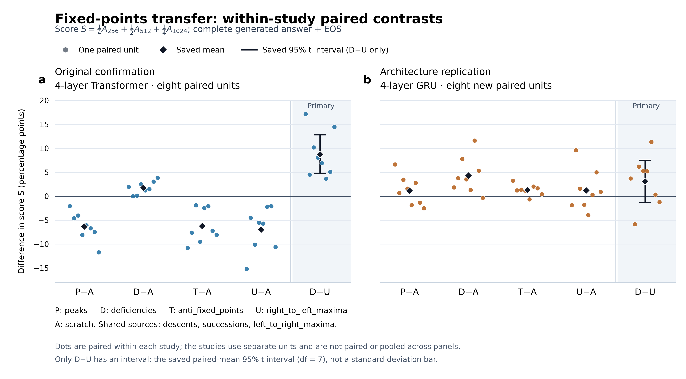

# PermWorld: Mathematical Relations, Source Learning, and Transfer

**Authors:** [AUTHOR LIST AND ORDER]. **Affiliations and contact:** [AFFILIATIONS AND CORRESPONDING AUTHOR].

**Resource metadata:** [CODE AND DATA LICENSES]; [CHECKPOINT HOSTING]; [ARCHIVAL TAG AND DOI]. Original workshop citation: [ORIGINAL PERMWORLD WORKSHOP CITATION].

## Abstract

PermWorld is a data platform of exact functions on permutations, annotated with answer relationships, joint reconstructions, input-query requirements, and verification status. It distinguishes mathematical derivability, source learning, and benefits from target adaptation. In an eight-unit Transformer experiment, deficiencies outperforms a specified comparison source by +8.7601 percentage points in weighted accuracy (95% paired t interval [+4.6823, +12.8378]). Its gain over scratch is +1.7670 points; the other comparison conditions exhibit negative transfer. A separate eight-unit GRU replication yields +3.1235 points with interval [-1.2743, +7.5213], leaving the primary effect uncertain. In a separate three-unit experiment, LDS complement-readout accuracy rises from 85.19% to 99.09% with additional pretraining, while direct LIS adaptation falls from 56.80% to 53.78%. Development-only calibration retains weakly learned and decoding-limited tasks, and an earlier background-interaction confirmation remains unsuccessful. These conditional findings separate available mathematical information from learned predictions and adaptation benefits; they do not establish internal formula use or a general transfer law.

## Introduction

Does a mathematically useful source task help a model learn another task? A formula alone cannot answer this question. Source answers may determine a target only after particular input queries; a trained model may predict those answers poorly; and even accurate source predictions need not make target adaptation easier. Separating these claims requires both a precisely specified task resource and measurements of learning under explicit compositions and budgets.

Permutations provide a shared input object on which exact functions can require different computations. Fixed points compare values with positions, cycle statistics follow repeated applications, subsequences compare global order, and blocks identify invariant prefixes. Inverse, reversal, and complement transformations make some answer correspondences explicit without reference to a trained model. This compact mathematical setting allows information requirements to be described before measuring their learning consequences.

The original PermWorld supplies task definitions, exact generators, mathematical transformations, and task/transfer infrastructure. Its workshop representation-alignment study is background, cited as [ORIGINAL PERMWORLD WORKSHOP CITATION]. The present extension organizes inherited and additional registrations in a unified interface, supplies typed answer/query relations and correctness evidence, and studies composition-dependent transfer. Registration does not imply invention of a mathematical function: cycle-length counting already exists in the inherited implementation. The newer, separate TMLR representation-control study is outside this paper; none of its encoding, initialization, architecture-control, or answer-control results is used as evidence here.

The contributions are a relation-annotated data platform; a transfer workflow that measures source learning and target adaptation alongside composition and actual exposure; and conditional empirical findings that include positive, negative, and uncertain outcomes. The worked case asks whether deficiencies adds value beyond specified alternative sources for learning fixed points. External formula readout and a recurrent-model replication provide distinct checks on the interpretation. The resource makes these questions expressible; the experiments do not show that annotations themselves improve training.

We do not claim priority for mathematical generators, task relationships, or data-composition research. Nor do we identify a general task-count law or show that models execute the annotated formulas. The scientific contribution is evidence that mathematical sufficiency, source prediction, and adaptation benefit can separate under specified learning conditions.

## Related work

### Procedural mathematics and algorithmic resources

Saxton et al. (2019) generate mathematical questions with typed subproblem composition and interpolation/extrapolation tests. Lample and Charton (2020) generate symbolic integration and differential-equation examples using mathematical identities and check predicted solutions symbolically. Exact generation, compositional structure, and mathematical validation therefore precede PermWorld. CLRS (Veličković et al., 2022) exposes typed algorithm inputs, outputs, and execution hints at controlled sizes; CLRS-Text (Markeeva et al., 2024) renders algorithmic traces as text and studies generalist language models. Algorithm counts and answer-function counts need not coincide: different algorithms can produce the same final answer.

Reasoning Gym (Stojanovski et al., 2025) is the closest broad resource comparison. It already includes verifiable generation, difficulty configuration, curricula, weighted mixtures, and within-domain, cross-domain, and external-benchmark transfer experiments; its implementation also includes generator and scorer checks. PermWorld's narrower contribution is not these capabilities in isolation, but explicit statements about which answers on which permutations suffice to recover another answer.

### Dependencies, data selection, and mixture prediction

Skill-It (Chen et al., 2023) studies known synthetic structure in LEGO and digit-addition tasks and estimates skill dependencies to guide data selection. Its formal dependency concerns the amount of training data required under a learning procedure, while its estimators use fixed-budget loss responses. Such a training-response relation differs from an answer identity that holds independently of learning. Both are useful; one does not imply the other.

DoReMi (Xie et al., 2023) learns domain weights from reference-relative excess loss without downstream-task information. DoGE (Fan et al., 2024) estimates generalization benefit through gradient interactions; its out-of-domain setup uses target data and also evaluates target fine-tuning. Exposure logging and adaptation are therefore not exclusive to PermWorld. Our experiments use specified source sets and balanced task sampling rather than introducing or benchmarking an adaptive mixture optimizer.

Data Mixing Laws (Ye et al., 2025) models domain-mixture loss and combines mixture ratios, training steps, and model size through a nested prediction pipeline. It already studies their joint practical influence; its discussion distinguishes the pipeline from a single joint law. Our finite composition-and-budget comparisons concern held-out adaptation at a specified model size, not a replacement for general mixture optimization or a scaling law.

The supported distinction is an explicit relation registry for exact functions on a shared object space, including joint answers, transformed-input queries, and separate evidence status, used alongside source learning and adaptation measurements. An equivalent systematic registry in the inspected external resources remains unverified, rather than proven absent. We provide no head-to-head performance comparison against those resources or selection methods.

## A relation-annotated permutation resource

### Tasks, counts, and exact answers

The platform retains 48 legacy endpoints and adds 6 registrations, for 54 endpoints in total. Excluding designated aliases and representation-output endpoints leaves 48 canonical mathematical templates. The catalog declares 62 instances, of which 56 unary non-alias instances have canonical generated data. These are different interface counts, not counts of independent mathematical abilities. Binary functions are callable, but certified binary data-pool generation is not part of this resource version.

The focus families are cycle decomposition, global subsequences, and permutation blocks. They contain 16 templates and 24 default instances; 22 instances are nonconstant at the calibrated lengths. Parameter values, encoding choices, exact same-input aliases, and relations under transformations remain separately identified. The registry gives definitions, legal parameters and lengths, exact algorithms, output types and bounds, computational complexity, generation costs, and relation status.

Inputs use one-line permutation encoding. The complete-answer interface extends the legacy vocabulary from 188 to 203 tokens while preserving previous token identifiers. Delimited base-100 integers and nested lists accommodate scalar and structured answers without truncation or modulo reduction. Context-incompatible examples are rejected explicitly. The later calibration retains the original decoder's separate output-length limit, discussed below.

### Relations describe information, not learned mechanisms

A single-task relation specifies a target answer as a function of a source answer on a declared transformed input. A joint relation requires several source answers, potentially at different queried inputs. Each record distinguishes a proof, finite implementation verification, empirical association, and an unchecked claim. Missing annotations do not imply mathematical unrelatedness.

For fixed points FP, exceedances E, and deficiencies D:

> FP(p) + E(p) + D(p) = n, and E(p) = D(inverse(p)).

Every position falls into exactly one of equality, excess, or deficiency. Consequently, FP(p) = n - D(p) - D(inverse(p)). This registered reconstruction requires both specified deficiency queries: D(p) alone does not recover the target. Likewise, FP(p) = AF(complement(p)) for anti-fixed points AF, and LIS(p) = LDS(complement(p)). These are statements about answers; none asserts that a model implements the reconstruction.

The source-replacement study's complete same-input answer vectors fail to determine fixed points in every composition, as witnessed by saved n=10 counterexamples. Allowing the registered inverse/reverse/complement queries makes the deficiencies and anti-fixed-points compositions sufficient; the peaks and right-to-left-maxima compositions still have insufficiency witnesses in that answer-query model. This does not imply that the raw permutation lacks the answer, or that unregistered relations are absent.

Independent algorithms check the exact labels: union-find for cycle structure, subset enumeration for subsequences, growth diagrams for RSK, and set-based block cuts. The resource certificate covers 6,105 fixtures, 272,741 label comparisons, and 445,581 pointwise formula checks. Mathematical proofs and finite implementation coverage remain separate. Historical relation certificates are reused without changing their evidence scope.

All 45 additional relation records and 22 historical records have compiled answer maps; seven historical records remain declarative. Query availability must be checked at the instance level: a full subsequence histogram can determine LIS, but a small subset of its counts need not supply that information.

### Data and development-only calibration

The canonical data contain 9,216 distinct permutations and 516,096 labels at lengths 8, 10, and 12, using two data units. Each unit has 1024 training, 256 development, and 256 reserved test inputs per length. Inputs are separated by complete inverse/reverse/complement orbits across roles and units, with historical inputs excluded. Different tasks intentionally share the same input objects. Uniform permutation proposals followed by sequential orbit rejection are not uniform orbit-class sampling or strictly independent draws.

The original calibration selects six representatives and uses two initialization/data pairings, 2400 updates, and a single learning rate. The extension covers all 50 requested remaining materialized unary non-alias instances: 49 complete training with both original units, yielding 98 runs, while to_reduced_word is explicitly rejected by the reader. No requested instance is silently dropped and no rejected instance receives an invented accuracy. The complete original and extension tables are in the calibration appendices.

The extension reuses exactly the original train/development pools, initialization pairing, training configuration, and decoding budget. Hashes and archived exposure records verify the original pools' use. The new tasks are directly comparable to the original calibration under these conditions, but they do not supply independent data units. Reserved test inputs are not used by the extension, and it performs no model test forward. Endpoint development accuracy, rather than the best development checkpoint, is the calibration reference.

There are 8 completed extension instances with a pooled development generation ceiling below one and 8 with mean endpoint accuracy below their training-derived majority baseline. The decoder allows at most eight tokens including EOS, whereas loss supervises the complete gold answer and the majority predictor returns an uncapped complete answer. A zero score on an impossible-length answer does not show that the mathematical task is unlearnable; negative baseline-relative scores can also reflect this asymmetry. The appendix therefore retains generation ceilings alongside accuracy and gains. All three lengths occur in training, so their development differences are not unseen-length extrapolation.

## Transfer and readout protocols

### The paired source-replacement comparison

The target is fixed_points. Each pretrained model has the common sources descents, successions, and left_to_right_maxima, with a fourth source as below. One three-learning-rate adaptation suite for scratch A is run per unit and target size and shared across comparisons. P and D inherit the task sets of the earlier background study's C conditions; T is a new composition, not a direct reproduction of its B condition.

| Route | Fourth source | Purpose |
| --- | --- | --- |
| P | peaks | Original-background reference |
| D | deficiencies | Primary candidate |
| T | anti_fixed_points | Specified transformed-input-related comparison |
| U | right_to_left_maxima | Specified alternative computation |
| A | No pretraining | Shared scratch baseline |

U is related to the common left-to-right-maxima source through reversal and is not an unrelated control. D and U are not matched in difficulty, answer distribution, or redundancy. The training presents ordinary individual task examples without explicit paired-transform queries, formula supervision, or local-position labels. Possible common operations, such as positional comparisons or directional maxima, are algorithmic observations rather than measurements of trained internal computation.

The original confirmation uses a four-layer, width-256 Transformer with eight attention heads and vocabulary 188, at n=10. The replication uses a four-layer, width-256 GRU and eight fresh paired units. Both studies use the same source composition, input format, loss, budgets, and adaptation selection procedure, but their units are separate and their results are never pooled. The architectures are not parameter-count matched.

Before the GRU transfer study, separate single-task fixed_points and deficiencies runs each achieve 100.00% endpoint development accuracy, passing the prespecified threshold of 0.90. The gate has 8192 training and 1024 development inputs at n=10, no test set, and discarded trained weights. The alternative was an eight-layer, width-256 Transformer if either task failed; no tuning or alternative-model training followed the passed gate. The gate is not an independent transfer unit.

Each source model receives 4800 updates, batch size 64, and 16 examples per task per update. The inherited learning rate decays through update 2400 and remains at its minimum through update 4800. Adaptation starts from this endpoint, loads all source parameters, restores only the target task's tied embedding/output row to the same unit's initial value, and creates a fresh optimizer. Learned numeric-answer parameters remain part of the transferred model.

Target training uses nested subsets of 256, 512, and 1024 examples, with each size adapted independently from its source endpoint or scratch initialization. Each route/size has 800 updates for each of the same learning rates, 3e-4, 1e-4, and 3e-5. Development selection maximizes full-answer accuracy, then minimizes answer cross-entropy, prefers the earliest positive update, and finally follows declared learning-rate order. The selected candidate's endpoint remains a diagnostic, not a test-selected alternative.

Each unit has 8192 source-training, 1024 source-development, 1024 maximum target-training, 1024 target-development, and 2048 test inputs. The 1024 labeled target-development examples are additional target supervision: the smallest adaptation condition does not use only 256 target labels overall. Data, initialization, source slots, and adaptation streams are paired within a unit. Full transformation orbits isolate roles, units, gate inputs, and history. Independent test pools are generated only after all development choices are made.

Accuracy requires free generation of the complete answer and EOS. For each unit and route, the primary score is S = 0.25*A256 + 0.5*A512 + 0.25*A1024, the normalized trapezoidal area over log2 target-training size. The sole primary contrast is S_D - S_U, calculated within unit before summarizing. Each study reports its own paired 95% t interval with df=7. Approximate normality and independence are assumptions with limited diagnostics; global orbit rejection creates finite-population dependence. Shared checkpoints, test samples, learning rates, sizes, and scratch baselines do not increase the number of units.

### External readout and task-count experiments

The task-count studies instead use the complete-answer platform's 203-token vocabulary, a four-layer width-256 Transformer with eight heads, and lengths 10 and 12. They use three paired units and 256 target-training examples, with 800 adaptation updates at one learning rate, 3e-4. All four held-out task-token rows are restored to paired initialization. The two vocabulary generations and adaptation procedures differ; absolute accuracies across them are not a controlled improvement or pooled benchmark.

The budget study compares 4M and 32M nonpadding sequence tokens at k=2 and k=16 within each of two specified source chains. Here k counts nonconstant source-task instances after removing complete same-input aliases, not independent mathematical capabilities or templates. Both budgets start from paired random initialization and use the same relative-budget schedule, so their absolute-token learning-rate trajectories differ. Each repeat uses the same 8192-object source pool at both budgets. More budget can increase task-specific coverage and repeated exposure; it does not add the same proportion of independent data. The contrasts combine composition, exposure, and optimization conditions rather than isolating a pure task-count cause.

The readout experiment reuses the budget study's three original training units and selected models, with 512 new test inputs at each length per unit. It supplies the registered formula and its specified source queries externally, comparing reconstructed targets with direct target adaptation and trained scratch baselines. Readout does not retrain or reselect models. Transformed queries are multiple requests about an object, not additional independent objects or units. External mathematical information and query costs differ from direct adaptation, so readout is a diagnostic rather than an equal-information competing learner.

## Findings: the worked case and its contrasts

### The Transformer source-replacement result

The sole primary contrast is +8.7601 pp, with sample SD 4.8776 and 95% paired t interval [+4.6823,+12.8378]; all eight unit differences are positive. This supports additional value of deficiencies over the specified U source under this background and budget. It is not a gain of that size over scratch.

| Original Transformer area contrast | Mean (pp) | Sample SD | Unit range (pp) |
| --- | ---: | ---: | --- |
| D - U | +8.7601 | 4.8776 | [+3.6621, +17.1509] |
| P - A | -6.3461 | 2.9339 | [-11.7432, -2.0630] |
| D - A | +1.7670 | 1.3512 | [+0.0000, +3.8574] |
| T - A | -6.2103 | 3.5444 | [-10.7910, -1.8921] |
| U - A | -6.9931 | 4.5911 | [-15.2100, -2.0874] |

D's mean scratch-relative gain is +1.7670 pp, while P, T, and U have means -6.3461, -6.2103, and -6.9931 pp, respectively. Thus much of the D-U separation reflects negative transfer in the comparison conditions. D is positive relative to scratch in 7/8 units, with one tie; the other routes are negative in 8/8. This is descriptive context, not a mediation analysis.

The pointwise D-U means are +24.1333 / +5.1514 / +0.6042 pp at 256 / 512 / 1024 target-training examples. The observed difference narrows across the studied sizes; these pointwise comparisons remain secondary to the weighted score.

Candidate-source development accuracy is 99.82% for deficiencies and 93.31% for anti-fixed points, compared with 66.82% for peaks and 94.54% for U. Common descents and successions remain incompletely fitted, despite much stronger prefix-maxima performance. Candidate difficulty, label distribution, and redundancy are not balanced, and accurate source prediction alone cannot explain the target differences.

### Separate recurrent-model replication

The GRU replication yields S_D-S_U = +3.1235 pp, sample SD 5.2604, with 95% paired t interval [-1.2743,+7.5213]. Six unit differences are positive and two are negative. The primary evidence remains uncertain: the interval includes zero, and a positive mean does not establish replication of the original effect. It also does not prove that deficiencies has no benefit.

| Separate GRU area contrast | Mean (pp) | Sample SD | Unit range (pp) |
| --- | ---: | ---: | --- |
| D - U | +3.1235 | 5.2604 | [-5.8472, +11.3159] |
| P - A | +1.1658 | 3.1007 | [-2.5269, +6.6284] |
| D - A | +4.3427 | 3.8597 | [-0.3540, +11.6089] |
| T - A | +1.2939 | 1.1391 | [-0.6714, +3.2349] |
| U - A | +1.2192 | 4.3303 | [-3.9551, +9.6191] |

The source and target learning regime also changes substantially. Although both separate single-task gate runs reach 100.00% development accuracy, four-source endpoint development accuracy is 53.53% for D and 46.01% for T; their training accuracies are 53.55% and 46.92%. U reaches 89.71% development accuracy and P reaches 57.85%. Scratch target accuracy is 44.93%, 46.63%, and 47.85% across 256, 512, and 1024 examples.

A single-task gate uses the full batch of 64 for one task, whereas multitask training allocates 16 examples per task per update. Passing the gate therefore does not establish sufficient per-task exposure in the mixture or identify interference. The replication changes architecture with fresh data/initializations and does not match parameter count. Limited source and target learning is part of its result, not grounds to delete units, extend training, or attribute the difference solely to architecture. No formal interaction test compares the architectures.

### Mathematical sufficiency, readout, and adaptation are separate observations

The summary below deliberately labels protocols and units within cells. Source learning and readout values from the task-count models are not measurements of the confirmation models. Likewise, a learned anti-fixed-points source in the Transformer confirmation does not imply mastery by the different task-count or GRU models. Budget pairs refer to the specified 4M-to-32M comparison.

| Case | Mathematical derivability (identity, no empirical unit) | Source accuracy (protocol and units) | External readout accuracy (protocol and units) | Transfer outcome (protocol and units) |
| --- | --- | --- | --- | --- |
| Deficiencies to fixed points | FP(p)=n-D(p)-D(inverse(p)); two specified queries for this reconstruction, not D(p) alone | Transformer confirmation, eight units: 99.82% dev. Task-count alpha/k16, three units: 38.93% to 98.96% dev | Task-count/readout alpha/k16, three original units: 42.51 +/- 1.66% to 98.73 +/- 0.54% | Transformer confirmation, eight units: D-U +8.7601 pp, 95% interval [+4.6823,+12.8378]; D-A +1.7670 pp. Separate GRU, eight new units: D-U +3.1235 pp, interval [-1.2743,+7.5213] |
| Anti-fixed points to fixed points | FP(p)=AF(complement(p)); one transformed query, also a reversal relation | Transformer confirmation, eight units: 93.31% dev. Task-count beta/k16, three units: 44.27% to 63.35% dev | Task-count/readout beta/k16, three original units: 45.54 +/- 1.94% to 66.11 +/- 6.53% | Transformer confirmation, eight units: T-A -6.2103 pp (SD 3.5444), negative in 8/8. Separate task-count/readout, three units: direct adaptation 55.63 +/- 5.67% to 46.09 +/- 1.73% |
| LDS to LIS | LIS(p)=LDS(complement(p)); one transformed query | Task-count alpha/k2, three units: 84.57% to 99.09% dev | Task-count/readout alpha/k2, the same three training units: 85.19 +/- 1.40% to 99.09 +/- 0.06% | On the same readout tests, three units: direct adaptation 56.80 +/- 1.81% to 53.78 +/- 2.34%; scratch 46.84 +/- 1.33% |

Readout values are mean +/- sample SD over the original three task-count units after combining the trained lengths within each unit. Correct oracle source answers reconstruct the target exactly; model reconstruction can also succeed when source errors cancel. Its mathematical information and extra queries are supplied by the evaluator. Direct adaptation success therefore need not imply source-query retention, and successful reconstruction need not imply internal formula use.

The readout study's direct fixed-points accuracy of 89.52% and the historical task-count result of 88.44% use the same selected models on different tests. They are not a training improvement. Both arithmetic readout routes also share models and objects, rather than providing independent replications.

*Worked-case evidence. The separate Transformer and GRU panels show paired area differences P-A, D-A, T-A, U-A, and the primary D-U contrast. Points retain all eight units within each study; means are shown, with 95% paired t intervals only for D-U. Units are neither paired across architectures nor pooled across studies. Shared models, sample sizes, and scratch baselines do not supply additional repeats. These contrasts do not establish an internal formula-use mechanism.*

## Secondary composition and budget evidence

The earlier background-interaction confirmation remains a distinct unsuccessful result. Across five new units, the fixed-points interaction is -3.02 pp with 95% paired t interval [-22.57,+16.54], reversing the exploratory mean direction. The longest-decreasing-run interaction is -13.15 pp with interval [-28.89,+2.58], leaving the effect uncertain. These compare changes in B-C across backgrounds, not D-U in the later source-replacement study. Shared gains of B and C do not establish an interaction.

The fixed-token task-count study uses k=2,4,8,16 within two nested source chains and three paired units. None of its eight target-chain mean curves is nondecreasing at every step. LIS k16-minus-k2 differences are -5.47 pp (sample SD 3.92) in alpha and -6.02 pp (2.23) in beta, despite all LIS condition means exceeding scratch. These are finite curves over specified task sets, not a universal count effect.

In three new budget-study units, D4 is k16-minus-k2 accuracy at 4M tokens, D32 is the same contrast at 32M, and the budget interaction is D32-D4. All table values are percentage points. Differences are calculated within unit before summarizing their mean and sample SD, not confidence intervals. The two chains share the same units and do not create additional independent repeats.

| Target | Chain | Mean D4 | Mean D32 | Mean interaction ± SD | Range of three interactions |
|---|---|---:|---:|---:|---:|
| lis_length | alpha | -6.18 | +11.75 | +17.94 ± 7.89 | [+13.28, +27.05] |
| lis_length | beta | -5.79 | +0.75 | +6.54 ± 5.96 | [+2.44, +13.38] |
| fixed_points | alpha | -0.33 | +41.08 | +41.41 ± 3.27 | [+38.09, +44.63] |
| fixed_points | beta | +2.73 | -6.35 | -9.08 ± 11.55 | [-22.17, -0.29] |

The larger budget improves LIS k16 relative to k2 in these chains, but does not uniformly remove negative transfer: fixed-points interactions have opposite signs across chains. Source learning, task-specific input coverage, repeated exposure, and absolute-token learning-rate trajectories all change with budget. These records describe associations rather than proving model interference or formula utilization. The task-count evidence is secondary to the separately specified source-replacement comparison.

Some source learning remains limited: 53 of 216 source-task/model endpoint records are at or below their training-derived majority baseline, with 38/108 at 4M and 15/108 at 32M. These overlapping records are not independent experiments. Source training accuracy uses a fixed probe rather than the full source pool, and no underlearned source is removed after examining transfer.

## Limitations and resource availability

The evidence is confined to a finite synthetic object space, specified task compositions, a small range of trained lengths, and the reported Transformer and GRU configurations. The source-replacement confirmation and its uncertain replication do not establish a general ordering of architectures, source families, or relationships. In particular, comparing deficiencies and anti-fixed points cannot show that shared subcomputations generally outperform transformed-input relations.

The source-replacement intervals rely on approximate repeat-level assumptions in a globally orbit-separated finite population. The small task-count repeat count supports descriptive contrasts, not a population law over task sets. Candidate difficulty, answer imbalance, redundancy, retained answer embeddings, and optimization may all contribute to transfer. These factors and source accuracy are not independently manipulated mediators. No result demonstrates a reusable internal lemma or implementation of the registered identity.

The n=8 orbit space is nearly exhausted for another calibration of the requested size: after the canonical pools, 2210 orbits remain, while two fresh training/development units require 2560. The extension consequently shares the original inputs and initialization pairing; it is directly comparable calibration, not independent evidence from new data units.

Structured-answer calibration is constrained by the decoder ceiling and context rejection, and majority comparisons can be asymmetric when the majority answer exceeds the model's generation limit. Binary query-group generation, unseen-length transfer, broad task-family sampling, and mechanistic formula-use tests are outside the demonstrated scope. The literature comparison is not an absence proof or a controlled benchmark against other platforms.

The accompanying resource provides task/instance definitions, generators, typed relations, correctness evidence, paired data manifests, raw result tables, prediction records, configurations, and reproduction commands. Table and figure reconstruction can use stored evidence without new model predictions. Checkpoints remain local; the extension's hash-bound calibration also requires the matching original initialization weights. [CHECKPOINT HOSTING].

[AUTHOR LIST AND ORDER]; [AFFILIATIONS AND CORRESPONDING AUTHOR]; [CODE AND DATA LICENSES]; [ORIGINAL PERMWORLD WORKSHOP CITATION]; [ARCHIVAL TAG AND DOI]. These metadata require decisions by the authors and rights holders and are not inferred from repository ownership. The resource and bounded findings support subsequent tests that distinguish mathematical information from learning response, without presenting the current results as a general transfer or scaling law.

## Appendix: earlier exploratory transfer studies

The initial pilots established the questions and exposed protocol limitations. Their scalar answer-token evaluation is kept separate from later complete-answer/EOS evaluation. The following stages are exploratory evidence, not extra repeats of either confirmation.

| Exploratory stage | Scope and retained finding |
| --- | --- |
| Initial fixed-points pilot | Two paired seeds, 17 and 42; no stable sample-efficiency benefit, negative transfer at small sample sizes, and incomplete source learning. |
| Adaptation and budget diagnostic | The same two seeds; at 2400 source updates, B-A=-17.26 and C-A=-8.74 pp; at 4800, B-A=-10.55 and C-A=-12.87 pp. Negative mean transfer remains after development selection. |
| Multiple-target pilot | Three paired seeds, 256 examples per target. Mean B-A: fixed_points -10.12 pp, exceedances +2.59 pp, left_to_right_minima -1.53 pp, longest_decreasing_run +11.20 pp. B-C changes sign across seeds for every target. |
| Background exploration | Two selected targets, three backgrounds, three paired blocks, and 256 target examples. Fixed-points deficiencies-background interaction +4.36 pp; longest-decreasing-run recoils-background interaction -12.00 pp. These motivated the later unsuccessful/uncertain confirmation rather than constituting independent confirmation themselves. |

## Appendix: original representative-task calibration

These are the original six-task results, retained separately from the remaining-instance extension. Fixed-endpoint complete-answer development accuracy is the reference, with training-derived majority answers determined separately by length. The same two initialization/data pairings and all trained lengths are reused by the extension.

| Task | seed617 | seed829 | Two-seed mean | Mean majority baseline | Mean training accuracy | Above baseline |
| --- | ---: | ---: | ---: | ---: | ---: | ---: |
| cycle_count | 43.75% | 41.93% | 42.84% | 32.68% | 73.88% | +10.16 pp |
| longest_cycle | 20.57% | 24.48% | 22.53% | 16.99% | 57.41% | +5.53 pp |
| lis_length | 87.50% | 85.03% | 86.26% | 41.80% | 97.62% | +44.47 pp |
| increasing_subsequence_count(k=3) | 26.04% | 24.48% | 25.26% | 4.36% | 46.61% | +20.90 pp |
| components | 99.74% | 99.74% | 99.74% | 77.08% | 99.97% | +22.66 pp |
| largest_component | 98.96% | 99.09% | 99.02% | 77.08% | 99.93% | +21.94 pp |

The original cycle and subsequence results retain both insufficient fitting and generalization gaps. High block accuracy must also be considered relative to its high majority baseline. These development results neither rank entire families nor establish transfer ability.

## Appendix: complete remaining-instance calibration

The table reproduces every requested instance at each trained length and pooled across lengths, including the reader rejection and generation-capped rows. Accuracy and ceiling columns are percentages; gains are percentage points. The pooled endpoint remains primary. Development-best checkpoints are diagnostic and do not replace these values. Both units share inputs across tasks and are the original calibration units.

| Instance | Family | Length | Dev617 (%) | Dev829 (%) | Mean dev (%) | Mean train (%) | Dev majority (%) | Gain (pp) | Dev ceiling (%) | Status |
| --- | --- | --- | ---: | ---: | ---: | ---: | ---: | ---: | ---: | --- |
| to_cycle | permutation_identity | 8 | 0.00 | 0.00 | 0.00 | 0.00 | 0.00 | +0.00 | 0.00 | completed; generation-capped |
| to_cycle | permutation_identity | 10 | 0.00 | 0.00 | 0.00 | 0.00 | 0.00 | +0.00 | 0.00 | completed; generation-capped |
| to_cycle | permutation_identity | 12 | 0.00 | 0.00 | 0.00 | 0.00 | 0.00 | +0.00 | 0.00 | completed; generation-capped |
| to_cycle | permutation_identity | all | 0.00 | 0.00 | 0.00 | 0.00 | 0.00 | +0.00 | 0.00 | completed; generation-capped |
| to_lehmer | permutation_identity | 8 | 0.00 | 0.00 | 0.00 | 0.00 | 0.00 | +0.00 | 0.00 | completed; generation-capped |
| to_lehmer | permutation_identity | 10 | 0.00 | 0.00 | 0.00 | 0.00 | 0.00 | +0.00 | 0.00 | completed; generation-capped |
| to_lehmer | permutation_identity | 12 | 0.00 | 0.00 | 0.00 | 0.00 | 0.00 | +0.00 | 0.00 | completed; generation-capped |
| to_lehmer | permutation_identity | all | 0.00 | 0.00 | 0.00 | 0.00 | 0.00 | +0.00 | 0.00 | completed; generation-capped |
| to_inversion_vector | permutation_identity | 8 | 0.00 | 0.00 | 0.00 | 0.00 | 0.00 | +0.00 | 0.00 | completed; generation-capped |
| to_inversion_vector | permutation_identity | 10 | 0.00 | 0.00 | 0.00 | 0.00 | 0.00 | +0.00 | 0.00 | completed; generation-capped |
| to_inversion_vector | permutation_identity | 12 | 0.00 | 0.00 | 0.00 | 0.00 | 0.00 | +0.00 | 0.00 | completed; generation-capped |
| to_inversion_vector | permutation_identity | all | 0.00 | 0.00 | 0.00 | 0.00 | 0.00 | +0.00 | 0.00 | completed; generation-capped |
| to_reduced_word | permutation_identity | 8 | not measured | not measured | not measured | not measured | not measured | not measured | not measured | reader-rejected: context |
| to_reduced_word | permutation_identity | 10 | not measured | not measured | not measured | not measured | not measured | not measured | not measured | reader-rejected: context |
| to_reduced_word | permutation_identity | 12 | not measured | not measured | not measured | not measured | not measured | not measured | not measured | reader-rejected: context |
| to_reduced_word | permutation_identity | all | not measured | not measured | not measured | not measured | not measured | not measured | not measured | reader-rejected: context |
| length | length | 8 | 69.92 | 77.73 | 73.83 | 82.18 | 8.40 | +65.43 | 100.00 | completed |
| length | length | 10 | 61.72 | 66.02 | 63.87 | 75.10 | 7.42 | +56.45 | 100.00 | completed |
| length | length | 12 | 37.50 | 33.20 | 35.35 | 53.27 | 5.08 | +30.27 | 100.00 | completed |
| length | length | all | 56.38 | 58.98 | 57.68 | 70.18 | 6.97 | +50.72 | 100.00 | completed |
| descents | descents | 8 | 100.00 | 99.61 | 99.80 | 99.95 | 40.62 | +59.18 | 100.00 | completed |
| descents | descents | 10 | 99.61 | 100.00 | 99.80 | 100.00 | 38.09 | +61.72 | 100.00 | completed |
| descents | descents | 12 | 97.66 | 100.00 | 98.83 | 99.41 | 33.59 | +65.23 | 100.00 | completed |
| descents | descents | all | 99.09 | 99.87 | 99.48 | 99.79 | 37.43 | +62.04 | 100.00 | completed |
| fixed_points | fixed_points | 8 | 100.00 | 100.00 | 100.00 | 99.71 | 36.52 | +63.48 | 100.00 | completed |
| fixed_points | fixed_points | 10 | 99.61 | 100.00 | 99.80 | 99.90 | 33.40 | +66.41 | 100.00 | completed |
| fixed_points | fixed_points | 12 | 100.00 | 100.00 | 100.00 | 99.80 | 38.28 | +61.72 | 100.00 | completed |
| fixed_points | fixed_points | all | 99.87 | 100.00 | 99.93 | 99.80 | 36.07 | +63.87 | 100.00 | completed |
| parity | parity | 8 | 53.52 | 48.44 | 50.98 | 72.07 | 48.24 | +2.73 | 100.00 | completed |
| parity | parity | 10 | 50.78 | 51.17 | 50.98 | 77.49 | 47.46 | +3.52 | 100.00 | completed |
| parity | parity | 12 | 48.05 | 48.83 | 48.44 | 78.66 | 49.02 | -0.59 | 100.00 | completed |
| parity | parity | all | 50.78 | 49.48 | 50.13 | 76.07 | 48.24 | +1.89 | 100.00 | completed |
| cycle_type | cycle_decomposition | 8 | 34.38 | 33.98 | 34.18 | 42.77 | 13.87 | +20.31 | 76.37 | completed; generation-capped |
| cycle_type | cycle_decomposition | 10 | 18.75 | 23.44 | 21.09 | 38.23 | 10.74 | +10.35 | 69.14 | completed; generation-capped |
| cycle_type | cycle_decomposition | 12 | 21.09 | 12.89 | 16.99 | 35.69 | 10.94 | +6.05 | 70.12 | completed; generation-capped |
| cycle_type | cycle_decomposition | all | 24.74 | 23.44 | 24.09 | 38.90 | 11.85 | +12.24 | 71.88 | completed; generation-capped |
| rsk_shape | global_subsequence | 8 | 33.98 | 28.91 | 31.45 | 38.62 | 24.22 | +7.23 | 36.33 | completed; generation-capped |
| rsk_shape | global_subsequence | 10 | 14.84 | 13.67 | 14.26 | 12.45 | 14.84 | -0.59 | 20.90 | completed; generation-capped |
| rsk_shape | global_subsequence | 12 | 1.56 | 1.56 | 1.56 | 3.08 | 9.96 | -8.40 | 5.27 | completed; generation-capped |
| rsk_shape | global_subsequence | all | 16.80 | 14.71 | 15.76 | 18.05 | 16.34 | -0.59 | 20.83 | completed; generation-capped |
| lds_length | global_subsequence | 8 | 98.83 | 98.83 | 98.83 | 99.95 | 46.09 | +52.73 | 100.00 | completed |
| lds_length | global_subsequence | 10 | 96.88 | 88.28 | 92.58 | 99.22 | 40.43 | +52.15 | 100.00 | completed |
| lds_length | global_subsequence | 12 | 80.86 | 76.95 | 78.91 | 96.83 | 41.60 | +37.30 | 100.00 | completed |
| lds_length | global_subsequence | all | 92.19 | 88.02 | 90.10 | 98.67 | 42.71 | +47.40 | 100.00 | completed |
| pattern_avoidance[pattern=1,2,3] | pattern_avoidance | 8 | 96.88 | 96.88 | 96.88 | 99.90 | 96.29 | +0.59 | 100.00 | completed |
| pattern_avoidance[pattern=1,2,3] | pattern_avoidance | 10 | 99.61 | 100.00 | 99.80 | 100.00 | 99.80 | +0.00 | 100.00 | completed |
| pattern_avoidance[pattern=1,2,3] | pattern_avoidance | 12 | 100.00 | 100.00 | 100.00 | 100.00 | 100.00 | +0.00 | 100.00 | completed |
| pattern_avoidance[pattern=1,2,3] | pattern_avoidance | all | 98.83 | 98.96 | 98.89 | 99.97 | 98.70 | +0.20 | 100.00 | completed |
| inverse | inverse | 8 | 0.00 | 0.00 | 0.00 | 0.00 | 0.00 | +0.00 | 0.00 | completed; generation-capped |
| inverse | inverse | 10 | 0.00 | 0.00 | 0.00 | 0.00 | 0.00 | +0.00 | 0.00 | completed; generation-capped |
| inverse | inverse | 12 | 0.00 | 0.00 | 0.00 | 0.00 | 0.00 | +0.00 | 0.00 | completed; generation-capped |
| inverse | inverse | all | 0.00 | 0.00 | 0.00 | 0.00 | 0.00 | +0.00 | 0.00 | completed; generation-capped |
| power[exponent=2] | power | 8 | 0.00 | 0.00 | 0.00 | 0.00 | 2.34 | -2.34 | 0.00 | completed; generation-capped |
| power[exponent=2] | power | 10 | 0.00 | 0.00 | 0.00 | 0.00 | 0.00 | +0.00 | 0.00 | completed; generation-capped |
| power[exponent=2] | power | 12 | 0.00 | 0.00 | 0.00 | 0.00 | 0.00 | +0.00 | 0.00 | completed; generation-capped |
| power[exponent=2] | power | all | 0.00 | 0.00 | 0.00 | 0.00 | 0.78 | -0.78 | 0.00 | completed; generation-capped |
| right_multiply_simple[index=1] | right_multiply_simple | 8 | 0.00 | 0.00 | 0.00 | 0.00 | 0.00 | +0.00 | 0.00 | completed; generation-capped |
| right_multiply_simple[index=1] | right_multiply_simple | 10 | 0.00 | 0.00 | 0.00 | 0.00 | 0.00 | +0.00 | 0.00 | completed; generation-capped |
| right_multiply_simple[index=1] | right_multiply_simple | 12 | 0.00 | 0.00 | 0.00 | 0.00 | 0.00 | +0.00 | 0.00 | completed; generation-capped |
| right_multiply_simple[index=1] | right_multiply_simple | all | 0.00 | 0.00 | 0.00 | 0.00 | 0.00 | +0.00 | 0.00 | completed; generation-capped |
| peaks | peaks | 8 | 96.48 | 90.23 | 93.36 | 98.78 | 57.81 | +35.55 | 100.00 | completed |
| peaks | peaks | 10 | 92.58 | 76.17 | 84.38 | 96.39 | 50.59 | +33.79 | 100.00 | completed |
| peaks | peaks | 12 | 73.05 | 65.23 | 69.14 | 91.06 | 48.63 | +20.51 | 100.00 | completed |
| peaks | peaks | all | 87.37 | 77.21 | 82.29 | 95.41 | 52.34 | +29.95 | 100.00 | completed |
| exceedances | exceedances | 8 | 100.00 | 100.00 | 100.00 | 100.00 | 36.52 | +63.48 | 100.00 | completed |
| exceedances | exceedances | 10 | 100.00 | 100.00 | 100.00 | 100.00 | 36.33 | +63.67 | 100.00 | completed |
| exceedances | exceedances | 12 | 99.22 | 99.61 | 99.41 | 99.95 | 32.62 | +66.80 | 100.00 | completed |
| exceedances | exceedances | all | 99.74 | 99.87 | 99.80 | 99.98 | 35.16 | +64.65 | 100.00 | completed |
| recoils | recoils | 8 | 76.17 | 98.83 | 87.50 | 95.21 | 34.38 | +53.12 | 100.00 | completed |
| recoils | recoils | 10 | 66.02 | 77.73 | 71.88 | 90.48 | 34.57 | +37.30 | 100.00 | completed |
| recoils | recoils | 12 | 53.91 | 53.52 | 53.71 | 80.47 | 32.03 | +21.68 | 100.00 | completed |
| recoils | recoils | all | 65.36 | 76.69 | 71.03 | 88.72 | 33.66 | +37.37 | 100.00 | completed |
| valleys | valleys | 8 | 98.44 | 98.44 | 98.44 | 99.66 | 58.79 | +39.65 | 100.00 | completed |
| valleys | valleys | 10 | 89.45 | 94.53 | 91.99 | 98.83 | 51.37 | +40.62 | 100.00 | completed |
| valleys | valleys | 12 | 77.34 | 81.25 | 79.30 | 96.68 | 50.00 | +29.30 | 100.00 | completed |
| valleys | valleys | all | 88.41 | 91.41 | 89.91 | 98.39 | 53.39 | +36.52 | 100.00 | completed |
| double_ascents | double_ascents | 8 | 100.00 | 99.61 | 99.80 | 99.85 | 43.95 | +55.86 | 100.00 | completed |
| double_ascents | double_ascents | 10 | 96.48 | 99.22 | 97.85 | 99.61 | 36.13 | +61.72 | 100.00 | completed |
| double_ascents | double_ascents | 12 | 77.73 | 88.28 | 83.01 | 95.21 | 33.79 | +49.22 | 100.00 | completed |
| double_ascents | double_ascents | all | 91.41 | 95.70 | 93.55 | 98.23 | 37.96 | +55.60 | 100.00 | completed |
| double_descents | double_descents | 8 | 100.00 | 100.00 | 100.00 | 100.00 | 39.45 | +60.55 | 100.00 | completed |
| double_descents | double_descents | 10 | 99.61 | 99.61 | 99.61 | 99.76 | 41.21 | +58.40 | 100.00 | completed |
| double_descents | double_descents | 12 | 94.14 | 96.09 | 95.12 | 98.73 | 30.86 | +64.26 | 100.00 | completed |
| double_descents | double_descents | all | 97.92 | 98.57 | 98.24 | 99.50 | 37.17 | +61.07 | 100.00 | completed |
| successions | successions | 8 | 43.75 | 41.41 | 42.58 | 73.44 | 40.82 | +1.76 | 100.00 | completed |
| successions | successions | 10 | 33.98 | 44.92 | 39.45 | 69.82 | 39.65 | -0.20 | 100.00 | completed |
| successions | successions | 12 | 33.20 | 34.77 | 33.98 | 71.29 | 36.52 | -2.54 | 100.00 | completed |
| successions | successions | all | 36.98 | 40.36 | 38.67 | 71.52 | 39.00 | -0.33 | 100.00 | completed |
| adjacencies | adjacencies | 8 | 39.45 | 43.36 | 41.41 | 71.19 | 32.42 | +8.98 | 100.00 | completed |
| adjacencies | adjacencies | 10 | 38.28 | 34.77 | 36.52 | 67.24 | 29.49 | +7.03 | 100.00 | completed |
| adjacencies | adjacencies | 12 | 27.73 | 28.52 | 28.12 | 67.19 | 27.54 | +0.59 | 100.00 | completed |
| adjacencies | adjacencies | all | 35.16 | 35.55 | 35.35 | 68.54 | 29.82 | +5.53 | 100.00 | completed |
| anti_fixed_points | anti_fixed_points | 8 | 100.00 | 99.22 | 99.61 | 99.76 | 31.64 | +67.97 | 100.00 | completed |
| anti_fixed_points | anti_fixed_points | 10 | 99.61 | 98.83 | 99.22 | 99.76 | 39.65 | +59.57 | 100.00 | completed |
| anti_fixed_points | anti_fixed_points | 12 | 96.88 | 96.48 | 96.68 | 99.56 | 37.11 | +59.57 | 100.00 | completed |
| anti_fixed_points | anti_fixed_points | all | 98.83 | 98.18 | 98.50 | 99.69 | 36.13 | +62.37 | 100.00 | completed |
| deficiencies | deficiencies | 8 | 100.00 | 100.00 | 100.00 | 100.00 | 41.21 | +58.79 | 100.00 | completed |
| deficiencies | deficiencies | 10 | 100.00 | 100.00 | 100.00 | 100.00 | 36.52 | +63.48 | 100.00 | completed |
| deficiencies | deficiencies | 12 | 100.00 | 100.00 | 100.00 | 99.85 | 35.74 | +64.26 | 100.00 | completed |
| deficiencies | deficiencies | all | 100.00 | 100.00 | 100.00 | 99.95 | 37.83 | +62.17 | 100.00 | completed |
| left_to_right_maxima | left_to_right_maxima | 8 | 99.61 | 100.00 | 99.80 | 99.95 | 31.64 | +68.16 | 100.00 | completed |
| left_to_right_maxima | left_to_right_maxima | 10 | 99.61 | 98.83 | 99.22 | 100.00 | 29.69 | +69.53 | 100.00 | completed |
| left_to_right_maxima | left_to_right_maxima | 12 | 96.48 | 98.83 | 97.66 | 99.76 | 34.38 | +63.28 | 100.00 | completed |
| left_to_right_maxima | left_to_right_maxima | all | 98.57 | 99.22 | 98.89 | 99.90 | 31.90 | +66.99 | 100.00 | completed |
| left_to_right_minima | left_to_right_minima | 8 | 100.00 | 100.00 | 100.00 | 100.00 | 30.66 | +69.34 | 100.00 | completed |
| left_to_right_minima | left_to_right_minima | 10 | 100.00 | 100.00 | 100.00 | 99.90 | 33.40 | +66.60 | 100.00 | completed |
| left_to_right_minima | left_to_right_minima | 12 | 99.22 | 99.61 | 99.41 | 99.90 | 33.20 | +66.21 | 100.00 | completed |
| left_to_right_minima | left_to_right_minima | all | 99.74 | 99.87 | 99.80 | 99.93 | 32.42 | +67.38 | 100.00 | completed |
| right_to_left_maxima | right_to_left_maxima | 8 | 99.61 | 100.00 | 99.80 | 100.00 | 31.64 | +68.16 | 100.00 | completed |
| right_to_left_maxima | right_to_left_maxima | 10 | 98.83 | 98.83 | 98.83 | 99.80 | 31.45 | +67.38 | 100.00 | completed |
| right_to_left_maxima | right_to_left_maxima | 12 | 95.31 | 97.27 | 96.29 | 99.07 | 33.20 | +63.09 | 100.00 | completed |
| right_to_left_maxima | right_to_left_maxima | all | 97.92 | 98.70 | 98.31 | 99.63 | 32.10 | +66.21 | 100.00 | completed |
| right_to_left_minima | right_to_left_minima | 8 | 100.00 | 100.00 | 100.00 | 99.90 | 31.84 | +68.16 | 100.00 | completed |
| right_to_left_minima | right_to_left_minima | 10 | 100.00 | 99.22 | 99.61 | 99.85 | 36.33 | +63.28 | 100.00 | completed |
| right_to_left_minima | right_to_left_minima | 12 | 98.05 | 97.66 | 97.85 | 99.90 | 34.77 | +63.09 | 100.00 | completed |
| right_to_left_minima | right_to_left_minima | all | 99.35 | 98.96 | 99.15 | 99.89 | 34.31 | +64.84 | 100.00 | completed |
| even_cycle_count | cycle_decomposition | 8 | 43.75 | 41.80 | 42.77 | 64.89 | 46.68 | -3.91 | 100.00 | completed |
| even_cycle_count | cycle_decomposition | 10 | 35.94 | 35.94 | 35.94 | 64.89 | 42.58 | -6.64 | 100.00 | completed |
| even_cycle_count | cycle_decomposition | 12 | 41.80 | 37.89 | 39.84 | 67.29 | 46.29 | -6.45 | 100.00 | completed |
| even_cycle_count | cycle_decomposition | all | 40.49 | 38.54 | 39.52 | 65.69 | 45.18 | -5.66 | 100.00 | completed |
| odd_cycle_count | cycle_decomposition | 8 | 87.50 | 87.11 | 87.30 | 91.80 | 58.59 | +28.71 | 100.00 | completed |
| odd_cycle_count | cycle_decomposition | 10 | 77.34 | 77.73 | 77.54 | 93.21 | 61.72 | +15.82 | 100.00 | completed |
| odd_cycle_count | cycle_decomposition | 12 | 75.39 | 77.73 | 76.56 | 93.75 | 64.26 | +12.30 | 100.00 | completed |
| odd_cycle_count | cycle_decomposition | all | 80.08 | 80.86 | 80.47 | 92.92 | 61.52 | +18.95 | 100.00 | completed |
| shortest_cycle | cycle_decomposition | 8 | 80.86 | 78.52 | 79.69 | 86.47 | 63.48 | +16.21 | 100.00 | completed |
| shortest_cycle | cycle_decomposition | 10 | 78.52 | 78.12 | 78.32 | 87.84 | 66.60 | +11.72 | 100.00 | completed |
| shortest_cycle | cycle_decomposition | 12 | 75.78 | 69.92 | 72.85 | 90.97 | 62.30 | +10.55 | 100.00 | completed |
| shortest_cycle | cycle_decomposition | all | 78.39 | 75.52 | 76.95 | 88.43 | 64.13 | +12.83 | 100.00 | completed |
| nontrivial_cycle_count | cycle_decomposition | 8 | 48.44 | 47.66 | 48.05 | 71.92 | 45.12 | +2.93 | 100.00 | completed |
| nontrivial_cycle_count | cycle_decomposition | 10 | 37.89 | 46.88 | 42.38 | 68.70 | 46.88 | -4.49 | 100.00 | completed |
| nontrivial_cycle_count | cycle_decomposition | 12 | 36.33 | 35.16 | 35.74 | 66.89 | 42.77 | -7.03 | 100.00 | completed |
| nontrivial_cycle_count | cycle_decomposition | all | 40.89 | 43.23 | 42.06 | 69.17 | 44.92 | -2.86 | 100.00 | completed |
| longest_increasing_run | longest_increasing_run | 8 | 97.27 | 99.22 | 98.24 | 99.66 | 52.15 | +46.09 | 100.00 | completed |
| longest_increasing_run | longest_increasing_run | 10 | 85.55 | 94.14 | 89.84 | 98.58 | 54.49 | +35.35 | 100.00 | completed |
| longest_increasing_run | longest_increasing_run | 12 | 66.80 | 69.53 | 68.16 | 91.60 | 58.59 | +9.57 | 100.00 | completed |
| longest_increasing_run | longest_increasing_run | all | 83.20 | 87.63 | 85.42 | 96.61 | 55.08 | +30.34 | 100.00 | completed |
| longest_decreasing_run | longest_decreasing_run | 8 | 93.36 | 96.09 | 94.73 | 99.32 | 46.68 | +48.05 | 100.00 | completed |
| longest_decreasing_run | longest_decreasing_run | 10 | 82.03 | 88.67 | 85.35 | 97.51 | 56.45 | +28.91 | 100.00 | completed |
| longest_decreasing_run | longest_decreasing_run | 12 | 63.67 | 77.73 | 70.70 | 94.38 | 49.41 | +21.29 | 100.00 | completed |
| longest_decreasing_run | longest_decreasing_run | all | 79.69 | 87.50 | 83.59 | 97.07 | 50.85 | +32.75 | 100.00 | completed |
| global_descents | permutation_blocks | 8 | 97.66 | 96.88 | 97.27 | 99.85 | 72.46 | +24.80 | 100.00 | completed |
| global_descents | permutation_blocks | 10 | 96.48 | 98.83 | 97.66 | 99.90 | 79.30 | +18.36 | 100.00 | completed |
| global_descents | permutation_blocks | 12 | 97.66 | 98.83 | 98.24 | 99.90 | 82.23 | +16.02 | 100.00 | completed |
| global_descents | permutation_blocks | all | 97.27 | 98.18 | 97.72 | 99.89 | 77.99 | +19.73 | 100.00 | completed |
| max_displacement | max_displacement | 8 | 99.61 | 100.00 | 99.80 | 99.61 | 35.16 | +64.65 | 100.00 | completed |
| max_displacement | max_displacement | 10 | 98.83 | 99.22 | 99.02 | 100.00 | 29.10 | +69.92 | 100.00 | completed |
| max_displacement | max_displacement | 12 | 100.00 | 98.83 | 99.41 | 100.00 | 25.78 | +73.63 | 100.00 | completed |
| max_displacement | max_displacement | all | 99.48 | 99.35 | 99.41 | 99.87 | 30.01 | +69.40 | 100.00 | completed |
| displacement_one_count | displacement_one_count | 8 | 100.00 | 100.00 | 100.00 | 99.90 | 26.95 | +73.05 | 100.00 | completed |
| displacement_one_count | displacement_one_count | 10 | 100.00 | 100.00 | 100.00 | 99.85 | 27.15 | +72.85 | 100.00 | completed |
| displacement_one_count | displacement_one_count | 12 | 100.00 | 98.44 | 99.22 | 99.80 | 26.37 | +72.85 | 100.00 | completed |
| displacement_one_count | displacement_one_count | all | 100.00 | 99.48 | 99.74 | 99.85 | 26.82 | +72.92 | 100.00 | completed |
| cycle_length_count[k=1] | cycle_decomposition | 8 | 100.00 | 100.00 | 100.00 | 99.95 | 36.52 | +63.48 | 100.00 | completed |
| cycle_length_count[k=1] | cycle_decomposition | 10 | 98.83 | 100.00 | 99.41 | 99.95 | 33.40 | +66.02 | 100.00 | completed |
| cycle_length_count[k=1] | cycle_decomposition | 12 | 99.61 | 100.00 | 99.80 | 99.90 | 38.28 | +61.52 | 100.00 | completed |
| cycle_length_count[k=1] | cycle_decomposition | all | 99.48 | 100.00 | 99.74 | 99.93 | 36.07 | +63.67 | 100.00 | completed |
| cycle_length_count[k=2] | cycle_decomposition | 8 | 59.38 | 71.48 | 65.43 | 79.98 | 60.94 | +4.49 | 100.00 | completed |
| cycle_length_count[k=2] | cycle_decomposition | 10 | 56.25 | 63.67 | 59.96 | 79.93 | 60.74 | -0.78 | 100.00 | completed |
| cycle_length_count[k=2] | cycle_decomposition | 12 | 53.12 | 57.42 | 55.27 | 77.49 | 62.70 | -7.42 | 100.00 | completed |
| cycle_length_count[k=2] | cycle_decomposition | all | 56.25 | 64.19 | 60.22 | 79.13 | 61.46 | -1.24 | 100.00 | completed |
| cycle_length_count[k=3] | cycle_decomposition | 8 | 65.62 | 62.89 | 64.26 | 78.12 | 72.66 | -8.40 | 100.00 | completed |
| cycle_length_count[k=3] | cycle_decomposition | 10 | 63.67 | 69.92 | 66.80 | 80.52 | 74.80 | -8.01 | 100.00 | completed |
| cycle_length_count[k=3] | cycle_decomposition | 12 | 67.97 | 64.84 | 66.41 | 83.84 | 72.07 | -5.66 | 100.00 | completed |
| cycle_length_count[k=3] | cycle_decomposition | all | 65.76 | 65.89 | 65.82 | 80.83 | 73.18 | -7.36 | 100.00 | completed |
| increasing_subsequence_count[k=1] | global_subsequence | 8 | 100.00 | 100.00 | 100.00 | 100.00 | 100.00 | +0.00 | 100.00 | completed |
| increasing_subsequence_count[k=1] | global_subsequence | 10 | 100.00 | 100.00 | 100.00 | 100.00 | 100.00 | +0.00 | 100.00 | completed |
| increasing_subsequence_count[k=1] | global_subsequence | 12 | 100.00 | 100.00 | 100.00 | 100.00 | 100.00 | +0.00 | 100.00 | completed |
| increasing_subsequence_count[k=1] | global_subsequence | all | 100.00 | 100.00 | 100.00 | 100.00 | 100.00 | +0.00 | 100.00 | completed |
| increasing_subsequence_count[k=2] | global_subsequence | 8 | 82.03 | 85.55 | 83.79 | 89.99 | 8.40 | +75.39 | 100.00 | completed |
| increasing_subsequence_count[k=2] | global_subsequence | 10 | 56.25 | 55.86 | 56.05 | 68.70 | 7.42 | +48.63 | 100.00 | completed |
| increasing_subsequence_count[k=2] | global_subsequence | 12 | 41.80 | 36.72 | 39.26 | 53.37 | 5.08 | +34.18 | 100.00 | completed |
| increasing_subsequence_count[k=2] | global_subsequence | all | 60.03 | 59.38 | 59.70 | 70.69 | 6.97 | +52.73 | 100.00 | completed |
| decreasing_subsequence_count[k=1] | global_subsequence | 8 | 100.00 | 100.00 | 100.00 | 100.00 | 100.00 | +0.00 | 100.00 | completed |
| decreasing_subsequence_count[k=1] | global_subsequence | 10 | 100.00 | 100.00 | 100.00 | 100.00 | 100.00 | +0.00 | 100.00 | completed |
| decreasing_subsequence_count[k=1] | global_subsequence | 12 | 100.00 | 100.00 | 100.00 | 100.00 | 100.00 | +0.00 | 100.00 | completed |
| decreasing_subsequence_count[k=1] | global_subsequence | all | 100.00 | 100.00 | 100.00 | 100.00 | 100.00 | +0.00 | 100.00 | completed |
| decreasing_subsequence_count[k=2] | global_subsequence | 8 | 77.34 | 84.77 | 81.05 | 87.26 | 8.40 | +72.66 | 100.00 | completed |
| decreasing_subsequence_count[k=2] | global_subsequence | 10 | 67.97 | 69.92 | 68.95 | 77.64 | 7.42 | +61.52 | 100.00 | completed |
| decreasing_subsequence_count[k=2] | global_subsequence | 12 | 27.73 | 36.33 | 32.03 | 51.51 | 5.08 | +26.95 | 100.00 | completed |
| decreasing_subsequence_count[k=2] | global_subsequence | all | 57.68 | 63.67 | 60.68 | 72.14 | 6.97 | +53.71 | 100.00 | completed |
| decreasing_subsequence_count[k=3] | global_subsequence | 8 | 53.52 | 48.05 | 50.78 | 66.06 | 7.03 | +43.75 | 100.00 | completed |
| decreasing_subsequence_count[k=3] | global_subsequence | 10 | 31.25 | 28.52 | 29.88 | 47.85 | 2.93 | +26.95 | 100.00 | completed |
| decreasing_subsequence_count[k=3] | global_subsequence | 12 | 10.16 | 11.72 | 10.94 | 36.96 | 1.76 | +9.18 | 100.00 | completed |
| decreasing_subsequence_count[k=3] | global_subsequence | all | 31.64 | 29.43 | 30.53 | 50.29 | 3.91 | +26.63 | 100.00 | completed |
| smallest_component | permutation_blocks | 8 | 99.61 | 99.61 | 99.61 | 100.00 | 72.27 | +27.34 | 100.00 | completed |
| smallest_component | permutation_blocks | 10 | 98.83 | 100.00 | 99.41 | 100.00 | 73.44 | +25.98 | 100.00 | completed |
| smallest_component | permutation_blocks | 12 | 100.00 | 99.22 | 99.61 | 100.00 | 85.55 | +14.06 | 100.00 | completed |
| smallest_component | permutation_blocks | all | 99.48 | 99.61 | 99.54 | 100.00 | 77.08 | +22.46 | 100.00 | completed |
| component_length_count[k=1] | permutation_blocks | 8 | 98.83 | 98.44 | 98.63 | 99.85 | 75.00 | +23.63 | 100.00 | completed |
| component_length_count[k=1] | permutation_blocks | 10 | 99.22 | 98.83 | 99.02 | 99.90 | 76.76 | +22.27 | 100.00 | completed |
| component_length_count[k=1] | permutation_blocks | 12 | 100.00 | 99.61 | 99.80 | 99.85 | 87.30 | +12.50 | 100.00 | completed |
| component_length_count[k=1] | permutation_blocks | all | 99.35 | 98.96 | 99.15 | 99.87 | 79.69 | +19.47 | 100.00 | completed |
| component_length_count[k=2] | permutation_blocks | 8 | 99.22 | 98.83 | 99.02 | 99.95 | 96.09 | +2.93 | 100.00 | completed |
| component_length_count[k=2] | permutation_blocks | 10 | 98.83 | 99.22 | 99.02 | 100.00 | 95.90 | +3.12 | 100.00 | completed |
| component_length_count[k=2] | permutation_blocks | 12 | 99.22 | 99.61 | 99.41 | 99.95 | 98.63 | +0.78 | 100.00 | completed |
| component_length_count[k=2] | permutation_blocks | all | 99.09 | 99.22 | 99.15 | 99.97 | 96.88 | +2.28 | 100.00 | completed |
| component_length_count[k=3] | permutation_blocks | 8 | 98.44 | 99.22 | 98.83 | 99.90 | 99.41 | -0.59 | 100.00 | completed |
| component_length_count[k=3] | permutation_blocks | 10 | 100.00 | 99.22 | 99.61 | 100.00 | 99.61 | +0.00 | 100.00 | completed |
| component_length_count[k=3] | permutation_blocks | 12 | 99.61 | 99.61 | 99.61 | 100.00 | 99.61 | +0.00 | 100.00 | completed |
| component_length_count[k=3] | permutation_blocks | all | 99.35 | 99.35 | 99.35 | 99.97 | 99.54 | -0.20 | 100.00 | completed |

The uncapped majority baseline returns the complete training-mode answer for each length, while the model retains its inherited generation limit. The ceiling marks answers that can fit that output budget. A reader rejection means required samples do not fit context and no accuracy was measured; it is not a zero-accuracy model result. Constants and equivalent functions remain in the requested inventory and do not count as independent capabilities.

## Appendix: computation and reproducibility scope

The remaining-instance calibration uses 235200 optimizer updates, 15052800 example exposures, and 483639226 nonpadding sequence tokens. Accumulated run elapsed time is 11131.37 seconds; the worker envelope is 5591.73 seconds. Concurrent run timers overlap and are not dedicated GPU-hours or additive wall time.

The original Transformer confirmation and separate GRU replication each complete 32 source models, 360 adaptation learning-rate candidates, and 120 development-selected results. Each has 240 selected/endpoint evaluations and 491,520 prediction records reusing 16,384 distinct test inputs. These counts describe computation and repeated measurement, not additional independent units.

Both confirmation studies use 275251200 source sequence tokens and 516096000 adaptation sequence tokens; respective supervised-token totals are 19660800 and 36864000. Gate and engineering work are separate from these scientific budgets. Complete accounting retains exposure and unique-input counts, and simultaneous run timings are not interpreted as exclusive device time.

Reproducibility has distinct scopes: independent label/relationship checks, data-interface use, table/figure reconstruction, and source-only provenance verification do not require new model inference. Reproducing training or stored predictions additionally requires the specified environment and model assets. The checkpoint access policy remains an author decision.

## References

- Saxton, D., Grefenstette, E., Hill, F., and Kohli, P. (2019). [Analysing Mathematical Reasoning Abilities of Neural Models](https://openreview.net/forum?id=H1gR5iR5FX). ICLR.
- Lample, G., and Charton, F. (2020). [Deep Learning for Symbolic Mathematics](https://openreview.net/forum?id=S1eZYeHFDS). ICLR. Preprint first posted in 2019.
- Veličković, P., et al. (2022). [The CLRS Algorithmic Reasoning Benchmark](https://proceedings.mlr.press/v162/velickovic22a.html). ICML, PMLR 162:22084-22102.
- Markeeva, L., et al. (2024). [The CLRS-Text Algorithmic Reasoning Language Benchmark](https://arxiv.org/abs/2406.04229). arXiv:2406.04229; formal publication not verified.
- Stojanovski, Z., et al. (2025). [Reasoning Gym: Reasoning Environments for Reinforcement Learning with Verifiable Rewards](https://proceedings.neurips.cc/paper_files/paper/2025/hash/528d56195a2c77c808494c86fa7c77ad-Abstract-Datasets_and_Benchmarks_Track.html). NeurIPS, Datasets and Benchmarks Track.
- Chen, M. F., et al. (2023). [Skill-it! A data-driven skills framework for understanding and training language models](https://proceedings.neurips.cc/paper_files/paper/2023/hash/70b8505ac79e3e131756f793cd80eb8d-Abstract-Conference.html). NeurIPS.
- Xie, S. M., et al. (2023). [DoReMi: Optimizing Data Mixtures Speeds Up Language Model Pretraining](https://proceedings.neurips.cc/paper_files/paper/2023/hash/dcba6be91359358c2355cd920da3fcbd-Abstract-Conference.html). NeurIPS.
- Fan, S., Pagliardini, M., and Jaggi, M. (2024). [DOGE: Domain Reweighting with Generalization Estimation](https://proceedings.mlr.press/v235/fan24e.html). ICML, PMLR 235:12895-12915.
- Ye, J., Liu, P., Sun, T., Zhan, J., Zhou, Y., and Qiu, X. (2025). [Data Mixing Laws: Optimizing Data Mixtures by Predicting Language Modeling Performance](https://proceedings.iclr.cc/paper_files/paper/2025/hash/cc84bfabe6389d8883fc2071c848f62a-Abstract-Conference.html). ICLR.
- Original PermWorld resource and workshop study: [ORIGINAL PERMWORLD WORKSHOP CITATION]. Task definitions, generators, transformations, and earlier task/transfer infrastructure are inherited.
