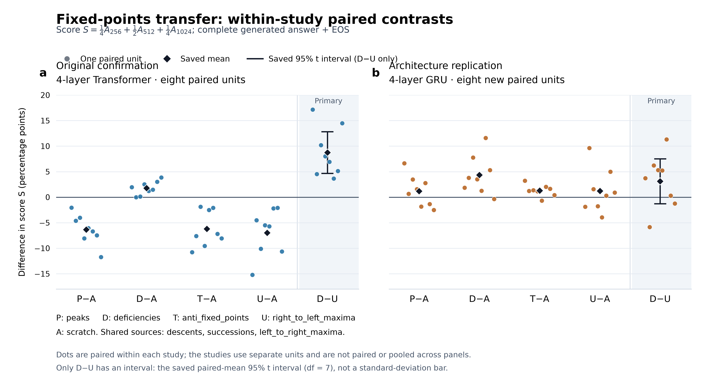

# Worked fixed-points case: two separate studies



[Vector SVG](worked_case.svg) · [Exact plotted unit values](PLOT_DATA.csv) ·
[Saved summary rows](PLOT_SUMMARIES.csv) · [Coordinate/source map](SOURCE_MAP.csv)

## Figure caption

**Fixed-points transfer under two separately registered model protocols.**
The left panel is the original four-layer, width-256 Transformer confirmation;
the right is the four-layer, width-256 GRU replication selected by its prespecified
development-only gate. Both use one-line length-10 permutations, the legacy
188-token vocabulary, and the same four-source compositions and training rules.
The panels each show eight paired units. The GRU study uses new data and new
initializations; the two sets of eight units are neither paired nor pooled across
studies. Horizontal offsets identify display positions only.

The score is S = 1/4 A256 + 1/2 A512 + 1/4 A1024, where A is complete generated
answer-plus-EOS test accuracy after development selection. Each contrast includes
every saved unit difference, with a black diamond for its saved mean. The only
interval is the already reported paired-mean 95% t interval for the sole primary
contrast D−U (df=7); it is not sample SD. No interval is newly computed or added
for secondary contrasts. Zero denotes no difference for that contrast.

Shared sources are descents, successions and left_to_right_maxima. The fourth
source is P=peaks, D=deficiencies, T=anti_fixed_points, or U=right_to_left_maxima.
A is random initialization with direct target training. The first four contrasts
give scratch-relative context: D−U must not be reported as D's gain over scratch.
Within each unit, all routes reuse the same corresponding data and A baseline;
these repeated comparisons do not increase the number of independent repeats.

Pretraining uses 4800 updates, batch 64 and 16 examples per task per update.
Each target subset starts independently from its source endpoint or paired scratch
initialization. Adaptation uses 800 updates and the three frozen learning rates
3e-4/1e-4/3e-5, selected by development accuracy, answer loss, earliest step and
fixed learning-rate order. The target training sizes 256/512/1024 also use 1024
labeled development examples per unit; the smallest condition does not use only
256 target labels overall.
The test pools are generated only after the complete development selections
freeze. Both studies retain endpoint diagnostics elsewhere; this figure includes
only development-selected checkpoints.

The original primary interval is positive. The GRU primary interval includes
zero, leaving its additional D-over-U transfer evidence uncertain rather than
proving no benefit. The figure does not estimate a between-architecture treatment
effect: architectures also have different parameter counts and fresh finite-space
data units. Global orbit exclusion conditions later samples on earlier samples;
the small-sample t interval has approximate sampling assumptions. No result proves
formula use or a transferable internal lemma module.

## Exact saved summary values

The following strings are copied directly from the original summary CSV fields,
without recomputation, rescaling or new rounding.

| Study | Contrast | Saved mean (pp) | Saved primary interval (pp) |
| --- | --- | --- | --- |
| original_transformer | P_minus_A | -6.34613037109375 | Not shown; secondary comparison |
| original_transformer | D_minus_A | 1.7669677734375 | Not shown; secondary comparison |
| original_transformer | T_minus_A | -6.2103271484375 | Not shown; secondary comparison |
| original_transformer | U_minus_A | -6.99310302734375 | Not shown; secondary comparison |
| original_transformer | D_minus_U | 8.76007080078125 | [4.682306385026723, 12.837835216535776] |
| new_gru | P_minus_A | 1.165771484375 | Not shown; secondary comparison |
| new_gru | D_minus_A | 4.3426513671875 | Not shown; secondary comparison |
| new_gru | T_minus_A | 1.2939453125 | Not shown; secondary comparison |
| new_gru | U_minus_A | 1.21917724609375 | Not shown; secondary comparison |
| new_gru | D_minus_U | 3.12347412109375 | [-1.2743444557412795, 7.5212926979287795] |

## Source selection and provenance

Each experiment supplies `artifacts/analysis/paired_differences.csv` and
`paired_summary.csv`, filtered by `metric=complete`, `checkpoint_kind=selected`,
and `scope=area`. Contrasts are P_minus_A, D_minus_A, T_minus_A, U_minus_A and
D_minus_U. Point coordinates use `difference_pp`; black diamonds use `mean_pp`;
the two primary intervals use `ci95_low_pp` and `ci95_high_pp`. All scientific
values are taken from saved fields. Numeric conversion for plotting does not
recalculate any statistic. `SOURCE_MAP.csv` retains each raw string, source path,
source SHA256, source CSV line, filter, field name and display coordinate.

`PLOT_DATA.csv` and `PLOT_SUMMARIES.csv` copy the selected original rows and add
provenance columns. Original row values, including the secondary sample SD fields,
remain unchanged; sample SD is not plotted. `MANIFEST.json` binds source tables,
frozen protocols, result reports, builder and every newly generated artifact.
The builder checks that source hashes are unchanged after rendering.

No experiment analysis script, data pool, checkpoint, training code or model
evaluator is loaded. Original analyses, predictions, scientific tables and
protocols are not modified. The figure is a presentation-only derivative.

## Reproduction

From the repository root, with Matplotlib installed:

```powershell
.venv/Scripts/python.exe -B publication/case_integration_v2/build_worked_case.py
```

The default output directory must be absent or empty. Existing outputs are never
overwritten. To reproduce without replacing this bundle:

```powershell
.venv/Scripts/python.exe -B publication/case_integration_v2/build_worked_case.py --out publication/figures/case_integration_v2/reproduction
```

Environment and executed command are recorded in the manifest. Review the PNG
for legibility; the SVG preserves editable text and vector marks.
